# Звіт з лабораторної роботи 3. Модифікація даних та транзакції

**Виконав:** Віннік Артем  
**Група:** ІПЗ-31  
**Варіант:** Система управління бібліотекою

## Мета роботи

Здобути практичні навички безпечної модифікації даних у реляційних базах даних, опанувати механізми транзакцій для забезпечення цілісності даних, навчитися працювати з обмеженнями цілісності та каскадними операціями при зміні взаємопов'язаних записів.

## Виконання роботи

### Рівень 1. Базові операції модифікації

#### Крок 1. Створення структури бази даних

Для виконання роботи використано PostgreSQL у середовищі Supabase. Оскільки робота виконувалась у вже створеній базі даних, окрема команда `CREATE DATABASE` не використовувалась.

Створено чотири основні таблиці: `authors`, `books`, `readers`, `lendings`.

```sql
CREATE TABLE authors (
    author_id SERIAL PRIMARY KEY,
    first_name VARCHAR(50) NOT NULL,
    last_name VARCHAR(50) NOT NULL,
    birth_year INTEGER CHECK (
        birth_year >= 1000
        AND birth_year <= EXTRACT(YEAR FROM CURRENT_DATE)
    ),
    country VARCHAR(50),
    created_at TIMESTAMP DEFAULT CURRENT_TIMESTAMP
);

CREATE TABLE books (
    book_id SERIAL PRIMARY KEY,
    isbn VARCHAR(17) UNIQUE NOT NULL,
    title VARCHAR(200) NOT NULL,
    author_id INTEGER NOT NULL,
    publication_year INTEGER CHECK (publication_year >= 1450),
    genre VARCHAR(50),
    total_copies INTEGER DEFAULT 1 CHECK (total_copies >= 0),
    available_copies INTEGER DEFAULT 1 CHECK (available_copies >= 0),
    created_at TIMESTAMP DEFAULT CURRENT_TIMESTAMP,

    FOREIGN KEY (author_id)
        REFERENCES authors(author_id)
        ON DELETE RESTRICT,

    CHECK (available_copies <= total_copies)
);

CREATE TABLE readers (
    reader_id SERIAL PRIMARY KEY,
    first_name VARCHAR(50) NOT NULL,
    last_name VARCHAR(50) NOT NULL,
    email VARCHAR(100) UNIQUE NOT NULL,
    phone VARCHAR(20),
    library_card_number VARCHAR(20) UNIQUE NOT NULL,
    registration_date DATE DEFAULT CURRENT_DATE,
    status VARCHAR(20) DEFAULT 'Active'
        CHECK (status IN ('Active', 'Blocked', 'Inactive'))
);

CREATE TABLE lendings (
    lending_id SERIAL PRIMARY KEY,
    book_id INTEGER NOT NULL,
    reader_id INTEGER NOT NULL,
    lending_date DATE DEFAULT CURRENT_DATE,
    due_date DATE NOT NULL,
    return_date DATE,

    FOREIGN KEY (book_id)
        REFERENCES books(book_id)
        ON DELETE RESTRICT,

    FOREIGN KEY (reader_id)
        REFERENCES readers(reader_id)
        ON DELETE RESTRICT,

    CHECK (due_date > lending_date),
    CHECK (return_date IS NULL OR return_date >= lending_date)
);
```

Перевірка створених таблиць:

```sql
SELECT table_name
FROM information_schema.tables
WHERE table_schema = 'public'
  AND table_name IN ('authors', 'books', 'readers', 'lendings')
ORDER BY table_name;
```

**Результат:**

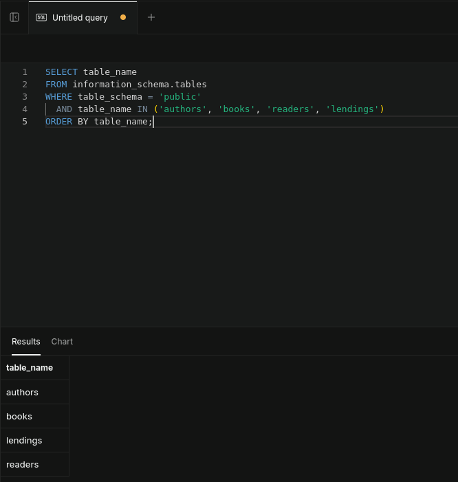

У таблицях використано обмеження `PRIMARY KEY`, `FOREIGN KEY`, `UNIQUE`, `NOT NULL` та `CHECK`, які забезпечують цілісність даних.

---

#### Крок 2. Додавання тестових даних

До таблиць було додано тестові записи авторів, книг та читачів.

```sql
INSERT INTO authors (first_name, last_name, birth_year, country)
VALUES
    ('Тарас', 'Шевченко', 1814, 'Україна'),
    ('Іван', 'Франко', 1856, 'Україна'),
    ('Леся', 'Українка', 1871, 'Україна'),
    ('Михайло', 'Коцюбинський', 1864, 'Україна'),
    ('Панас', 'Мирний', 1849, 'Україна');

INSERT INTO books (
    isbn,
    title,
    author_id,
    publication_year,
    genre,
    total_copies,
    available_copies
)
VALUES
    ('978-966-03-4561-2', 'Кобзар', 1, 1840, 'Поезія', 10, 8),
    ('978-966-03-4562-9', 'Захар Беркут', 2, 1883, 'Історична проза', 5, 4),
    ('978-966-03-4563-6', 'Лісова пісня', 3, 1911, 'Драма', 7, 7),
    ('978-966-03-4564-3', 'Тіні забутих предків', 4, 1911, 'Повість', 6, 5),
    ('978-966-03-4565-0', 'Хіба ревуть воли, як ясла повні', 5, 1880, 'Повість', 4, 4);

INSERT INTO readers (
    first_name,
    last_name,
    email,
    phone,
    library_card_number
)
VALUES
    ('Олена', 'Петренко', 'olena.petrenko@email.com', '+380501234567', 'LIB-2024-001'),
    ('Андрій', 'Коваленко', 'andrii.kovalenko@email.com', '+380502345678', 'LIB-2024-002'),
    ('Марія', 'Сидоренко', 'maria.sydorenko@email.com', '+380503456789', 'LIB-2024-003'),
    ('Іван', 'Мельник', 'ivan.melnyk@email.com', '+380504567890', 'LIB-2024-004');
```

Перевірка:

```sql
SELECT
    b.book_id,
    b.title,
    a.first_name || ' ' || a.last_name AS author,
    b.total_copies,
    b.available_copies
FROM books b
JOIN authors a ON b.author_id = a.author_id
ORDER BY b.book_id;
```

**Результат:**

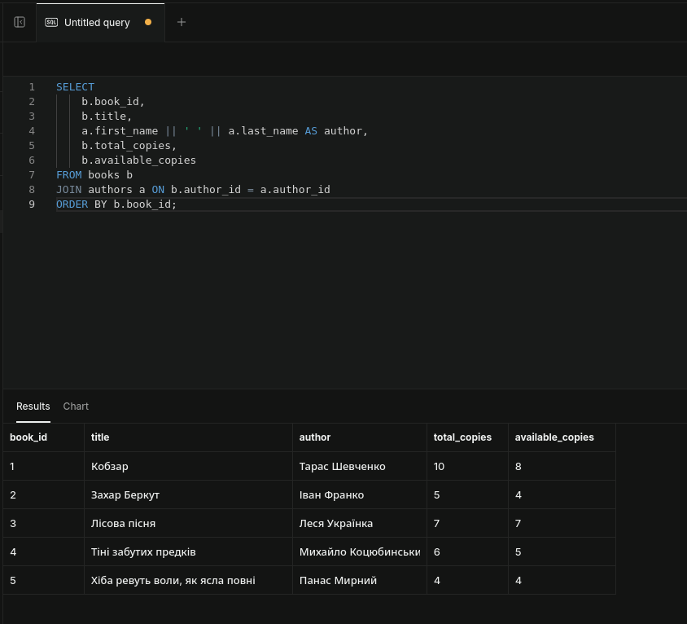

---

#### Крок 3. Безпечне оновлення записів

Перед модифікацією даних було перевірено поточний стан запису.

```sql
SELECT book_id, title, available_copies
FROM books
WHERE book_id = 1;

UPDATE books
SET available_copies = available_copies - 1
WHERE book_id = 1
  AND available_copies > 0;

SELECT book_id, title, available_copies
FROM books
WHERE book_id = 1;
```

Умова `WHERE` дозволяє змінювати тільки необхідний запис, а перевірка `available_copies > 0` не допускає від'ємної кількості книг.

**Результат:**

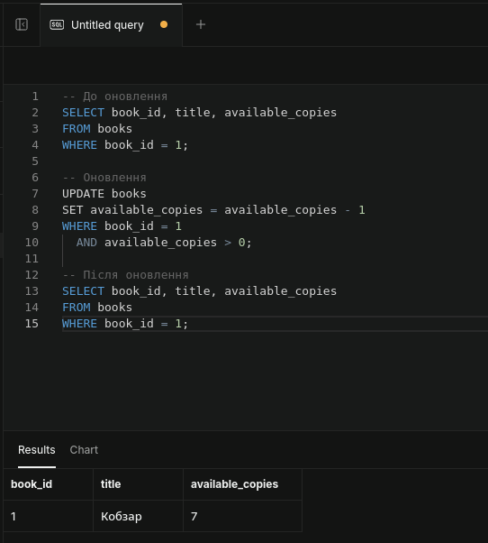

---

#### Крок 4. Операції з транзакціями

Процес видачі книги реалізовано як одну транзакцію.

```sql
BEGIN;

INSERT INTO lendings (book_id, reader_id, due_date)
VALUES (1, 1, CURRENT_DATE + 14);

UPDATE books
SET available_copies = available_copies - 1
WHERE book_id = 1
  AND available_copies > 0;

COMMIT;
```

Перевірка:

```sql
SELECT
    l.lending_id,
    b.title,
    r.first_name,
    r.last_name,
    l.lending_date,
    l.due_date
FROM lendings l
JOIN books b ON l.book_id = b.book_id
JOIN readers r ON l.reader_id = r.reader_id
WHERE l.book_id = 1
  AND l.reader_id = 1
ORDER BY l.lending_id DESC
LIMIT 1;
```

**Результат:**

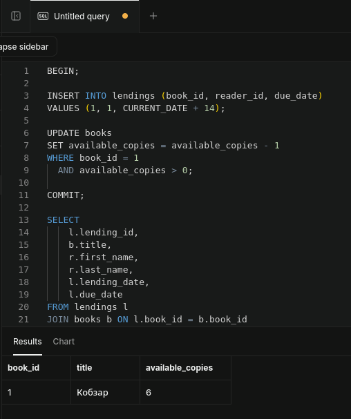

Транзакція забезпечує атомарність операцій: запис про видачу книги та зміна кількості доступних примірників виконуються як єдине ціле.

---

#### Крок 5. Демонстрація ROLLBACK

Для демонстрації відкату було виконано тимчасову зміну даних автора.

```sql
BEGIN;

UPDATE authors
SET country = 'Тестова країна'
WHERE author_id = 1;

ROLLBACK;

SELECT first_name, last_name, country
FROM authors
WHERE author_id = 1;
```

Після `ROLLBACK` зміна була скасована, а значення країни залишилося початковим.

**Результат:**

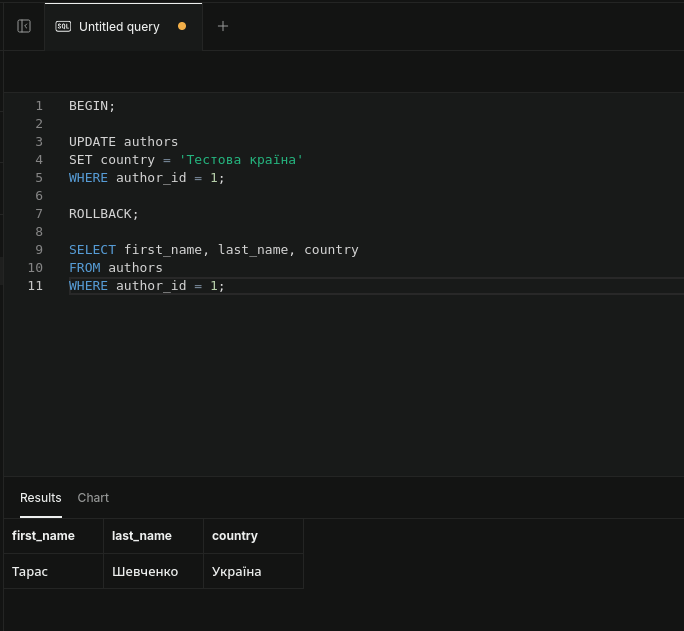

Також було перевірено дію зовнішнього ключа при спробі видалити автора, у якого існують книги:

```sql
DELETE FROM authors
WHERE author_id = 1;
```

Операція була заборонена обмеженням `FOREIGN KEY` з `ON DELETE RESTRICT`.


Це демонструє, що база даних захищає пов'язані записи від некоректного видалення.

---

#### Крок 6. Безпечне видалення

Для демонстрації безпечного видалення статус одного читача було змінено на `Inactive`.

```sql
UPDATE readers
SET status = 'Inactive'
WHERE reader_id = 4;
```

Перевірка перед видаленням:

```sql
SELECT *
FROM readers
WHERE status = 'Inactive'
  AND reader_id NOT IN (
      SELECT DISTINCT reader_id
      FROM lendings
      WHERE return_date IS NULL
  );
```

Безпечне видалення:

```sql
DELETE FROM readers
WHERE status = 'Inactive'
  AND reader_id NOT IN (
      SELECT DISTINCT reader_id
      FROM lendings
      WHERE return_date IS NULL
  )
RETURNING *;
```

**Результат:**

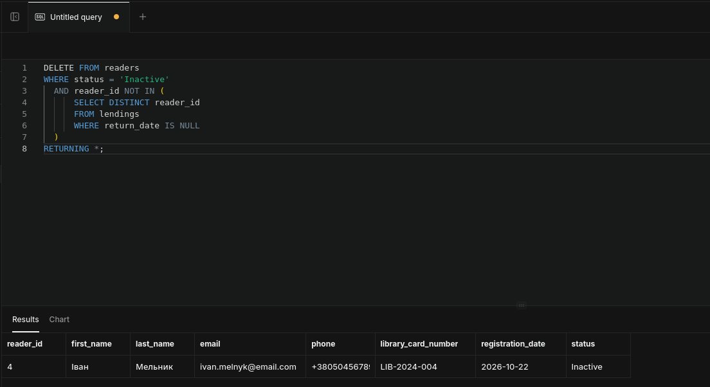

Операція видаляє лише неактивних читачів, які не мають неповернених книг.

---

## Рівень 2. Розширена функціональність

### Крок 1. Додавання нових таблиць

Створено таблицю бронювань та таблицю журналу аудиту.

```sql
CREATE TABLE reservations (
    reservation_id SERIAL PRIMARY KEY,
    book_id INTEGER NOT NULL,
    reader_id INTEGER NOT NULL,
    reservation_date TIMESTAMP DEFAULT CURRENT_TIMESTAMP,
    expiration_date TIMESTAMP NOT NULL,
    status VARCHAR(20) DEFAULT 'Active'
        CHECK (status IN ('Active', 'Fulfilled', 'Cancelled', 'Expired')),

    FOREIGN KEY (book_id)
        REFERENCES books(book_id)
        ON DELETE CASCADE,

    FOREIGN KEY (reader_id)
        REFERENCES readers(reader_id)
        ON DELETE CASCADE
);

CREATE TABLE audit_log (
    log_id SERIAL PRIMARY KEY,
    table_name VARCHAR(50) NOT NULL,
    operation VARCHAR(10) NOT NULL,
    record_id INTEGER NOT NULL,
    old_data JSONB,
    new_data JSONB,
    changed_at TIMESTAMP DEFAULT CURRENT_TIMESTAMP,
    changed_by VARCHAR(100) DEFAULT CURRENT_USER
);
```

Перевірка:

```sql
SELECT table_name
FROM information_schema.tables
WHERE table_schema = 'public'
  AND table_name IN ('reservations', 'audit_log')
ORDER BY table_name;
```

**Результат:**

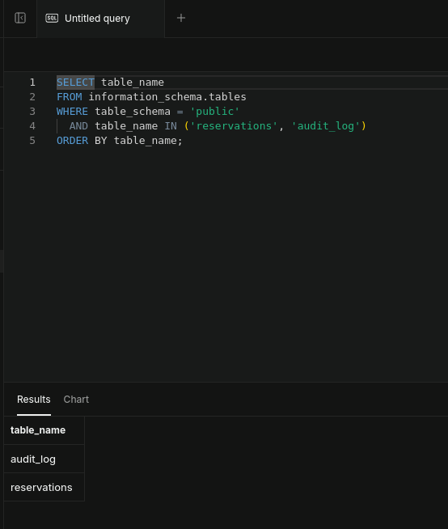

---

### Крок 2. Складна транзакція

Створено бронювання книги:

```sql
INSERT INTO reservations (
    book_id,
    reader_id,
    expiration_date
)
VALUES (
    1,
    2,
    CURRENT_TIMESTAMP + INTERVAL '7 days'
);
```

Після цього виконано транзакцію повернення книги:

```sql
BEGIN;

UPDATE lendings
SET return_date = CURRENT_DATE
WHERE lending_id = 1
  AND return_date IS NULL;

UPDATE books
SET available_copies = available_copies + 1
WHERE book_id = (
    SELECT book_id
    FROM lendings
    WHERE lending_id = 1
);

UPDATE reservations
SET status = 'Fulfilled'
WHERE reservation_id = (
    SELECT reservation_id
    FROM reservations
    WHERE book_id = (
        SELECT book_id
        FROM lendings
        WHERE lending_id = 1
    )
      AND status = 'Active'
    ORDER BY reservation_date
    LIMIT 1
);

COMMIT;
```

Перевірка:

```sql
SELECT
    l.lending_id,
    b.title,
    l.return_date,
    b.available_copies,
    r.reservation_id,
    r.status AS reservation_status
FROM lendings l
JOIN books b
    ON l.book_id = b.book_id
LEFT JOIN reservations r
    ON r.book_id = b.book_id
WHERE l.lending_id = 1;
```

**Результат:**

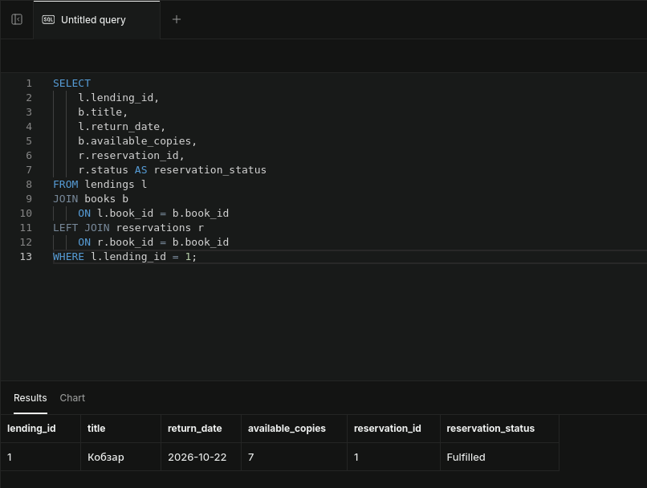

Одна транзакція змінила інформацію одразу у кількох пов'язаних таблицях. Це забезпечує узгодженість процесу повернення книги.

---

### Крок 3. Використання SAVEPOINT

Для часткового відкату транзакції використано точку збереження.

```sql
BEGIN;

INSERT INTO authors (
    first_name,
    last_name,
    birth_year,
    country
)
VALUES (
    'Ольга',
    'Кобилянська',
    1863,
    'Україна'
);

SAVEPOINT after_author;

INSERT INTO books (
    isbn,
    title,
    author_id,
    publication_year,
    genre,
    total_copies,
    available_copies
)
VALUES (
    '978-966-03-4566-7',
    'Тимчасова книга',
    (
        SELECT author_id
        FROM authors
        WHERE first_name = 'Ольга'
          AND last_name = 'Кобилянська'
        ORDER BY author_id DESC
        LIMIT 1
    ),
    1902,
    'Роман',
    3,
    3
);

ROLLBACK TO SAVEPOINT after_author;

INSERT INTO books (
    isbn,
    title,
    author_id,
    publication_year,
    genre,
    total_copies,
    available_copies
)
VALUES (
    '978-966-03-4567-4',
    'Земля',
    (
        SELECT author_id
        FROM authors
        WHERE first_name = 'Ольга'
          AND last_name = 'Кобилянська'
        ORDER BY author_id DESC
        LIMIT 1
    ),
    1902,
    'Роман',
    3,
    3
);

COMMIT;
```

Перевірка:

```sql
SELECT
    a.author_id,
    a.first_name,
    a.last_name,
    b.isbn,
    b.title
FROM authors a
LEFT JOIN books b
    ON a.author_id = b.author_id
WHERE a.first_name = 'Ольга'
  AND a.last_name = 'Кобилянська';
```

**Результат:**

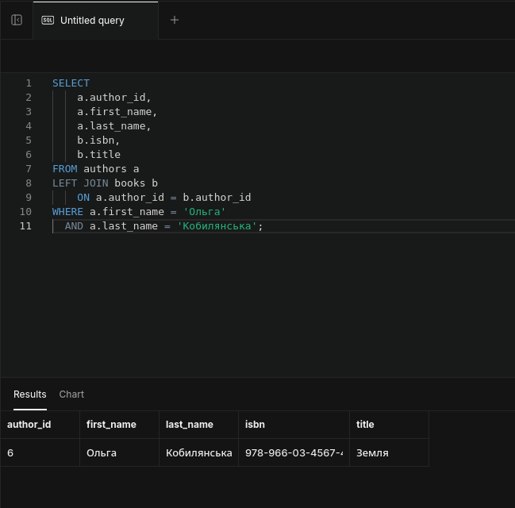

`SAVEPOINT` дозволив скасувати тільки частину транзакції, не скасовуючи додавання автора.

---

### Крок 4. Каскадні операції

Для перевірки `ON DELETE CASCADE` було створено тестову книгу та бронювання.

```sql
INSERT INTO authors (first_name, last_name, birth_year, country)
VALUES ('Тестовий', 'Автор', 1900, 'Україна');

INSERT INTO books (
    isbn,
    title,
    author_id,
    publication_year,
    genre,
    total_copies,
    available_copies
)
VALUES (
    '978-966-00-0000-0',
    'Тестова книга',
    (
        SELECT author_id
        FROM authors
        WHERE first_name = 'Тестовий'
          AND last_name = 'Автор'
        ORDER BY author_id DESC
        LIMIT 1
    ),
    2000,
    'Тест',
    1,
    0
);

INSERT INTO reservations (
    book_id,
    reader_id,
    expiration_date
)
VALUES (
    (
        SELECT book_id
        FROM books
        WHERE isbn = '978-966-00-0000-0'
    ),
    1,
    CURRENT_TIMESTAMP + INTERVAL '7 days'
);
```

Після видалення книги:

```sql
DELETE FROM books
WHERE isbn = '978-966-00-0000-0';
```

перевірено пов'язані бронювання:

```sql
SELECT *
FROM reservations
WHERE book_id NOT IN (
    SELECT book_id FROM books
);
```

**Результат:**

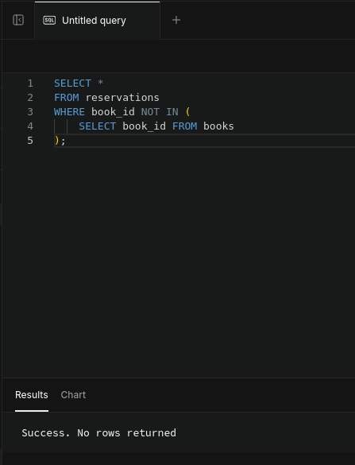

Пов'язаний запис бронювання був автоматично видалений завдяки `ON DELETE CASCADE`.

---

### Крок 5. Тригер для аудиту

Створено функцію автоматичного логування змін таблиці `books`.

```sql
CREATE OR REPLACE FUNCTION log_books_changes()
RETURNS TRIGGER AS $$
BEGIN
    IF TG_OP = 'INSERT' THEN
        INSERT INTO audit_log (
            table_name,
            operation,
            record_id,
            new_data
        )
        VALUES (
            'books',
            'INSERT',
            NEW.book_id,
            row_to_json(NEW)::jsonb
        );

    ELSIF TG_OP = 'UPDATE' THEN
        INSERT INTO audit_log (
            table_name,
            operation,
            record_id,
            old_data,
            new_data
        )
        VALUES (
            'books',
            'UPDATE',
            NEW.book_id,
            row_to_json(OLD)::jsonb,
            row_to_json(NEW)::jsonb
        );

    ELSIF TG_OP = 'DELETE' THEN
        INSERT INTO audit_log (
            table_name,
            operation,
            record_id,
            old_data
        )
        VALUES (
            'books',
            'DELETE',
            OLD.book_id,
            row_to_json(OLD)::jsonb
        );
    END IF;

    RETURN NULL;
END;
$$ LANGUAGE plpgsql;

CREATE TRIGGER books_audit_trigger
AFTER INSERT OR UPDATE OR DELETE
ON books
FOR EACH ROW
EXECUTE FUNCTION log_books_changes();
```

Тестування:

```sql
UPDATE books
SET available_copies = available_copies + 1
WHERE book_id = 1;
```

Перегляд аудиту:

```sql
SELECT
    log_id,
    operation,
    record_id,
    new_data->>'title' AS title,
    old_data->>'available_copies' AS old_copies,
    new_data->>'available_copies' AS new_copies,
    changed_at
FROM audit_log
WHERE table_name = 'books'
ORDER BY changed_at DESC;
```

**Результат:**

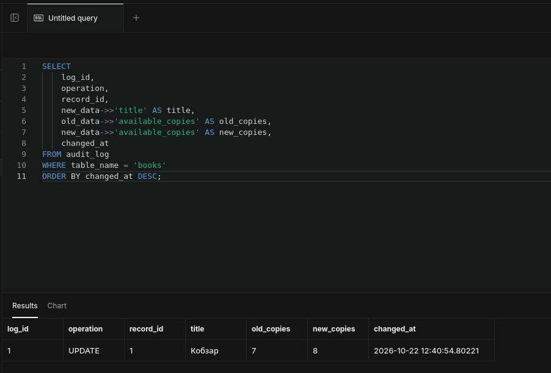

Тригер автоматично записує тип операції, старі та нові дані, час зміни й користувача.

---

### Крок 6. Блокування записів

Для демонстрації конкурентного доступу було використано блокування `FOR UPDATE`.

У першій сесії запис книги був заблокований:

```sql
WITH locked_book AS (
    SELECT *
    FROM books
    WHERE book_id = 1
    FOR UPDATE
)
SELECT
    pg_sleep(20),
    book_id,
    title,
    available_copies
FROM locked_book;
```

Одночасно у другій сесії виконувалась операція:

```sql
UPDATE books
SET available_copies = available_copies - 1
WHERE book_id = 1
RETURNING book_id, title, available_copies;
```

Друга операція залишалася у стані `Running`, доки перша сесія утримувала блокування.

**Результат:**

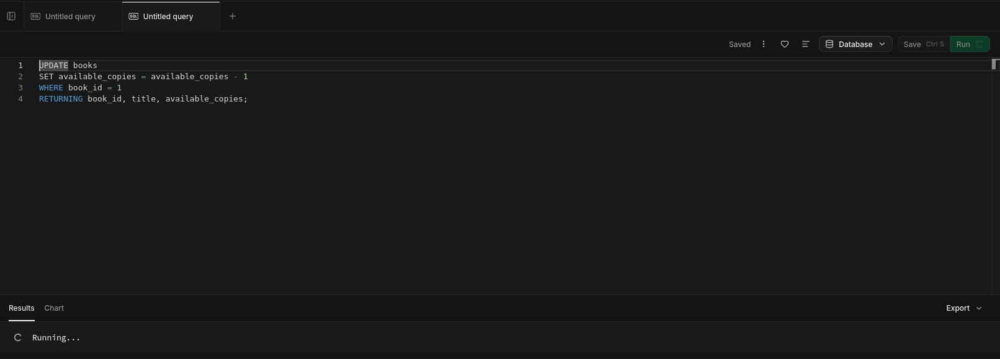

Блокування запобігає одночасній неконтрольованій модифікації одного запису та проблемі втрачених оновлень.

---

## Рівень 3. Творче розширення

### Крок 1. Система версіонування

Створено таблицю для збереження різних версій записів книг.

```sql
CREATE TABLE IF NOT EXISTS books_versions (
    version_id SERIAL PRIMARY KEY,
    book_id INTEGER NOT NULL,
    version_number INTEGER NOT NULL,
    data JSONB NOT NULL,
    valid_from TIMESTAMP DEFAULT CURRENT_TIMESTAMP,
    valid_to TIMESTAMP,
    created_by VARCHAR(100) DEFAULT CURRENT_USER,
    UNIQUE(book_id, version_number)
);
```

Створено тригерну функцію:

```sql
CREATE OR REPLACE FUNCTION create_book_version()
RETURNS TRIGGER AS $$
DECLARE
    v_version_number INTEGER;
BEGIN
    UPDATE books_versions
    SET valid_to = CURRENT_TIMESTAMP
    WHERE book_id = NEW.book_id
      AND valid_to IS NULL;

    SELECT COALESCE(MAX(version_number), 0) + 1
    INTO v_version_number
    FROM books_versions
    WHERE book_id = NEW.book_id;

    INSERT INTO books_versions (
        book_id,
        version_number,
        data
    )
    VALUES (
        NEW.book_id,
        v_version_number,
        row_to_json(NEW)::jsonb
    );

    RETURN NEW;
END;
$$ LANGUAGE plpgsql;

CREATE TRIGGER book_versioning_trigger
AFTER INSERT OR UPDATE
ON books
FOR EACH ROW
EXECUTE FUNCTION create_book_version();
```

Для створення декількох версій виконано зміни:

```sql
UPDATE books
SET genre = 'Класична література'
WHERE book_id = 1;

UPDATE books
SET genre = 'Поезія'
WHERE book_id = 1;
```

Перегляд історії:

```sql
SELECT
    version_number,
    data->>'title' AS title,
    data->>'genre' AS genre,
    valid_from,
    valid_to
FROM books_versions
WHERE book_id = 1
ORDER BY version_number;
```

**Результат:**

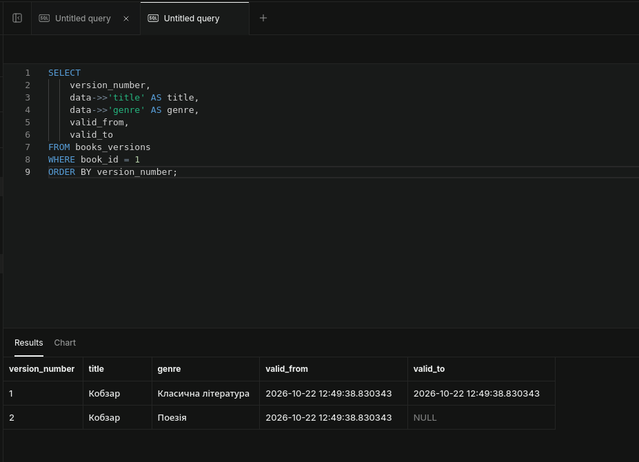

Механізм дозволяє отримувати попередні стани запису та бачити час дії кожної версії.

---

### Крок 2. Відкладені операції

Створено таблицю для збереження запланованих операцій.

```sql
CREATE TABLE IF NOT EXISTS scheduled_operations (
    operation_id SERIAL PRIMARY KEY,
    operation_type VARCHAR(50) NOT NULL,
    target_table VARCHAR(50) NOT NULL,
    operation_data JSONB NOT NULL,
    scheduled_for TIMESTAMP NOT NULL,
    status VARCHAR(20) DEFAULT 'Pending'
        CHECK (
            status IN (
                'Pending',
                'Executed',
                'Failed',
                'Cancelled'
            )
        ),
    executed_at TIMESTAMP,
    error_message TEXT,
    created_at TIMESTAMP DEFAULT CURRENT_TIMESTAMP
);
```

Створено функцію виконання операцій:

```sql
CREATE OR REPLACE FUNCTION execute_scheduled_operations()
RETURNS INTEGER AS $$
DECLARE
    v_operation RECORD;
    v_count INTEGER := 0;
BEGIN
    FOR v_operation IN
        SELECT *
        FROM scheduled_operations
        WHERE status = 'Pending'
          AND scheduled_for <= CURRENT_TIMESTAMP
    LOOP
        BEGIN
            CASE v_operation.operation_type

                WHEN 'UPDATE_BOOK_STATUS' THEN
                    UPDATE books
                    SET available_copies =
                        (v_operation.operation_data->>'available_copies')::INTEGER
                    WHERE book_id =
                        (v_operation.operation_data->>'book_id')::INTEGER;

                WHEN 'EXPIRE_RESERVATION' THEN
                    UPDATE reservations
                    SET status = 'Expired'
                    WHERE reservation_id =
                        (v_operation.operation_data->>'reservation_id')::INTEGER;

                WHEN 'BLOCK_READER' THEN
                    UPDATE readers
                    SET status = 'Blocked'
                    WHERE reader_id =
                        (v_operation.operation_data->>'reader_id')::INTEGER;

            END CASE;

            UPDATE scheduled_operations
            SET status = 'Executed',
                executed_at = CURRENT_TIMESTAMP
            WHERE operation_id = v_operation.operation_id;

            v_count := v_count + 1;

        EXCEPTION WHEN OTHERS THEN

            UPDATE scheduled_operations
            SET status = 'Failed',
                executed_at = CURRENT_TIMESTAMP,
                error_message = SQLERRM
            WHERE operation_id = v_operation.operation_id;

        END;
    END LOOP;

    RETURN v_count;
END;
$$ LANGUAGE plpgsql;
```

Тестова операція:

```sql
INSERT INTO scheduled_operations (
    operation_type,
    target_table,
    operation_data,
    scheduled_for
)
VALUES (
    'UPDATE_BOOK_STATUS',
    'books',
    '{"book_id": 1, "available_copies": 5}'::jsonb,
    CURRENT_TIMESTAMP - INTERVAL '1 second'
);

SELECT execute_scheduled_operations();
```

Перевірка:

```sql
SELECT
    operation_id,
    operation_type,
    target_table,
    status,
    scheduled_for,
    executed_at,
    error_message
FROM scheduled_operations
ORDER BY operation_id DESC;
```

**Результат:**

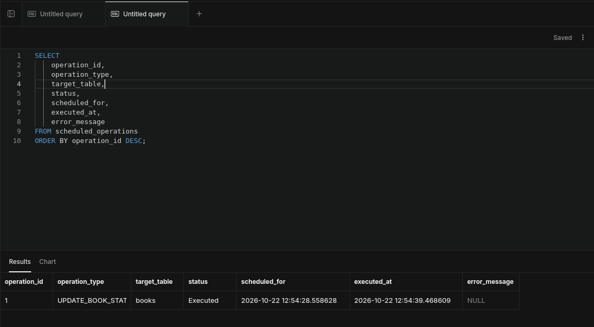

Статус `Executed` та заповнене поле `executed_at` підтверджують успішне виконання запланованої операції.

---

### Крок 3. Складна бізнес-логіка

Створено функцію продовження терміну видачі книги.

```sql
CREATE OR REPLACE FUNCTION extend_lending(
    p_lending_id INTEGER,
    p_days INTEGER DEFAULT 7
)
RETURNS TABLE (
    success BOOLEAN,
    message TEXT,
    new_due_date DATE
) AS $$
DECLARE
    v_reader_status VARCHAR(20);
    v_overdue_count INTEGER;
    v_current_due_date DATE;
BEGIN
    SELECT r.status, l.due_date
    INTO v_reader_status, v_current_due_date
    FROM lendings l
    JOIN readers r
        ON l.reader_id = r.reader_id
    WHERE l.lending_id = p_lending_id;

    IF v_reader_status = 'Blocked' THEN
        RETURN QUERY
        SELECT FALSE,
               'Читач заблокований'::TEXT,
               NULL::DATE;
        RETURN;
    END IF;

    SELECT COUNT(*)
    INTO v_overdue_count
    FROM lendings l
    WHERE l.reader_id = (
        SELECT reader_id
        FROM lendings
        WHERE lending_id = p_lending_id
    )
      AND l.return_date IS NULL
      AND l.due_date < CURRENT_DATE;

    IF v_overdue_count > 0 THEN
        RETURN QUERY
        SELECT FALSE,
               'У читача є прострочені книги'::TEXT,
               NULL::DATE;
        RETURN;
    END IF;

    UPDATE lendings
    SET due_date = due_date + p_days
    WHERE lending_id = p_lending_id;

    RETURN QUERY
    SELECT TRUE,
           'Термін продовжено'::TEXT,
           (v_current_due_date + p_days)::DATE;
END;
$$ LANGUAGE plpgsql;
```

Для тестування створено активну видачу:

```sql
INSERT INTO lendings (
    book_id,
    reader_id,
    due_date
)
VALUES (
    2,
    2,
    CURRENT_DATE + INTERVAL '14 days'
);
```

Виклик функції:

```sql
SELECT *
FROM extend_lending(
    (
        SELECT MAX(lending_id)
        FROM lendings
        WHERE reader_id = 2
          AND book_id = 2
    ),
    14
);
```

**Результат:**

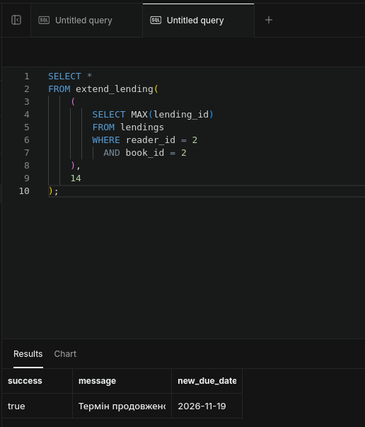

Функція перевіряє статус читача та наявність прострочених книг і лише після цього дозволяє продовжити термін видачі.

---

### Крок 4. Система прав доступу

Створено ролі з різним рівнем доступу.

```sql
DO $$
BEGIN
    IF NOT EXISTS (
        SELECT 1 FROM pg_roles
        WHERE rolname = 'librarian_read'
    ) THEN
        CREATE ROLE librarian_read NOLOGIN;
    END IF;

    IF NOT EXISTS (
        SELECT 1 FROM pg_roles
        WHERE rolname = 'librarian_write'
    ) THEN
        CREATE ROLE librarian_write NOLOGIN;
    END IF;

    IF NOT EXISTS (
        SELECT 1 FROM pg_roles
        WHERE rolname = 'library_admin'
    ) THEN
        CREATE ROLE library_admin NOLOGIN;
    END IF;
END
$$;
```

Надання прав:

```sql
GRANT USAGE ON SCHEMA public
TO librarian_read, librarian_write, library_admin;

GRANT SELECT ON ALL TABLES IN SCHEMA public
TO librarian_read;

GRANT SELECT, INSERT, UPDATE
ON books, lendings, reservations
TO librarian_write;

GRANT DELETE
ON reservations
TO librarian_write;

GRANT USAGE, SELECT
ON ALL SEQUENCES IN SCHEMA public
TO librarian_write;

GRANT ALL PRIVILEGES
ON ALL TABLES IN SCHEMA public
TO library_admin;

GRANT ALL PRIVILEGES
ON ALL SEQUENCES IN SCHEMA public
TO library_admin;
```

Перевірка:

```sql
SELECT
    grantee,
    table_name,
    privilege_type
FROM information_schema.role_table_grants
WHERE grantee IN (
    'librarian_read',
    'librarian_write',
    'library_admin'
)
ORDER BY grantee, table_name, privilege_type;
```

**Результат:**

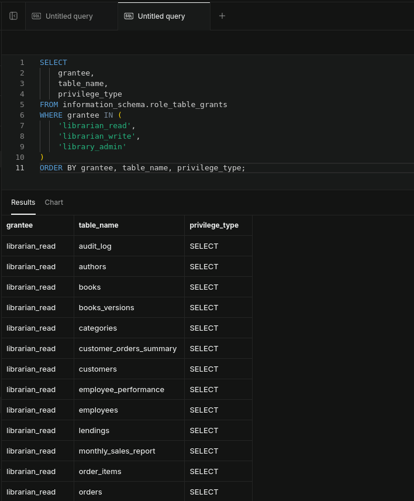

Роль `librarian_read` призначена для перегляду, `librarian_write` — для читання та модифікації основних даних, а `library_admin` має повні права.

---

### Крок 5. Контрольна точка

Створено таблицю для збереження контрольних точок.

```sql
CREATE TABLE IF NOT EXISTS backup_points (
    backup_id SERIAL PRIMARY KEY,
    backup_name VARCHAR(100) NOT NULL,
    backup_timestamp TIMESTAMP DEFAULT CURRENT_TIMESTAMP,
    description TEXT,
    data_snapshot JSONB
);
```

Функція створення знімка даних:

```sql
CREATE OR REPLACE FUNCTION create_backup_point(
    p_name VARCHAR,
    p_description TEXT DEFAULT NULL
)
RETURNS INTEGER AS $$
DECLARE
    v_backup_id INTEGER;
    v_snapshot JSONB;
BEGIN
    SELECT jsonb_build_object(
        'books',
        (SELECT jsonb_agg(row_to_json(b)) FROM books b),

        'authors',
        (SELECT jsonb_agg(row_to_json(a)) FROM authors a),

        'readers',
        (SELECT jsonb_agg(row_to_json(r)) FROM readers r),

        'lendings',
        (SELECT jsonb_agg(row_to_json(l)) FROM lendings l)
    )
    INTO v_snapshot;

    INSERT INTO backup_points (
        backup_name,
        description,
        data_snapshot
    )
    VALUES (
        p_name,
        p_description,
        v_snapshot
    )
    RETURNING backup_id INTO v_backup_id;

    RETURN v_backup_id;
END;
$$ LANGUAGE plpgsql;
```

Створення контрольної точки:

```sql
SELECT create_backup_point(
    'Lab 3 backup',
    'Контрольна точка перед завершенням лабораторної'
);
```

Перевірка:

```sql
SELECT
    backup_id,
    backup_name,
    backup_timestamp,
    description
FROM backup_points
ORDER BY backup_id DESC;
```

**Результат:**

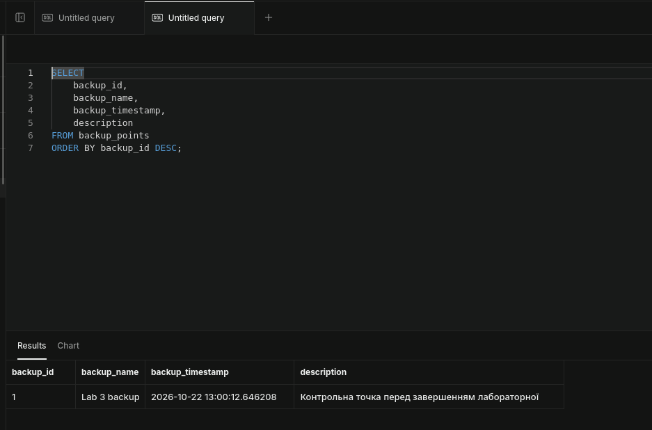

У полі `data_snapshot` зберігається JSONB-знімок критичних таблиць, який може бути використаний як основа для відновлення стану бази.

---

### Крок 6. Інтерфейс перегляду історії змін

Створено представлення для зручного перегляду журналу аудиту.

```sql
CREATE OR REPLACE VIEW books_change_history AS
SELECT
    a.log_id,
    a.operation,
    a.record_id AS book_id,

    COALESCE(
        a.new_data->>'title',
        a.old_data->>'title'
    ) AS title,

    CASE
        WHEN a.operation = 'INSERT' THEN
            'Додано нову книгу'

        WHEN a.operation = 'UPDATE' THEN
            CONCAT(
                'Оновлено: ',
                CASE
                    WHEN (a.old_data->>'available_copies')
                         IS DISTINCT FROM
                         (a.new_data->>'available_copies')
                    THEN CONCAT(
                        'Доступні примірники: ',
                        a.old_data->>'available_copies',
                        ' → ',
                        a.new_data->>'available_copies'
                    )
                    ELSE 'Інші поля'
                END
            )

        WHEN a.operation = 'DELETE' THEN
            'Видалено книгу'

        ELSE
            'Невідома операція'
    END AS change_description,

    a.changed_at,
    a.changed_by

FROM audit_log a
WHERE a.table_name = 'books';
```

Також створено функцію формування звіту за період:

```sql
CREATE OR REPLACE FUNCTION get_changes_report(
    p_start_date TIMESTAMP,
    p_end_date TIMESTAMP DEFAULT CURRENT_TIMESTAMP
)
RETURNS TABLE (
    change_date DATE,
    total_changes BIGINT,
    inserts BIGINT,
    updates BIGINT,
    deletes BIGINT
) AS $$
BEGIN
    RETURN QUERY
    SELECT
        DATE(a.changed_at),
        COUNT(*),
        COUNT(*) FILTER (
            WHERE a.operation = 'INSERT'
        ),
        COUNT(*) FILTER (
            WHERE a.operation = 'UPDATE'
        ),
        COUNT(*) FILTER (
            WHERE a.operation = 'DELETE'
        )
    FROM audit_log a
    WHERE a.changed_at
        BETWEEN p_start_date AND p_end_date
    GROUP BY DATE(a.changed_at)
    ORDER BY DATE(a.changed_at) DESC;
END;
$$ LANGUAGE plpgsql;
```

Перегляд історії змін:

```sql
SELECT *
FROM books_change_history
ORDER BY changed_at DESC;
```

**Результат:**

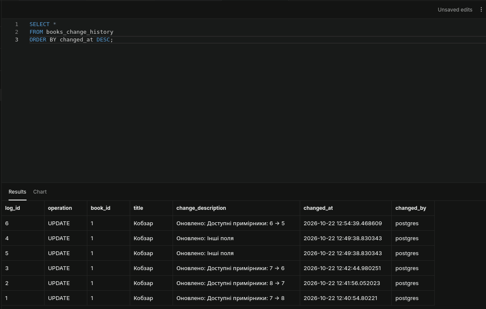

Представлення дозволяє переглядати тип операції, книгу, опис зміни, час та користувача у зручному форматі.

---

## Висновки

У результаті виконання лабораторної роботи було здобуто практичні навички модифікації даних та роботи з транзакціями у PostgreSQL.

Було створено систему управління бібліотекою з таблицями авторів, книг, читачів, видач та бронювань. Для забезпечення цілісності даних використано первинні та зовнішні ключі, обмеження `UNIQUE`, `NOT NULL` та `CHECK`.

Було виконано безпечні операції `INSERT`, `UPDATE` та `DELETE` із використанням умов `WHERE` та попередньої перевірки даних.

На практиці досліджено транзакції з використанням `BEGIN`, `COMMIT`, `ROLLBACK` та `SAVEPOINT`. Продемонстровано захист пов'язаних записів зовнішніми ключами, каскадне видалення та блокування рядків при паралельному доступі.

Було створено тригер автоматичного аудиту змін таблиці книг, систему версіонування записів, механізм відкладених операцій та функцію реалізації бізнес-логіки продовження терміну видачі.

Також реалізовано ролі з різними правами доступу, механізм створення контрольної точки з JSONB-знімком даних та представлення для зручного перегляду історії змін.

Усі три рівні складності лабораторної роботи виконано.