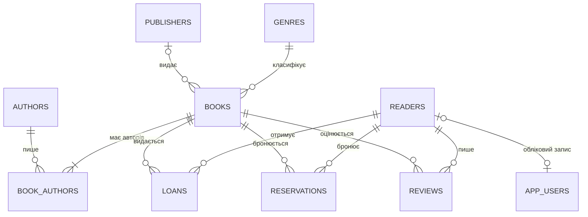

# Логічна схема бази даних «Електронна бібліотека»

СУБД: PostgreSQL 17. Схема приведена до **третьої нормальної форми (3НФ)**.

## ER-діаграма (Mermaid)

GitHub показує цю діаграму автоматично. PNG-версія лежить у файлі [conceptual_model.png](conceptual_model.png).

## Таблиці

Позначення: **PK** — первинний ключ, **FK** — зовнішній ключ, **UK** — унікальне значення.

### genres — жанри (довідник)
| Атрибут | Тип | Обмеження |
|---|---|---|
| genre_id | SERIAL | PK |
| name | VARCHAR(50) | NOT NULL, UK |
| description | TEXT | |

### publishers — видавництва (довідник)
| Атрибут | Тип | Обмеження |
|---|---|---|
| publisher_id | SERIAL | PK |
| name | VARCHAR(100) | NOT NULL, UK |
| city | VARCHAR(50) | NOT NULL |
| country | VARCHAR(50) | NOT NULL, DEFAULT 'Україна' |
| phone | VARCHAR(20) | CHECK (формат телефону) |
| website | VARCHAR(100) | |

### authors — автори
| Атрибут | Тип | Обмеження |
|---|---|---|
| author_id | SERIAL | PK |
| first_name, last_name | VARCHAR(50) | NOT NULL |
| birth_year | INTEGER | CHECK 1000..2025 |
| death_year | INTEGER | CHECK death_year ≥ birth_year |
| country | VARCHAR(50) | |
| biography | TEXT | |

### books — книги
| Атрибут | Тип | Обмеження |
|---|---|---|
| book_id | SERIAL | PK |
| title | VARCHAR(200) | NOT NULL |
| isbn | VARCHAR(17) | NOT NULL, UK, CHECK (регулярний вираз ISBN) |
| genre_id | INTEGER | NOT NULL, FK → genres (ON DELETE RESTRICT) |
| publisher_id | INTEGER | FK → publishers (ON DELETE SET NULL) |
| publish_year | INTEGER | CHECK 1450..2026 |
| pages | INTEGER | CHECK > 0 |
| language | VARCHAR(30) | NOT NULL, DEFAULT 'українська' |
| price | NUMERIC(8,2) | CHECK ≥ 0 |
| total_copies | INTEGER | CHECK ≥ 0 |
| available_copies | INTEGER | CHECK ≥ 0, CHECK ≤ total_copies |
| description | TEXT | |
| created_at, updated_at | TIMESTAMP | NOT NULL, DEFAULT CURRENT_TIMESTAMP |

### book_authors — зв'язок «багато-до-багатьох» між книгами та авторами
| Атрибут | Тип | Обмеження |
|---|---|---|
| book_id | INTEGER | PK, FK → books (ON DELETE CASCADE) |
| author_id | INTEGER | PK, FK → authors (ON DELETE CASCADE) |
| author_order | SMALLINT | порядок автора в книзі, CHECK > 0 |

### readers — читачі
| Атрибут | Тип | Обмеження |
|---|---|---|
| reader_id | SERIAL | PK |
| ticket_number | VARCHAR(10) | NOT NULL, UK, CHECK формат `LIB-0000` |
| first_name, last_name | VARCHAR(50) | NOT NULL |
| email | VARCHAR(100) | NOT NULL, UK, CHECK (формат email) |
| phone | VARCHAR(20) | CHECK (формат телефону) |
| birth_date | DATE | CHECK > 1900-01-01 |
| address | VARCHAR(200) | |
| registration_date | DATE | DEFAULT CURRENT_DATE |
| is_active | BOOLEAN | DEFAULT TRUE |

### loans — видачі книг
| Атрибут | Тип | Обмеження |
|---|---|---|
| loan_id | SERIAL | PK |
| book_id | INTEGER | FK → books (ON DELETE RESTRICT) |
| reader_id | INTEGER | FK → readers (ON DELETE RESTRICT) |
| loan_date | DATE | DEFAULT CURRENT_DATE |
| due_date | DATE | NOT NULL, CHECK > loan_date |
| return_date | DATE | CHECK ≥ loan_date |
| status | VARCHAR(10) | CHECK IN (active, returned, overdue, lost) |
| extensions_count | SMALLINT | CHECK 0..2 |
| fine_amount | NUMERIC(8,2) | CHECK ≥ 0 |

### reservations — бронювання
| Атрибут | Тип | Обмеження |
|---|---|---|
| reservation_id | SERIAL | PK |
| book_id | INTEGER | FK → books (CASCADE) |
| reader_id | INTEGER | FK → readers (CASCADE) |
| reservation_date | TIMESTAMP | DEFAULT now |
| expires_at | TIMESTAMP | DEFAULT now + 3 дні, CHECK > reservation_date |
| status | VARCHAR(10) | CHECK IN (pending, fulfilled, cancelled, expired) |

Частковий унікальний індекс `uq_reservation_pending (book_id, reader_id) WHERE status='pending'` не дає читачу двічі забронювати одну книгу.

### reviews — відгуки
| Атрибут | Тип | Обмеження |
|---|---|---|
| review_id | SERIAL | PK |
| book_id, reader_id | INTEGER | FK, UK (book_id, reader_id) |
| rating | SMALLINT | CHECK 1..5 |
| comment | TEXT | |
| created_at | TIMESTAMP | DEFAULT now |

### app_users — користувачі застосунку (рівень 3)
| Атрибут | Тип | Обмеження |
|---|---|---|
| user_id | SERIAL | PK |
| username | VARCHAR(30) | UK, CHECK `^[a-z0-9_]{3,30}$` |
| password_hash | VARCHAR(255) | хеш PBKDF2-SHA256 |
| role | VARCHAR(10) | CHECK IN (admin, librarian, reader) |
| reader_id | INTEGER | UK, FK → readers; обов'язковий для ролі reader |
| full_name, is_active, created_at, last_login | | |

### audit_log — журнал операцій (рівень 3)
| Атрибут | Тип | Опис |
|---|---|---|
| log_id | BIGSERIAL | PK |
| table_name | VARCHAR(50) | таблиця, у якій відбулася зміна |
| operation | VARCHAR(20) | INSERT / UPDATE / DELETE / LOGIN / REPORT / BACKUP ... |
| record_id | INTEGER | ID зміненого запису |
| old_data, new_data | JSONB | значення до і після зміни (для UPDATE лише змінені поля) |
| changed_by | VARCHAR(50) | користувач застосунку |
| details | TEXT | опис події застосунку |
| changed_at | TIMESTAMP | час |

## Зв'язки

| Зв'язок | Тип | Реалізація |
|---|---|---|
| Жанр — Книга | 1 : N | `books.genre_id` → `genres` |
| Видавництво — Книга | 1 : N (необов'язковий) | `books.publisher_id` → `publishers` |
| Книга — Автор | M : N | проміжна таблиця `book_authors` |
| Читач — Видача — Книга | 1 : N та N : 1 | `loans.reader_id`, `loans.book_id` |
| Читач — Бронювання — Книга | 1 : N та N : 1 | `reservations` |
| Читач — Відгук — Книга | 1 : N та N : 1 | `reviews`, один відгук на пару (книга, читач) |
| Читач — Користувач | 1 : 1 (необов'язковий) | `app_users.reader_id UNIQUE` |

## Відповідність нормальним формам

* **1НФ.** Усі атрибути атомарні. Автори книги винесені в окрему таблицю `book_authors`, а не зберігаються списком в одному полі.
* **2НФ.** Неключові атрибути залежать від усього ключа. У `book_authors` (складений ключ book_id + author_id) є лише `author_order`, і він залежить від усієї пари.
* **3НФ.** Транзитивних залежностей немає. Назва жанру та дані видавництва зберігаються в окремих довідниках, а в `books` лежить лише зовнішній ключ. Дані читача (ПІБ, телефон) не дублюються у видачах.
* **Свідома денормалізація.** Поле `books.available_copies` можна обчислити з таблиці `loans`, але воно зберігається для швидких перевірок наявності. Узгодженість гарантує тригер `trg_loans_sync_availability`, а обмеження `chk_copies` не дає йому перевищити `total_copies`.

## Індекси

| Індекс | Призначення |
|---|---|
| `idx_books_title_lower` (LOWER(title)) | пошук книги за назвою без урахування регістру |
| `idx_books_genre`, `idx_books_publisher`, `idx_book_authors_author` | з'єднання (JOIN) та фільтр за жанром |
| `idx_readers_last_name` (LOWER(last_name)) | пошук читача |
| `idx_loans_reader`, `idx_loans_book`, `idx_loans_loan_date` | історія видач і статистика по місяцях |
| `idx_loans_open` (due_date) WHERE return_date IS NULL | **частковий** індекс: лише невидані книги, для пошуку боржників |
| `idx_reservations_book`, `idx_reviews_book` | бронювання та рейтинг книги |
| `idx_audit_changed_at`, `idx_audit_table_op`, `idx_audit_user` | фільтрація журналу операцій |
