# Звіт з лабораторної роботи №5. Керування БД, оптимізація продуктивності та автоматизація

## Загальна інформація

- **ПІБ студента:** Віннік Артем
- **Група:** ІПЗ-31
- **Варіант (предметна область):** Електронна бібліотека (база даних з лабораторної роботи №4)
- **Рівень виконання:** 3 (усі вимоги рівнів 1, 2 і 3)
- **Програмне забезпечення:** PostgreSQL 17.12 (контейнер `postgres:17-alpine`, Podman + podman-compose), розширення `pg_stat_statements` і `pg_trgm`, утиліти `pg_dump`, `pg_restore`, `vacuumdb`, `pgbench`, Python 3.15 + psycopg2

## Мета роботи

Навчитися аналізувати та оптимізувати продуктивність бази даних за допомогою індексів і планів виконання запитів, автоматизувати роботу тригерами та представленнями, а також опанувати базові операції адміністрування: керування правами доступу, резервне копіювання, обслуговування та моніторинг.

---

## Підготовка середовища

### Окремий екземпляр бази для експериментів

Лабораторна виконується на базі «Електронна бібліотека» з лабораторної роботи №4. Для експериментів з продуктивністю база наповнюється сотнями тисяч рядків. Щоб це навантаження не зачепило вебзастосунок, піднято **окремий контейнер** `library_lab5` на порту 5433.

Він створюється тими самими SQL-скриптами лабораторної 4: папка `../lab_4/database` змонтована в контейнер, і при першому запуску скрипт `init/00_lab4_base.sh` виконує їх по черзі. Потім він підключає два розширення:

* `pg_stat_statements` — статистика виконання запитів, потрібна для моніторингу (рівень 3);
* `pg_trgm` — триграмні індекси для пошуку за частиною рядка.

`pg_stat_statements` вимагає завантаження бібліотеки під час старту сервера, тому параметри передано через `command` у `docker-compose.yml`:

```yaml
services:
  postgres:
    image: docker.io/library/postgres:17-alpine
    container_name: library_lab5
    command:
      - postgres
      - -c
      - shared_preload_libraries=pg_stat_statements   # статистика виконання запитів
      - -c
      - pg_stat_statements.track=all                  # враховувати й запити всередині функцій
      - -c
      - track_io_timing=on                            # час читання з диска в EXPLAIN (BUFFERS)
    ports:
      - "5433:5432"                                   # 5432 зайнятий базою лабораторної 4
    volumes:
      - lab5_data:/var/lib/postgresql/data
      - ./init:/docker-entrypoint-initdb.d:ro,z       # скрипт початкового розгортання
      - ../lab_4/database:/lab4:ro,z                  # схема та дані з лабораторної 4
      - ./backups:/backups:z                          # резервні копії
```

**Результат:** контейнер запущено, базу з лабораторної 4 відтворено, обидва розширення встановлено.

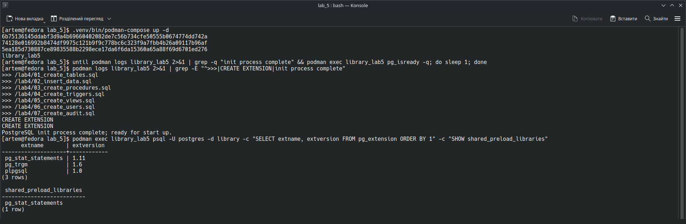

### Генерація тестових даних

На таблицях із кількома десятками рядків оптимізатор завжди обирає послідовне сканування, і ефекту від індексів не видно. Тому скрипт `database/01_bulk_data.sql` додає великий обсяг даних:

| Таблиця | Рядків | Як згенеровано |
|---|---|---|
| authors | 2 000 | імена та прізвища з довідкових списків |
| books | 50 000 | назви «<прикметник> <іменник>. Книга N», ISBN `979-1…`, 1–5 примірників |
| readers | 50 000 | квитки `LIB-100001…`, 5% заблокованих |
| loans | 500 000 + 3 000 | повернені видачі за ~3 роки зі штрафами + 3 000 відкритих |
| reviews | 100 000 | лише від читачів, які брали книгу; 20% негативних |
| reservations | 20 000 | переважно виконані, 5% очікують |

Особливості скрипта:

* `setseed(0.42)` робить «випадкові» дані однаковими при кожному запуску.
* Усе завантаження — **одна транзакція**: при помилці нічого не збережеться.
* `SET LOCAL session_replication_role = replica` вимикає тригери на час завантаження. Інакше кожен з 500 000 рядків ще й потрапляв би в журнал аудиту.
* У режимі `replica` не перевіряються й зовнішні ключі (вони також реалізовані тригерами). Тому **перед COMMIT** цілісність перевіряється вручну:

```sql
DO $$
DECLARE v_bad INTEGER;
BEGIN
    SELECT (SELECT COUNT(*) FROM loans l   WHERE NOT EXISTS (SELECT 1 FROM books b   WHERE b.book_id = l.book_id))
         + (SELECT COUNT(*) FROM loans l   WHERE NOT EXISTS (SELECT 1 FROM readers r WHERE r.reader_id = l.reader_id))
         + ...
    INTO v_bad;
    IF v_bad > 0 THEN
        RAISE EXCEPTION 'Порушено посилальну цілісність: % рядків без батьківського запису', v_bad;
    END IF;
    RAISE NOTICE 'Посилальна цілісність перевірена: порушень немає';
END
$$;
```

Ця перевірка з'явилася не випадково. Під час першої спроби помилка зсунула лічильник `books_book_id_seq`, і частина видач почала посилатися на неіснуючі книги. Проблему виявив `pg_restore` на кроці 7: він не зміг створити зовнішні ключі. Тепер id задаються явно, лічильники вирівнюються через `setval()`, а порушення цілісності зупиняє транзакцію.

**Результат:** 500 000 видач завантажено за 2,7 с, база займає близько 150 МБ.

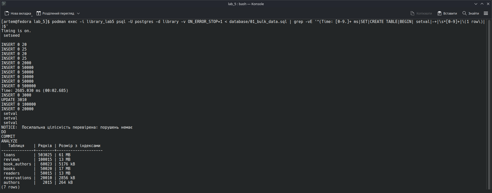

---

## Рівень 1

### Крок 2. Аналіз продуктивності запитів (EXPLAIN ANALYZE)

Для аналізу обрано три типові «важкі» запити бібліотеки (`database/02_performance_before.sql`):

| № | Запит | Де використовується |
|---|---|---|
| Q1 | Пошук книги за частиною назви `ILIKE '%маяк. книга 1%'` | рядок пошуку в каталозі |
| Q2 | Сума штрафів за останні 90 днів по тижнях | фінансовий звіт |
| Q3 | Відгуки читача та скільки разів він брав кожну книгу | особистий кабінет читача |

Щоб порівнювати результати об'єктивно, створено функцію `measure_query()`. Вона виконує запит через `EXPLAIN (ANALYZE, FORMAT JSON)` 7 разів (перший «холодний» запуск не враховується) і бере **медіану** часу. Результат разом із методами доступу з плану записується в таблицю `perf_results`. Представлення `v_perf_comparison` автоматично рахує відсоток покращення.

```sql
CREATE OR REPLACE FUNCTION measure_query(p_stage TEXT, p_name TEXT, p_sql TEXT, p_runs INT DEFAULT 7)
RETURNS NUMERIC LANGUAGE plpgsql AS $$
DECLARE
    v_plan JSONB; v_times NUMERIC[] := '{}'; v_nodes TEXT; v_median NUMERIC;
BEGIN
    EXECUTE 'EXPLAIN (ANALYZE, FORMAT JSON) ' || p_sql INTO v_plan;      -- прогрів кешу
    FOR i IN 1..p_runs LOOP
        EXECUTE 'EXPLAIN (ANALYZE, FORMAT JSON) ' || p_sql INTO v_plan;
        v_times := v_times || (v_plan -> 0 ->> 'Execution Time')::NUMERIC;
    END LOOP;
    SELECT percentile_cont(0.5) WITHIN GROUP (ORDER BY t) INTO v_median FROM unnest(v_times) t;

    -- усі вузли сканування з плану: Seq Scan, Index Scan, Bitmap ... та їх об'єкти
    SELECT string_agg(DISTINCT n ->> 'Node Type' ||
                      COALESCE(' ' || COALESCE(n ->> 'Index Name', n ->> 'Relation Name'), ''), ', ')
    INTO v_nodes
    FROM jsonb_path_query(v_plan, 'strict $.**') n
    WHERE jsonb_typeof(n) = 'object' AND n ->> 'Node Type' ~ 'Scan';

    INSERT INTO perf_results (stage, query_name, exec_ms, plan_nodes)
    VALUES (p_stage, p_name, ROUND(v_median, 3), v_nodes);
    RETURN ROUND(v_median, 3);
END;
$$;
```

#### Q1. Пошук за частиною назви

```sql
EXPLAIN (ANALYZE, BUFFERS)
SELECT b.book_id, b.title, g.name AS genre, b.publish_year, b.available_copies
FROM books b JOIN genres g ON g.genre_id = b.genre_id
WHERE b.title ILIKE '%маяк. книга 1%'
ORDER BY b.title LIMIT 20;
```

**Результат:**

* виконано `Seq Scan on books`: переглянуто всі 50 020 книг, 49 575 відкинуто фільтром;
* прочитано 1 119 сторінок, час 29,8 мс.

Звичайний B-tree індекс `idx_books_title_lower` з лабораторної 4 тут не допомагає. Шаблон починається з `%`, а B-tree вміє шукати лише за початком рядка.

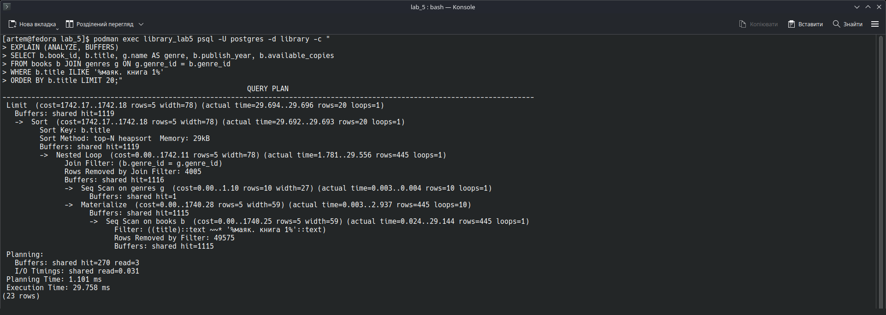

#### Q2. Штрафи за 90 днів

```sql
EXPLAIN (ANALYZE, BUFFERS)
SELECT DATE_TRUNC('week', return_date)::DATE AS week, COUNT(*) AS fined_loans, SUM(fine_amount) AS fines_total
FROM loans
WHERE return_date >= CURRENT_DATE - 90 AND fine_amount > 0
GROUP BY 1 ORDER BY 1;
```

**Результат:**

* індексу за датою повернення немає, тому виконано `Parallel Seq Scan on loans` двома паралельними процесами;
* прочитано 4 505 сторінок (уся таблиця), час 22,8 мс.

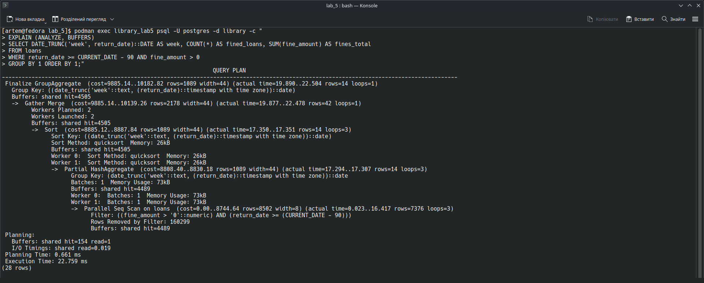

#### Q3. Кабінет читача

```sql
EXPLAIN (ANALYZE, BUFFERS)
SELECT b.title, rv.rating, rv.created_at,
       (SELECT COUNT(*) FROM loans l WHERE l.reader_id = rv.reader_id AND l.book_id = rv.book_id) AS times_borrowed
FROM reviews rv JOIN books b ON b.book_id = rv.book_id
WHERE rv.reader_id = 777
ORDER BY rv.created_at DESC;
```

**Результат:**

* Зовнішній ключ `reviews.reader_id` не має власного індексу: PostgreSQL не створює індекси для FK автоматично.
* Тому оптимізатор перебирає **весь** індекс `uq_review (book_id, reader_id)`, де `reader_id` стоїть другим стовпцем. Це 276 сторінок заради одного рядка.
* Після цього виконується окреме сортування (`Sort`).

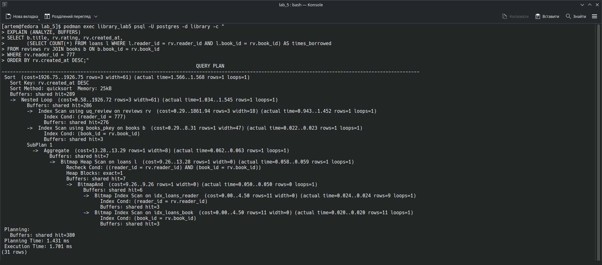

Медіанний час до оптимізації:

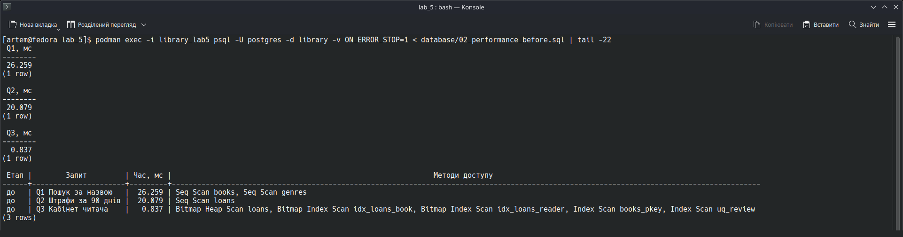

### Крок 3. Створення індексів для оптимізації

На основі планів створено три індекси різних типів (`database/03_indexes.sql`):

```sql
-- 1. GIN-індекс на триграмах назви (розширення pg_trgm).
-- Назва розбивається на трійки символів («мая», «аяк», …), тому індекс
-- підтримує LIKE / ILIKE з % на початку шаблону.
CREATE INDEX idx_books_title_trgm ON books USING GIN (title gin_trgm_ops);

-- 2. Покривний (covering) B-tree індекс за датою повернення.
-- INCLUDE (fine_amount) зберігає суму штрафу прямо в індексі, тож
-- можливе Index Only Scan — без звернення до самої таблиці loans.
CREATE INDEX idx_loans_return_date ON loans (return_date) INCLUDE (fine_amount);

-- 3. Складений індекс для зовнішнього ключа reviews.reader_id.
-- Другий стовпець created_at DESC віддає відгуки одразу у потрібному
-- порядку, тому окреме сортування не потрібне.
CREATE INDEX idx_reviews_reader_created ON reviews (reader_id, created_at DESC);

-- Оновлюємо статистику та карту видимості (потрібна для Index Only Scan)
VACUUM ANALYZE books;
VACUUM ANALYZE loans;
VACUUM ANALYZE reviews;
```

**Результат:**

| Запит | До, мс | Після, мс | Покращення | Прискорення | Метод доступу після |
|---|---|---|---|---|---|
| Q1 Пошук за назвою | 26,259 | 2,250 | **91,4%** | 11,7× | Bitmap Index Scan `idx_books_title_trgm` |
| Q2 Штрафи за 90 днів | 20,079 | 7,379 | **63,3%** | 2,7× | Index Only Scan `idx_loans_return_date` |
| Q3 Кабінет читача | 0,837 | 0,053 | **93,7%** | 15,8× | Index Scan `idx_reviews_reader_created` |

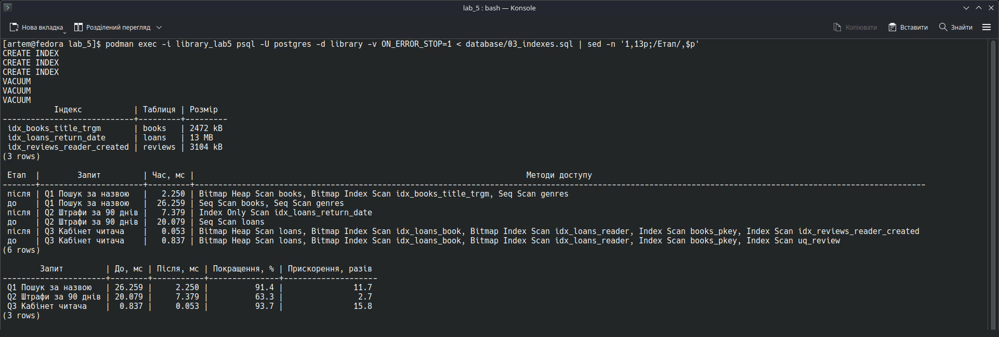

Плани після оптимізації:

* **Q1.** `Bitmap Index Scan on idx_books_title_trgm` знаходить 445 кандидатів, і з таблиці читається лише 236 сторінок. Усього прочитано 349 сторінок замість 1 119.

  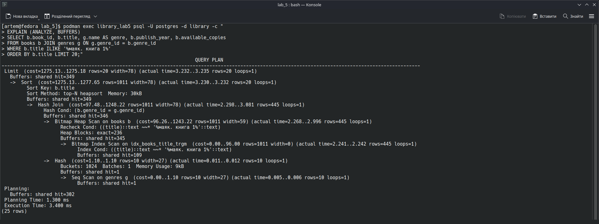

* **Q2.** `Index Only Scan` із `Heap Fetches: 0`: таблиця `loans` не читалася взагалі, прочитано 126 сторінок індексу замість 4 505. Прискорення менше, ніж в інших запитах, бо умові `return_date >= CURRENT_DATE - 90` відповідає близько 36 тисяч записів, і їх усе одно треба агрегувати.

  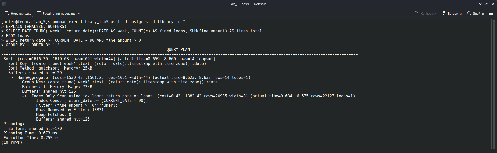

* **Q3.** Вузол `Sort` зник: індекс віддає рядки вже впорядкованими за `created_at DESC`. Прочитано 14 сторінок замість 289.

  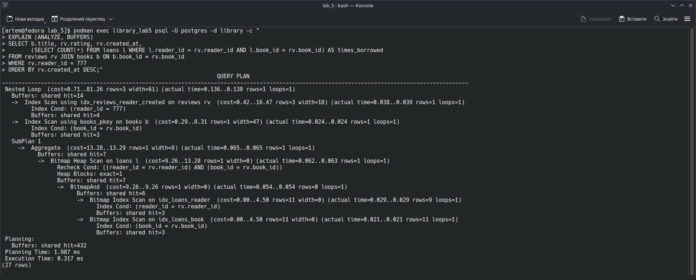

### Крок 4. Представлення

Скрипт `database/04_views.sql` створює два представлення для запитів, які в бібліотеці виконуються щодня.

```sql
-- 1. Популярність книг: видачі за 30 / 90 / 365 днів, рейтинг, кількість відгуків
CREATE OR REPLACE VIEW v_book_popularity AS
SELECT b.book_id, b.title, g.name AS genre,
       COUNT(l.loan_id) FILTER (WHERE l.loan_date >= CURRENT_DATE - 30)  AS loans_30d,
       COUNT(l.loan_id) FILTER (WHERE l.loan_date >= CURRENT_DATE - 90)  AS loans_90d,
       COUNT(l.loan_id) FILTER (WHERE l.loan_date >= CURRENT_DATE - 365) AS loans_365d,
       COUNT(l.loan_id)                                                  AS loans_total,
       r.avg_rating, COALESCE(r.reviews_count, 0)                        AS reviews_count
FROM books b
JOIN genres g ON g.genre_id = b.genre_id
LEFT JOIN loans l ON l.book_id = b.book_id
LEFT JOIN LATERAL (SELECT ROUND(AVG(rating), 2) AS avg_rating, COUNT(*) AS reviews_count
                   FROM reviews rv WHERE rv.book_id = b.book_id) r ON TRUE
GROUP BY b.book_id, b.title, g.name, r.avg_rating, r.reviews_count;

-- 2. Боржники: читачі з простроченими книгами та очікуваним штрафом
CREATE OR REPLACE VIEW v_overdue_readers AS
SELECT r.reader_id, r.ticket_number,
       r.last_name || ' ' || r.first_name                AS reader_name,
       r.phone, r.email,
       COUNT(*)                                          AS overdue_books,
       MIN(l.due_date)                                   AS oldest_due_date,
       MAX(CURRENT_DATE - l.due_date)                    AS max_days_overdue,
       SUM(CURRENT_DATE - l.due_date) * 5.00             AS expected_fine,
       STRING_AGG(b.title, '; ' ORDER BY l.due_date)     AS books
FROM loans l
JOIN readers r ON r.reader_id = l.reader_id
JOIN books   b ON b.book_id   = l.book_id
WHERE l.return_date IS NULL AND l.due_date < CURRENT_DATE
GROUP BY r.reader_id;
```

Перевірка простими запитами:

```sql
SELECT title, genre, loans_30d, loans_90d, loans_365d, avg_rating, reviews_count
FROM v_book_popularity ORDER BY loans_365d DESC, avg_rating DESC NULLS LAST LIMIT 10;

SELECT ticket_number, reader_name, phone, overdue_books, max_days_overdue, expected_fine
FROM v_overdue_readers ORDER BY expected_fine DESC LIMIT 10;
```

**Результат:** складні запити з JOIN, `FILTER` і `LATERAL` тепер викликаються як звичайна таблиця. Знайдено 1 902 боржники з очікуваними штрафами на 128 390 грн.

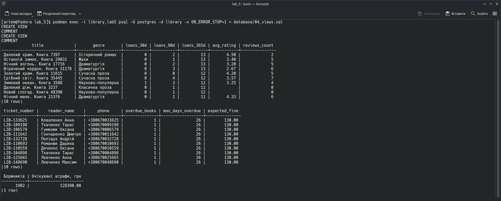

### Крок 5. Тригер логування вставки та оновлення

Скрипт `database/05_logging_trigger.sql` створює історію цін книг. Вона потрібна для обліку вартості фонду й компенсації втрачених книг.

* При **додаванні** книги фіксується початкова ціна.
* При **зміні ціни** фіксуються стара й нова ціна, відсоток зміни та хто змінив.

```sql
CREATE TABLE book_price_history (
    history_id BIGSERIAL PRIMARY KEY,
    book_id    INTEGER NOT NULL REFERENCES books(book_id) ON DELETE CASCADE,
    operation  VARCHAR(10) NOT NULL,           -- INSERT або UPDATE
    old_price  NUMERIC(8,2),
    new_price  NUMERIC(8,2) NOT NULL,
    change_pct NUMERIC(6,2),                   -- зміна ціни у відсотках
    changed_by VARCHAR(50) NOT NULL,
    changed_at TIMESTAMP NOT NULL DEFAULT CURRENT_TIMESTAMP
);

CREATE OR REPLACE FUNCTION fn_log_book_price()
RETURNS TRIGGER LANGUAGE plpgsql AS $$
BEGIN
    INSERT INTO book_price_history (book_id, operation, old_price, new_price, change_pct, changed_by)
    VALUES (NEW.book_id, TG_OP,
            CASE WHEN TG_OP = 'UPDATE' THEN OLD.price END,
            NEW.price,
            CASE WHEN TG_OP = 'UPDATE' AND OLD.price > 0
                 THEN ROUND((NEW.price - OLD.price) / OLD.price * 100, 2) END,
            -- користувач застосунку, а якщо зміна напряму в БД — роль PostgreSQL
            COALESCE(NULLIF(current_setting('app.username', TRUE), ''), session_user));
    RETURN NEW;
END;
$$;

CREATE TRIGGER trg_books_price_insert
AFTER INSERT ON books
FOR EACH ROW EXECUTE FUNCTION fn_log_book_price();

-- умова WHEN перевіряється ще до виклику функції: зміна інших полів не створює запису
CREATE TRIGGER trg_books_price_update
AFTER UPDATE OF price ON books
FOR EACH ROW
WHEN (OLD.price IS DISTINCT FROM NEW.price)
EXECUTE FUNCTION fn_log_book_price();
```

**Результат:**

* вставка книги створила запис `INSERT` з ціною 450 грн;
* підвищення ціни на 10% і знижку до 399 грн записано з відсотками +10,00 і −19,39 та користувачем `librarian` з налаштування сесії `app.username`;
* зміна кількості сторінок запису не створила.

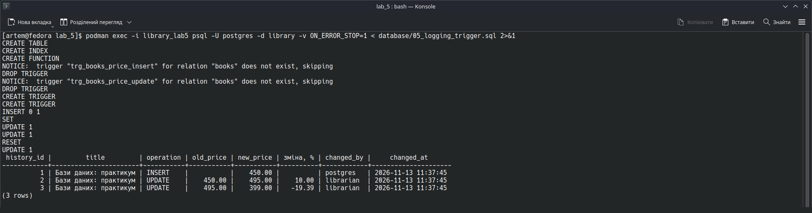

### Крок 6. Користувач з обмеженими правами

`report_viewer` — аналітик, який будує звіти (`database/06_limited_user.sql`).

* Він може лише **читати** довідники, каталог і два представлення з кроку 4.
* Таблиця `readers` йому недоступна. Контакти він бачить тільки для боржників і тільки через представлення `v_overdue_readers`. Тут представлення працює як механізм безпеки.

```sql
CREATE USER report_viewer WITH PASSWORD 'Rep0rt_Viewer!2026'
    CONNECTION LIMIT 3;                         -- не більше 3 одночасних підключень

GRANT CONNECT ON DATABASE library TO report_viewer;
GRANT USAGE   ON SCHEMA public   TO report_viewer;
GRANT SELECT ON genres, publishers, authors, books, book_authors TO report_viewer;
GRANT SELECT ON v_book_popularity, v_overdue_readers           TO report_viewer;

-- обмеження часу запиту, щоб звіт не «повісив» сервер
ALTER ROLE report_viewer SET statement_timeout = '30s';
```

Скрипт `scripts/test_report_viewer.sql` перевіряє права, **підключившись від імені** `report_viewer`.

**Результат:**

* дозволено: читання каталогу (50 021 книга) і представлення боржників;
* відхилено з помилкою `permission denied`: читання `readers`, `UPDATE books`, `DELETE FROM genres`, читання `app_users`.

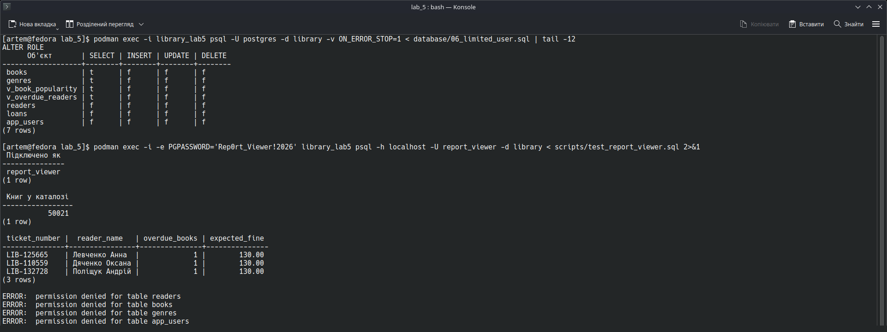

---

## Рівень 2

### Крок 7. Представлення з оновленням через правила (RULES)

`v_reader_cards` — «картка читача» (`database/07_rules_view.sql`). Вона поєднує дані з `readers`, обліковий запис з `app_users` і обчислені поля: книги на руках і поточний борг. Через JOIN і підзапити PostgreSQL не робить таке представлення оновлюваним автоматично, тому поведінку задають три правила `DO INSTEAD`:

```sql
CREATE VIEW v_reader_cards AS
SELECT r.reader_id, r.ticket_number, r.last_name, r.first_name, r.email, r.phone, r.address, r.is_active,
       u.username, u.role,
       (SELECT COUNT(*) FROM loans l WHERE l.reader_id = r.reader_id AND l.return_date IS NULL) AS books_on_hand,
       (SELECT COALESCE(SUM(GREATEST(CURRENT_DATE - l.due_date, 0)), 0) * 5.00
        FROM loans l WHERE l.reader_id = r.reader_id AND l.return_date IS NULL)              AS current_debt
FROM readers r
LEFT JOIN app_users u ON u.reader_id = r.reader_id;

-- UPDATE: лише контактні дані та статус; блокування читача блокує і його акаунт
CREATE RULE r_reader_cards_update AS ON UPDATE TO v_reader_cards
DO INSTEAD (
    UPDATE app_users SET is_active = NEW.is_active
     WHERE reader_id = OLD.reader_id AND is_active IS DISTINCT FROM NEW.is_active;
    UPDATE readers
       SET first_name = NEW.first_name, last_name = NEW.last_name, email = NEW.email,
           phone = NEW.phone, address = NEW.address, is_active = NEW.is_active
     WHERE reader_id = OLD.reader_id;
);

-- INSERT: номер квитка генерується автоматично, якщо не вказаний
CREATE RULE r_reader_cards_insert AS ON INSERT TO v_reader_cards
DO INSTEAD
    INSERT INTO readers (ticket_number, first_name, last_name, email, phone, address, is_active)
    VALUES (COALESCE(NEW.ticket_number,
                     'LIB-' || (SELECT COALESCE(MAX(SUBSTRING(ticket_number FROM 5)::INT), 0) + 1 FROM readers)),
            NEW.first_name, NEW.last_name, NEW.email, NEW.phone, NEW.address, COALESCE(NEW.is_active, TRUE));

-- DELETE: «м'яке» видалення — історія видач зберігається, читач лише блокується
CREATE RULE r_reader_cards_delete AS ON DELETE TO v_reader_cards
DO INSTEAD (
    UPDATE app_users SET is_active = FALSE WHERE reader_id = OLD.reader_id;
    UPDATE readers   SET is_active = FALSE WHERE reader_id = OLD.reader_id;
);
```

Перевірка:

```sql
UPDATE v_reader_cards SET phone = '+380501112233', address = 'м. Луцьк, вул. Волі, 1' WHERE reader_id = 1;
INSERT INTO v_reader_cards (first_name, last_name, email, phone)
VALUES ('Артем', 'Тестовий', 'artem.test@example.com', '+380671234567');
DELETE FROM v_reader_cards WHERE reader_id = 2;
```

**Результат:**

* `UPDATE` змінив телефон і адресу в таблиці `readers`.
* `INSERT` створив читача з автоматично згенерованим квитком `LIB-150001`.
* `DELETE` не видалив читача 2, а заблокував і його самого, і акаунт `shevchuk`.

Особливість правил: клієнт бачить `DELETE 0`. Статус команди береться з останньої команди правила того самого типу (DELETE), а правило містить лише UPDATE. Через такі неочевидні ефекти документація PostgreSQL рекомендує для нових проєктів тригери `INSTEAD OF`.

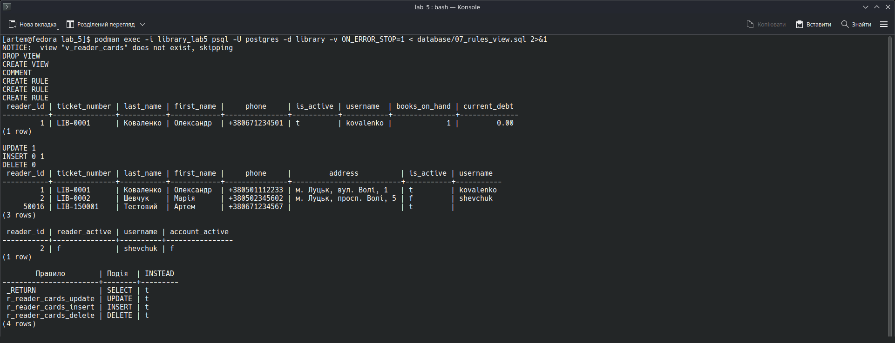

### Крок 8. Тригери валідації з обробкою помилок

Скрипт `database/08_validation_triggers.sql` створює два тригери `BEFORE`. Такий тригер може **змінити** рядок перед записом (нормалізація) або **відхилити** його через `RAISE EXCEPTION`. Кожна помилка має власний код SQLSTATE, `DETAIL` і `HINT`, щоб застосунок міг показати зрозуміле повідомлення.

**Тригер на `readers`:**

* прибирає пробіли на краях і робить ім'я та прізвище з великої літери;
* переводить email у нижній регістр;
* приводить телефон до формату `+380XXXXXXXXX`;
* відхиляє ПІБ з цифрами, дату народження в майбутньому та вік менше 6 або більше 120 років.

```sql
CREATE OR REPLACE FUNCTION fn_validate_reader()
RETURNS TRIGGER LANGUAGE plpgsql AS $$
DECLARE
    v_digits TEXT;
BEGIN
    NEW.first_name := INITCAP(BTRIM(NEW.first_name));
    NEW.last_name  := INITCAP(BTRIM(NEW.last_name));
    NEW.email      := LOWER(BTRIM(NEW.email));

    IF NEW.first_name ~ '[0-9]' OR NEW.last_name ~ '[0-9]' THEN
        RAISE EXCEPTION 'Ім''я та прізвище не можуть містити цифр: "% %"', NEW.last_name, NEW.first_name
            USING ERRCODE = 'check_violation', HINT = 'Перевірте правильність введення ПІБ';
    END IF;

    IF NEW.phone IS NOT NULL THEN
        v_digits := regexp_replace(NEW.phone, '[^0-9]', '', 'g');   -- лише цифри
        IF v_digits ~ '^0[0-9]{9}$' THEN v_digits := '38' || v_digits; END IF;
        IF v_digits !~ '^380[0-9]{9}$' THEN
            RAISE EXCEPTION 'Некоректний номер телефону: %', NEW.phone
                USING ERRCODE = 'check_violation',
                      DETAIL  = 'Очікується український номер з 12 цифр',
                      HINT    = 'Приклад: +380671234567 або 067 123 45 67';
        END IF;
        NEW.phone := '+' || v_digits;
    END IF;
    -- ... перевірка дати народження та віку ...
    RETURN NEW;          -- повертаємо змінений (нормалізований) рядок
END;
$$;

CREATE TRIGGER trg_readers_validate
BEFORE INSERT OR UPDATE OF first_name, last_name, email, phone, birth_date ON readers
FOR EACH ROW EXECUTE FUNCTION fn_validate_reader();
```

**Тригер на `reviews`** перевіряє бізнес-правила:

* відгук залишає лише читач, який брав цю книгу (`EXISTS` у `loans`);
* заблокований читач відгуків не залишає (код `42501`, `insufficient_privilege`);
* коментар не довший за 1000 символів, а порожній коментар перетворюється на `NULL`.

Для перевірки помилкові вставки виконуються в окремих блоках з обробником `EXCEPTION`. Код помилки, повідомлення та підказку читає `GET STACKED DIAGNOSTICS`:

```sql
BEGIN
    EXECUTE v_sql;
EXCEPTION WHEN OTHERS THEN
    GET STACKED DIAGNOSTICS v_state = RETURNED_SQLSTATE, v_msg = MESSAGE_TEXT, v_hint = PG_EXCEPTION_HINT;
    RAISE NOTICE 'ВІДХИЛЕНО [%] % (підказка: %)', v_state, v_msg, v_hint;
END;
```

**Результат:**

* дані `'  олена '`, `'ПЕТРЕНКО  '`, `' Olena.Petrenko@Example.COM '`, `'067 555-44-33'` збережено як `Олена Петренко`, `olena.petrenko@example.com`, `+380675554433`;
* п'ять некоректних вставок відхилено з кодами `23514` та `42501`.

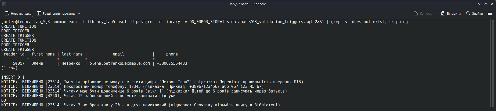

Так виглядає та сама помилка без обробника, тобто як її бачить клієнт. `DETAIL` і `HINT` передаються разом з повідомленням. Остання команда показує нормалізацію при `UPDATE`.

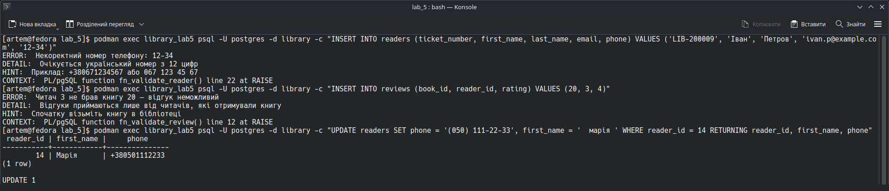

### Крок 9. Система логування змін (audit_log)

Таблиця `audit_log` та універсальна тригерна функція `fn_audit()` з'явилися ще в лабораторній 4 і вже фіксують усі вимоги методички:

* тип операції (INSERT, UPDATE, DELETE);
* назву таблиці;
* часову мітку;
* користувача;
* старі й нові значення у форматі JSONB (для UPDATE — лише змінені поля).

У цій роботі систему розширено (`database/09_audit_system.sql`):

1. **Додаткові поля:**
   * `db_user` — роль PostgreSQL;
   * `client_addr` — IP-адреса клієнта;
   * `app_name` — програма, з якої підключено;
   * `tx_id` — номер транзакції: зміни з однаковим `tx_id` зроблено однією транзакцією.
2. **Аудит ще двох таблиць** (`reviews`, `book_authors`). Для `TRUNCATE`, який не викликає рядкових тригерів, додано окремий тригер рівня оператора `FOR EACH STATEMENT`.
3. **Незмінність журналу (append-only).** Тригер забороняє `UPDATE`, `DELETE` і `TRUNCATE` на `audit_log`, щоб ніхто не зміг «підчистити» сліди. Старі записи видаляє лише процедура обслуговування (крок 14): вона вмикає дозвіл тільки в межах своєї транзакції.
4. **Функція `audit_history(таблиця, id)`** показує історію змін конкретного запису по полях.

```sql
ALTER TABLE audit_log
    ADD COLUMN IF NOT EXISTS db_user     VARCHAR(50) DEFAULT current_user,
    ADD COLUMN IF NOT EXISTS client_addr INET        DEFAULT inet_client_addr(),
    ADD COLUMN IF NOT EXISTS app_name    VARCHAR(64) DEFAULT current_setting('application_name'),
    ADD COLUMN IF NOT EXISTS tx_id       BIGINT      DEFAULT txid_current();

CREATE OR REPLACE FUNCTION fn_audit_protect()
RETURNS TRIGGER LANGUAGE plpgsql AS $$
BEGIN
    IF TG_OP = 'DELETE' AND current_setting('audit.allow_purge', TRUE) = 'on' THEN
        RETURN OLD;
    END IF;
    RAISE EXCEPTION 'Журнал аудиту не можна змінювати (операція %)', TG_OP
        USING ERRCODE = 'insufficient_privilege',
              HINT    = 'Старі записи видаляє лише процедура maintain_database()';
END;
$$;

CREATE TRIGGER trg_audit_log_protect BEFORE UPDATE OR DELETE ON audit_log
FOR EACH ROW EXECUTE FUNCTION fn_audit_protect();
CREATE TRIGGER trg_audit_log_no_truncate BEFORE TRUNCATE ON audit_log
FOR EACH STATEMENT EXECUTE FUNCTION fn_audit_protect();
```

**Результат:**

* INSERT, UPDATE і DELETE жанру «Комікси» записано в журнал трьома рядками з різними `tx_id`;
* у записі UPDATE збережено лише змінене поле `description` (старе й нове значення);
* `audit_history()` показує повну історію запису по полях;
* спробу видалити записи журналу відхилено.

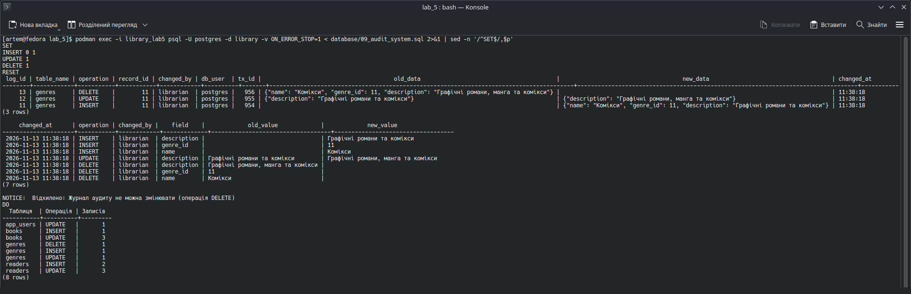

### Крок 10. Часткові індекси та аналіз їх ефективності

Частковий індекс містить лише рядки, що задовольняють умові `WHERE` (`database/10_partial_indexes.sql`):

```sql
-- Черга модерації: лише відгуки з оцінкою 1–2 (≈20% таблиці), від найновіших
CREATE INDEX idx_reviews_negative ON reviews (created_at DESC) WHERE rating <= 2;

-- Нагадування: лише бронювання в статусі pending (≈5% таблиці)
CREATE INDEX idx_reservations_pending ON reservations (expires_at) WHERE status = 'pending';
```

**Результат: прискорення.** Час виміряно тією ж функцією `measure_query()`:

| Запит | До, мс | Після, мс | Покращення | Прискорення |
|---|---|---|---|---|
| P1 Останні 20 негативних відгуків | 5,043 | 0,015 | 99,7% | 336× |
| P2 Бронювання, що спливають за добу | 0,231 | 0,022 | 90,5% | 10,5× |

**Результат: розмір.** Для порівняння тимчасово створено повні аналоги індексів:

| Індекс | Тип | Розмір | Економія |
|---|---|---|---|
| `idx_reviews_negative` | частковий | 456 kB | у **4,8 раза** менший |
| повний індекс на `reviews(created_at)` | повний | 2 208 kB | |
| `idx_reservations_pending` | частковий | 40 kB | у **11,4 раза** менший |
| повний індекс на `reservations(expires_at)` | повний | 456 kB | |
| `idx_loans_open` (з лабораторної 4) | частковий | 56 kB | лише ~3 000 відкритих видач з 503 000 |

Частковий індекс використовується, лише якщо умова запиту **випливає** з умови індексу:

* `WHERE rating <= 3` ширша за `rating <= 2`, тому план повертається до `Seq Scan` + `Sort`;
* для вужчої умови `rating = 1` індекс підходить.

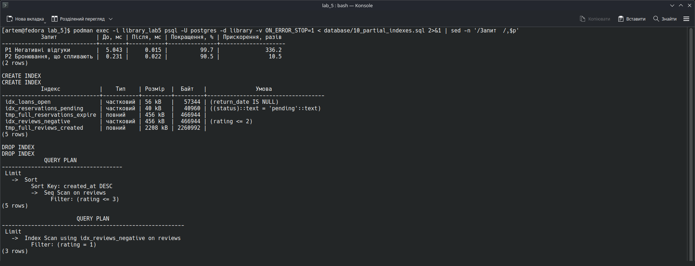

Плани запитів P1 і P2 з частковими індексами:

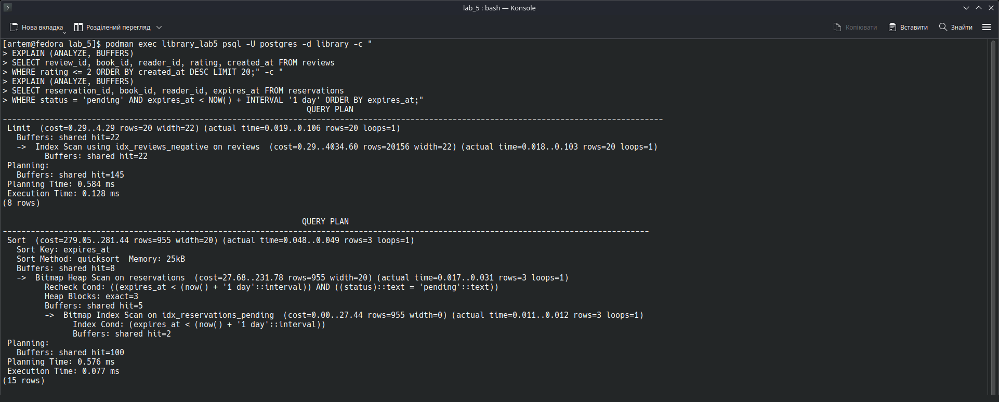

### Крок 11. Резервне копіювання (pg_dump) та відновлення

Скрипт `scripts/backup_restore.sh` виконує повний цикл. Утиліти запускаються всередині контейнера, а папка `./backups` змонтована в нього як `/backups`.

```bash
# 1. Повна копія у форматі custom зі стисненням 9 (основна)
pg_dump -U postgres -d library -F c -Z 9 -f /backups/library_$STAMP.dump
# 2. Копія як SQL-скрипт (читабельна, відновлюється через psql)
pg_dump -U postgres -d library -F p -f /backups/library_$STAMP.sql
# 3. Копія однієї таблиці
pg_dump -U postgres -d library -t genres -F p -f /backups/genres_$STAMP.sql

# 4. Відновлення в нову базу в 4 паралельні потоки
dropdb  -U postgres --if-exists test_restore
createdb -U postgres test_restore
pg_restore -U postgres -d test_restore --jobs 4 /backups/library_$STAMP.dump

# 5. «Аварія» в test_restore і вибіркове відновлення даних однієї таблиці
psql -d test_restore -c "TRUNCATE notifications;"
pg_restore -U postgres -d test_restore --data-only -t notifications /backups/library_$STAMP.dump
```

Після відновлення скрипт звіряє оригінал і копію за кількістю рядків головних таблиць, кількістю функцій, тригерів, представлень та індексів, а також сумою всіх штрафів.

**Результат:**

* Копія у форматі custom зі стисненням займає **14 МБ**, у форматі SQL — **55 МБ**, тобто у 4 рази менше. Створення копії тривало 8,9 с.
* Відновлення в 4 потоки зайняло 2,7 с. Усі 11 показників оригіналу та копії збігаються.
* Після «аварії» таблиця `notifications` порожня (0 рядків). Вибіркове `pg_restore -t notifications --data-only` повернуло всі 6 рядків, решту бази не зачеплено.

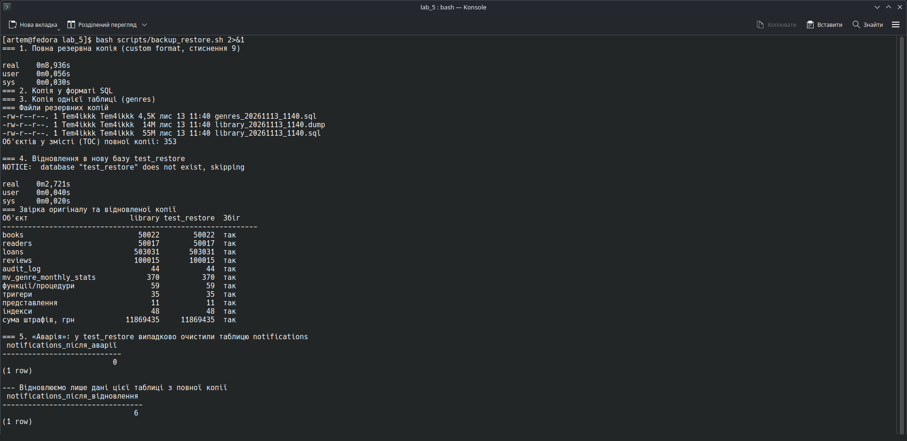

Скрипт виконано в кінці роботи, тому копія містить і об'єкти рівня 3 (матеріалізоване представлення, таблицю повідомлень).

---

## Рівень 3

### Крок 12. Матеріалізоване представлення з автоматичним оновленням

`mv_genre_monthly_stats` — щомісячна статистика за жанрами (`database/11_materialized_view.sql`):

* видачі;
* унікальні читачі;
* сума штрафів;
* середня тривалість читання;
* середня оцінка.

Звичайне представлення щоразу агрегувало б 500 000 видач, а матеріалізоване зберігає готовий результат: 370 рядків, 112 kB.

```sql
CREATE MATERIALIZED VIEW mv_genre_monthly_stats AS
WITH loan_stats AS (
    SELECT b.genre_id, DATE_TRUNC('month', l.loan_date)::DATE AS month,
           COUNT(*) AS loans_count, COUNT(DISTINCT l.reader_id) AS unique_readers,
           SUM(l.fine_amount) AS fines_total,
           ROUND(AVG(l.return_date - l.loan_date), 1) AS avg_days_reading
    FROM loans l JOIN books b ON b.book_id = l.book_id
    GROUP BY 1, 2
), review_stats AS (
    SELECT b.genre_id, DATE_TRUNC('month', r.created_at)::DATE AS month,
           ROUND(AVG(r.rating), 2) AS avg_rating, COUNT(*) AS reviews_count
    FROM reviews r JOIN books b ON b.book_id = r.book_id
    GROUP BY 1, 2
)
SELECT g.genre_id, g.name AS genre, ls.month, ls.loans_count, ls.unique_readers, ls.fines_total,
       ls.avg_days_reading, rs.avg_rating, COALESCE(rs.reviews_count, 0) AS reviews_count,
       NOW() AS refreshed_at
FROM loan_stats ls
JOIN genres g ON g.genre_id = ls.genre_id
LEFT JOIN review_stats rs ON rs.genre_id = ls.genre_id AND rs.month = ls.month;

-- Унікальний індекс обов'язковий для REFRESH ... CONCURRENTLY
CREATE UNIQUE INDEX idx_mv_genre_month ON mv_genre_monthly_stats (genre_id, month);
```

**Автоматичне оновлення.** Найпростіше було б оновлювати MV після кожного оператора, але тоді транзакція з кількома видачами виконувала б важке оновлення кілька разів поспіль. Тому використано такий механізм:

* **Відкладений тригер обмеження** (`CONSTRAINT TRIGGER … INITIALLY DEFERRED`) спрацьовує в момент `COMMIT`.
* **Прапорець у налаштуваннях транзакції** гарантує, що `REFRESH` виконається **один раз на транзакцію**, скільки б рядків вона не змінила.
* **`REFRESH … CONCURRENTLY`** не блокує читання MV під час оновлення.
* **`SECURITY DEFINER`.** Оновлювати MV може лише власник (або роль з правом `MAINTAIN` у PostgreSQL 17), тому функція виконується з правами власника, а не користувача застосунку.

```sql
CREATE OR REPLACE FUNCTION fn_refresh_genre_stats()
RETURNS TRIGGER LANGUAGE plpgsql SECURITY DEFINER SET search_path = public AS $$
BEGIN
    -- уже оновлювали в цій транзакції — пропускаємо
    IF current_setting('lab5.mv_refreshed_tx', TRUE) = txid_current()::TEXT THEN
        RETURN NULL;
    END IF;
    PERFORM set_config('lab5.mv_refreshed_tx', txid_current()::TEXT, TRUE);   -- до кінця транзакції
    REFRESH MATERIALIZED VIEW CONCURRENTLY mv_genre_monthly_stats;
    RETURN NULL;
END;
$$;

CREATE CONSTRAINT TRIGGER trg_mv_refresh_loans
AFTER INSERT OR UPDATE OR DELETE ON loans
DEFERRABLE INITIALLY DEFERRED
FOR EACH ROW EXECUTE FUNCTION fn_refresh_genre_stats();
-- такий самий тригер trg_mv_refresh_reviews на таблиці reviews
```

**Результат:**

* однаковий агрегат за 12 місяців з MV виконується за **0,8 мс**, а «на льоту» з 500 000 видач — за **36,0 мс** (у 44 рази швидше);
* транзакція з трьома видачами викликала оновлення MV **рівно один раз**, під час `COMMIT` (455 мс);
* лічильники видач у MV зросли на 2 (Поезія) і на 1 (Історичний роман) без ручного `REFRESH`.

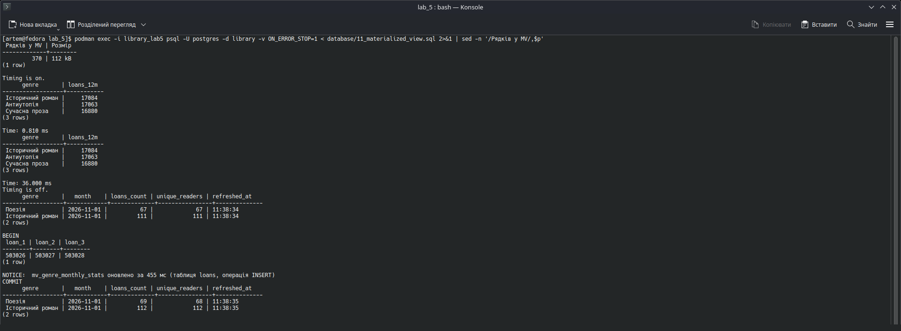

Ціна автоматичного оновлення — близько 0,5 с на кожну транзакцію, що змінює `loans` або `reviews`. Для навчальної бази це прийнятно. У реальній системі з інтенсивним записом MV краще оновлювати за розкладом. Саме це робить процедура обслуговування (крок 14).

### Крок 13. Каскадні тригери

Каскадні тригери працюють ланцюжком: зміна в одній таблиці запускає тригер, який змінює іншу таблицю, а там спрацьовує наступний тригер (`database/12_cascade_triggers.sql`). Кожна функція виводить рівень вкладеності через `pg_trigger_depth()` і має захист від нескінченного каскаду.

**Ланцюжок А — повернення книги, на яку є черга:**

```
loans.return_date                  ── trg_loans_sync_availability (лаб. 4)
  └─ books.available_copies + 1     ── trg_books_notify_reservation       [рівень 2]
       └─ reservations.notified_at  ── trg_reservations_notify            [рівень 3]
            └─ notifications: «Заброньована книга чекає на вас до …»
loans (повернення зі штрафом)       ── trg_loans_fine_notify              [рівень 1]
  └─ notifications: «Нараховано штраф …»
```

**Ланцюжок Б — блокування читацького квитка:**

```
readers.is_active = FALSE           ── trg_readers_blocked                [рівень 1]
  ├─ reservations: pending → cancelled ── trg_reservations_notify         [рівень 2]
  │     └─ notifications: «Бронювання … скасовано»
  ├─ app_users.is_active = FALSE    ── trg_audit_users (журнал аудиту)
  └─ notifications: «Ваш квиток заблоковано»
```

Ключова функція ланцюжка А:

```sql
CREATE OR REPLACE FUNCTION fn_books_notify_reservation()
RETURNS TRIGGER LANGUAGE plpgsql AS $$
DECLARE
    v_res_id INTEGER;
BEGIN
    IF pg_trigger_depth() > 5 THEN RETURN NULL; END IF;     -- захист від нескінченного каскаду

    SELECT reservation_id INTO v_res_id
    FROM reservations
    WHERE book_id = NEW.book_id AND status = 'pending' AND notified_at IS NULL
    ORDER BY reservation_date                                -- черга: хто раніше забронював
    LIMIT 1
    FOR UPDATE SKIP LOCKED;

    IF FOUND THEN
        RAISE NOTICE '[рівень %] books: книга % знову доступна -> бронювання %',
            pg_trigger_depth(), NEW.book_id, v_res_id;
        UPDATE reservations
        SET notified_at = CURRENT_TIMESTAMP, expires_at = CURRENT_TIMESTAMP + INTERVAL '3 days'
        WHERE reservation_id = v_res_id;                     -- -> trg_reservations_notify
    END IF;
    RETURN NULL;
END;
$$;

CREATE TRIGGER trg_books_notify_reservation
AFTER UPDATE OF available_copies ON books
FOR EACH ROW
WHEN (NEW.available_copies > OLD.available_copies)
EXECUTE FUNCTION fn_books_notify_reservation();
```

Сценарій перевірки:

1. Створено книгу з одним примірником. Його забирає Олена Петренко, а читач 3 бронює книгу.
2. Повернення книги функцією `return_book()` спричинило каскад: `books` (рівень 2) → `reservations` (рівень 3) → `notifications`.
3. Повернення простроченої книги створило повідомлення про штраф 55 грн. Одночасно спрацював ланцюжок А для іншої книги з чергою.
4. Блокування читача 3 скасувало два його бронювання (рівень 2), заблокувало акаунт `bondarenko` і створило повідомлення.

**Результат:** одна команда (`return_book` або `UPDATE readers`) автоматично змінює 3–4 таблиці. У таблиці `notifications` видно, на якому рівні каскаду створено кожне повідомлення.

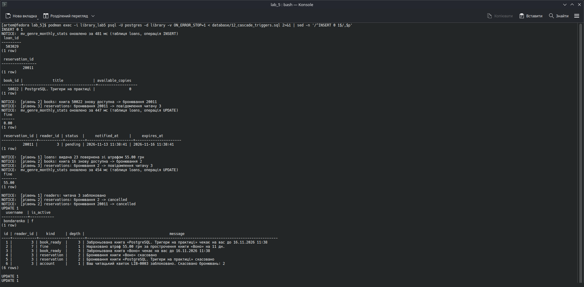

### Крок 14. Ієрархія ролей з детальною системою прав

Скрипт `database/13_role_hierarchy.sql` будує ієрархію з трьох групових ролей. Кожна наступна успадковує права попередньої:

```
lib_administrator  ── усе: усі таблиці, журнал аудиту, обслуговування БД
       │ успадковує
lib_moderator      ── бібліотекар: каталог, видачі, модерація відгуків,
       │ успадковує     обмежений доступ до персональних даних читачів
lib_user           ── читач: перегляд каталогу, рейтингів, бронювання
```

Права задаються на всіх рівнях гранулярності: база → схема → таблиця → **стовпець** → **функція**.

```sql
-- Принцип найменших привілеїв: за замовчуванням функції може виконувати будь-хто (PUBLIC)
REVOKE EXECUTE ON ALL FUNCTIONS  IN SCHEMA public FROM PUBLIC;
REVOKE EXECUTE ON ALL PROCEDURES IN SCHEMA public FROM PUBLIC;

-- lib_user: лише читання каталогу; бронювання — через функцію-«шлюз»
GRANT SELECT ON genres, publishers, authors, books, book_authors, reviews,
                v_books_catalog, v_book_popularity, mv_genre_monthly_stats TO lib_user;
ALTER FUNCTION reserve_book(INTEGER, INTEGER) SECURITY DEFINER SET search_path = public;
GRANT EXECUTE ON FUNCTION reserve_book(INTEGER, INTEGER) TO lib_user;

-- lib_moderator успадковує lib_user
GRANT lib_user TO lib_moderator;
GRANT INSERT, UPDATE, DELETE ON genres, publishers, authors, books, book_authors TO lib_moderator;
GRANT UPDATE (comment), DELETE ON reviews TO lib_moderator;          -- модерація відгуків
GRANT SELECT (reader_id, ticket_number, first_name, last_name, email, phone,
              registration_date, is_active) ON readers TO lib_moderator;  -- без адреси та дати народження
GRANT UPDATE (phone, email, is_active) ON readers TO lib_moderator;
GRANT SELECT, INSERT, UPDATE ON loans, reservations TO lib_moderator;
GRANT EXECUTE ON FUNCTION issue_book(INTEGER, INTEGER, INTEGER), return_book(INTEGER),
                          extend_loan(INTEGER, INTEGER), get_reader_history(INTEGER) TO lib_moderator;

-- lib_administrator успадковує lib_moderator
GRANT lib_moderator TO lib_administrator;
GRANT ALL PRIVILEGES ON ALL TABLES IN SCHEMA public TO lib_administrator;
GRANT pg_read_all_stats TO lib_administrator;                  -- вбудована роль для моніторингу
ALTER DEFAULT PRIVILEGES IN SCHEMA public GRANT ALL ON TABLES TO lib_administrator;

-- Користувачі з правом входу
CREATE USER olena_reader WITH PASSWORD 'Olena#Reader1' CONNECTION LIMIT 2;
CREATE USER ivan_moder   WITH PASSWORD 'Ivan#Moder1'   CONNECTION LIMIT 5;
CREATE USER petro_admin  WITH PASSWORD 'Petro#Admin1'  CREATEROLE VALID UNTIL '2027-06-30';
GRANT lib_user TO olena_reader;  GRANT lib_moderator TO ivan_moder;  GRANT lib_administrator TO petro_admin;
ALTER ROLE olena_reader SET statement_timeout = '5s';
```

Важливе рішення: тригерні функції, що пишуть у службові таблиці (`fn_audit`, `fn_log_book_price`, функції повідомлень), отримали `SECURITY DEFINER`. Користувачі не мають права `INSERT` в `audit_log` і не можуть підробити журнал, але їхні дії все одно туди потрапляють.

Документацію прав генерує сама база:

* дерево успадкування — рекурсивний запит до `pg_auth_members`;
* матриця прав — функція `rights_cell()` на основі `has_table_privilege()` і `has_any_column_privilege()`.

| Об'єкт | olena_reader (user) | ivan_moder (moderator) | petro_admin (admin) |
|---|---|---|---|
| books | S - - - | S I U D | S I U D |
| reviews | S - - - | S - uс D | S I U D |
| readers | - - - - | sс iс uс - | S I U D |
| loans, reservations | - - - - | S I U - | S I U D |
| audit_log, app_users | - - - - | - - - - | S I U D |
| v_book_popularity, mv_genre_monthly_stats | S - - - | S - - - | S I U D |

S/I/U/D — SELECT/INSERT/UPDATE/DELETE; «с» — право лише на окремі стовпці.

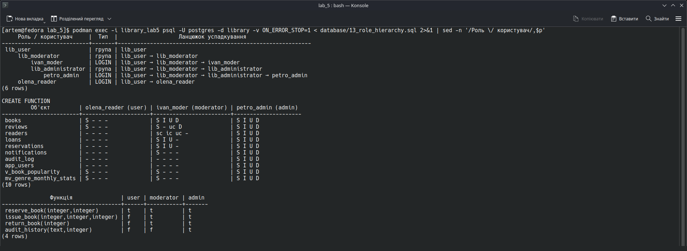

Скрипт `scripts/test_roles.sh` підключається **від імені кожного користувача** і виконує однакові 7 дій:

| Дія | olena_reader | ivan_moder | petro_admin |
|---|---|---|---|
| 1. Додати жанр | ✖ permission denied | ✔ | ✔ |
| 2. Прочитати адресу читача | ✖ | ✖ (стовпець закритий) | ✔ |
| 3. Прочитати квиток і телефон | ✖ | ✔ | ✔ |
| 4. Видати книгу `issue_book()` | ✖ permission denied for function | ✔ | ✔ |
| 5. Забронювати `reserve_book()` | ✔ (через SECURITY DEFINER) | ✔ | ✔ |
| 6. Переглянути журнал аудиту | ✖ | ✖ | ✔ (44 записи) |
| 7. Видалити таблицю | ✖ | ✖ | ✖ must be owner |

Навіть адміністратор не може видалити таблицю. DDL-операції доступні лише власнику об'єкта (`postgres`), тому зловмисник з викраденим паролем адміністратора не знищить структуру бази.

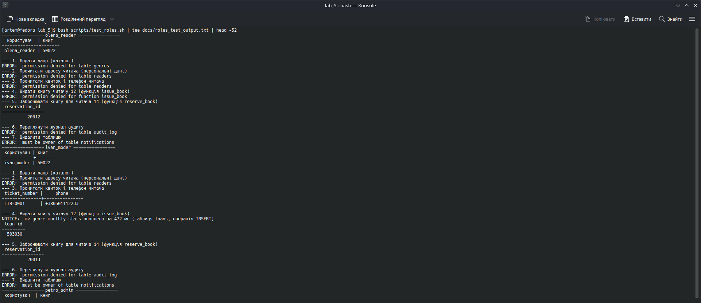

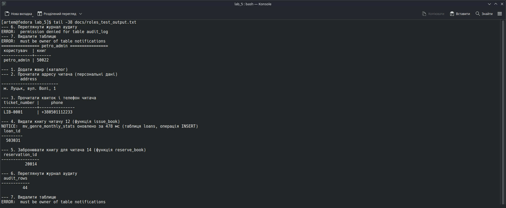

### Крок 15. Збережена процедура автоматизованого обслуговування

Процедура `maintain_database()` (`database/14_maintenance.sql`) виконує обслуговування вибірково, а не «все й завжди»:

1. `ANALYZE` лише тих таблиць, де з моменту останнього аналізу змінилося більше `p_analyze_pct` % рядків (статистика `pg_stat_user_tables.n_mod_since_analyze`).
2. `REINDEX` таблиць, де частка «мертвих» рядків перевищує `p_dead_pct` %. Після масових UPDATE/DELETE індекси «розбухають».
3. `REFRESH MATERIALIZED VIEW CONCURRENTLY`.
4. Бізнес-обслуговування: процедура `update_overdue_status()` з лабораторної 4 позначає прострочені видачі.
5. Очищення журналу аудиту, старшого за `p_audit_keep`. Журнал захищений тригером, тому дозвіл вмикається лише в межах цієї транзакції.

Кожен крок з тривалістю записується в `maintenance_log`. Режим `p_dry_run => TRUE` лише показує, що буде зроблено.

```sql
CREATE OR REPLACE PROCEDURE maintain_database(
    p_analyze_pct NUMERIC  DEFAULT 5,
    p_dead_pct    NUMERIC  DEFAULT 10,
    p_audit_keep  INTERVAL DEFAULT INTERVAL '1 year',
    p_dry_run     BOOLEAN  DEFAULT FALSE
)
LANGUAGE plpgsql AS $$
DECLARE
    v_run INTEGER := nextval('maintenance_run_seq');
    tbl   RECORD;
BEGIN
    -- 1. ANALYZE таблиць із суттєвими змінами
    FOR tbl IN
        SELECT schemaname, relname, n_live_tup, n_mod_since_analyze,
               ROUND(100.0 * n_mod_since_analyze / GREATEST(n_live_tup, 1), 1) AS mod_pct
        FROM pg_stat_user_tables
        WHERE schemaname = 'public'
          AND 100.0 * n_mod_since_analyze / GREATEST(n_live_tup, 1) > p_analyze_pct
    LOOP
        IF NOT p_dry_run THEN
            EXECUTE format('ANALYZE %I.%I', tbl.schemaname, tbl.relname);
        END IF;
        INSERT INTO maintenance_log (run_id, operation, object_name, details) VALUES (...);
    END LOOP;

    -- 2. REINDEX таблиць з великою часткою «мертвих» рядків
    FOR tbl IN SELECT ... WHERE 100.0 * n_dead_tup / GREATEST(n_live_tup + n_dead_tup, 1) > p_dead_pct LOOP
        IF NOT p_dry_run THEN
            EXECUTE format('REINDEX TABLE %I.%I', tbl.schemaname, tbl.relname);
        END IF;
        ...
    END LOOP;

    -- 3–5. REFRESH MV, update_overdue_status(), очищення старого аудиту
    ...
END;
$$;
```

`VACUUM` і `REINDEX DATABASE` не можна виконувати всередині процедури, бо вони не працюють у транзакційному блоці. Тому `VACUUM` запускає окремий скрипт `scripts/maintenance.sh` через утиліту `vacuumdb`, а потім викликає процедуру. Скрипт розрахований на запуск за розкладом через cron, щоночі о 03:00.

Для перевірки змодельовано інтенсивну роботу: оновлено 30% видач (150 910 рядків), і кожен UPDATE залишив «мертву» версію рядка.

**Результат:**

* пробний запуск показав план робіт за 6 мс, нічого не змінюючи;
* реальний запуск (1,2 с) оновив статистику 8 таблиць і перебудував індекси `loans`;
* **розмір індексів `loans` зменшився з 66 МБ до 37 МБ**, а `n_mod_since_analyze` обнулився.

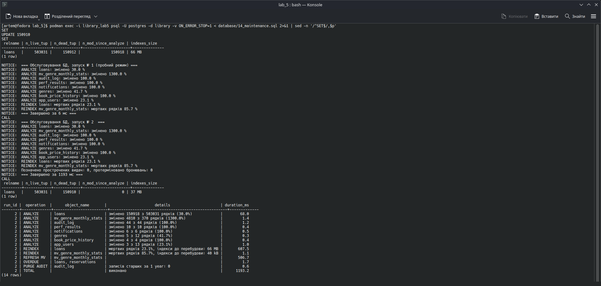

**Результат скрипта `maintenance.sh`:** після `vacuumdb` у всіх великих таблицях 0–1 «мертвих» рядків.

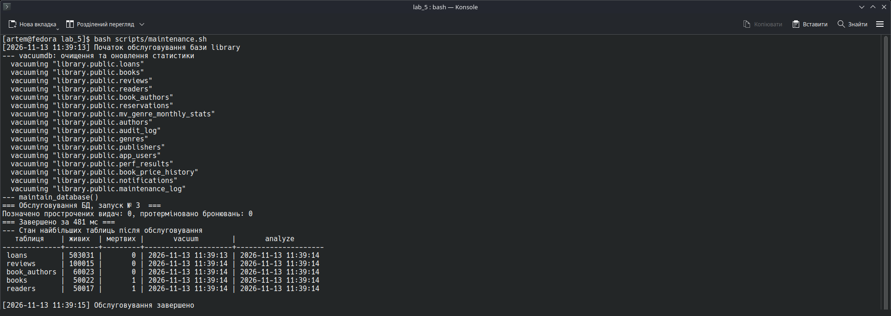

### Крок 16. Скрипт моніторингу продуктивності

`monitoring/monitor.py` — скрипт на Python (psycopg2), що будує звіт із шести розділів:

1. **Загальний стан:** розмір бази, підключення, cache hit ratio, транзакції, deadlocks, тимчасові файли.
2. **Таблиці:** розмір, частка «мертвих» рядків, кількість послідовних і індексних сканувань, частка звернень через індекс, час останнього ANALYZE.
3. **Індекси:** топ за кількістю сканувань і список невикористаних (без PK та UNIQUE).
4. **Найповільніші запити** з `pg_stat_statements`: середній і максимальний час, частка в загальному часі, cache hit.
5. **Довгі запити та блокування** в цей момент (`pg_stat_activity`, `pg_blocking_pids`), а також останнє обслуговування з `maintenance_log`.
6. **Автоматичні рекомендації:** низький cache hit, «мертві» рядки, таблиці з частими Seq Scan, невикористані індекси, запити довші за 100 мс.

Параметри:

* `--markdown FILE` додатково зберігає звіт у Markdown (приклад: [monitoring_report.md](monitoring_report.md));
* `--watch N` оновлює звіт кожні N секунд;
* `--reset` обнуляє статистику перед навантаженням.

Ті самі запити для ручного запуску в psql зібрано у `monitoring/monitoring.sql`.

Ключовий запит розділу 4:

```sql
SELECT calls,
       round(mean_exec_time::numeric, 2) AS mean_ms,
       round(max_exec_time::numeric, 2)  AS max_ms,
       round((100.0 * total_exec_time / nullif(sum(total_exec_time) OVER (), 0))::numeric, 1) AS pct_total,
       round(100.0 * shared_blks_hit / nullif(shared_blks_hit + shared_blks_read, 0), 1)      AS hit_pct,
       regexp_replace(query, '\s+', ' ', 'g') AS query
FROM pg_stat_statements
WHERE dbid = (SELECT oid FROM pg_database WHERE datname = current_database())
ORDER BY mean_exec_time DESC
LIMIT 6;
```

Для реалістичної статистики створено навантаження `monitoring/workload.sql`: типові запити вебзастосунку з випадковими параметрами. Його 20 секунд виконує утиліта `pgbench` у 4 клієнти.

**Результат навантаження:** 10 401 транзакція, 519 tps.

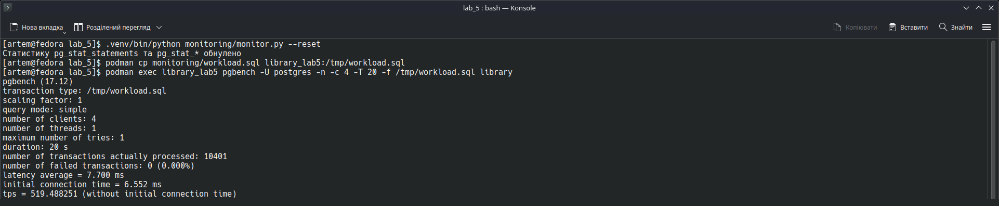

**Результат моніторингу:**

* cache hit ratio 99,97%;
* таблицю `readers` прочитано повним скануванням **10 401 раз**, через індекс — лише 50% звернень;
* перше місце серед найповільніших (44% усього часу) займає запит `SELECT COUNT(*) FROM readers WHERE registration_date = …`;
* скрипт сам видав рекомендацію: «знайти запит з Seq Scan і додати індекс».

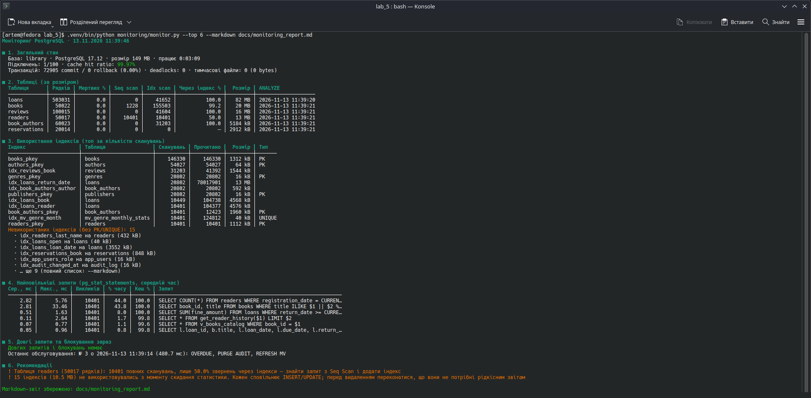

**Реакція на моніторинг.** За результатами створено індекс:

```sql
CREATE INDEX idx_readers_registration ON readers (registration_date);
```

**Результат:** `Seq Scan` (3,8 мс) замінився на `Index Only Scan` (0,04 мс).

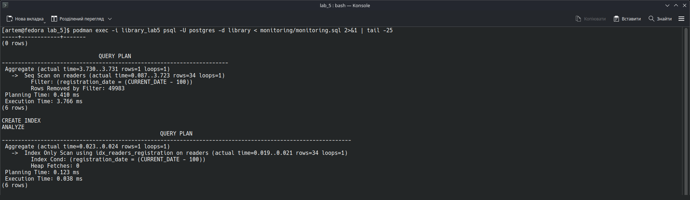

Повторне навантаження тим самим `pgbench`:

| Показник | До | Після |
|---|---|---|
| Пропускна здатність | 519 tps | **883 tps** (+70%) |
| Середня затримка | 7,70 мс | **4,53 мс** |
| Звернень до `readers` через індекс | 50% | **100%** |
| Рекомендацій щодо таблиць | 1 | 0 |

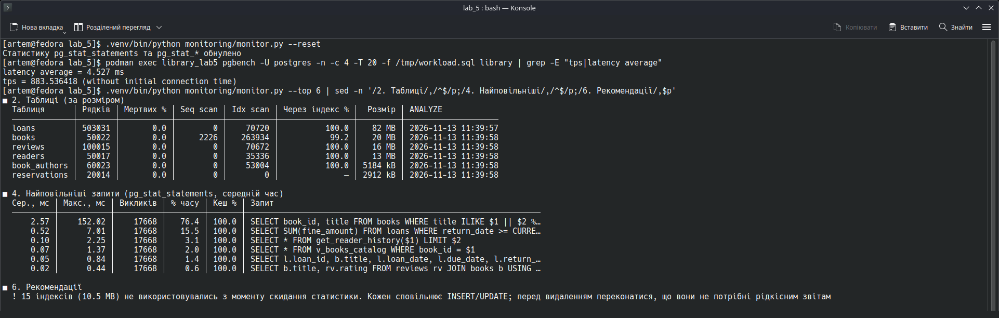

Залишилася одна рекомендація: 15 індексів не використовувались під час навантаження. Це очікувано, бо `workload.sql` не викликає звітів і пошуку боржників, для яких ці індекси створювалися. Скрипт тому й радить перевірити рідкісні звіти перед видаленням.

---

## Висновки

У ході лабораторної роботи база даних «Електронна бібліотека» пройшла повний цикл оптимізації, автоматизації та адміністрування.

**Аналіз продуктивності та індекси.** База наповнена 500 000 видачами, 50 000 книг і читачів, щоб оптимізатор поводився як у реальній системі. Функція `measure_query()` автоматизувала вимірювання: медіана з 7 запусків і методи доступу з JSON-плану.

* Три індекси різних типів прискорили запити у 2,7–15,8 раза:
  * GIN-триграмний — для пошуку `ILIKE '%…%'`;
  * покривний `INCLUDE` — для Index Only Scan;
  * складений — для зовнішнього ключа із сортуванням.
* Часткові індекси прискорили цільові запити у 10–336 разів і виявились у 4,8–11,4 раза меншими за повні аналоги.

**Автоматизація:**

* **Представлення** приховують складні запити й водночас слугують механізмом безпеки.
* **Правила (RULES)** зробили оновлюваною складну «картку читача» з м'яким видаленням.
* **Тригери:**
  * логування історії цін;
  * валідація з нормалізацією даних і зрозумілими помилками (`SQLSTATE`, `DETAIL`, `HINT`);
  * каскадні ланцюжки до 3 рівнів, що автоматично сповіщають читачів.
* **Матеріалізоване представлення** відповідає у 44 рази швидше за агрегат «на льоту» й оновлюється відкладеним тригером рівно один раз на транзакцію.

**Адміністрування:**

* Журнал аудиту став незмінним (append-only) і фіксує роль, IP-адресу та транзакцію.
* Ієрархія ролей `lib_user → lib_moderator → lib_administrator` поєднує права на таблиці, стовпці та функції з `SECURITY DEFINER`-«шлюзами».
* `pg_dump`/`pg_restore` перевірено повністю: копія в 4 рази менша за SQL-дамп, відновлення займає 2,7 с, вибіркове відновлення однієї таблиці працює.
* Процедура обслуговування працює вибірково і зменшила індекси `loans` з 66 до 37 МБ.
* Скрипт моніторингу знайшов реальне вузьке місце. Індекс, доданий за його рекомендацією, збільшив пропускну здатність на 70%.

**Труднощі та їх розв'язання:**

* **Цілісність при масовому завантаженні.** Режим `session_replication_role = replica` вимикає й перевірку зовнішніх ключів. Невдалий перший запуск генератора зсунув лічильник `book_id`, і проблему виявив лише `pg_restore`. Рішення: явні id, `setval()` і перевірка цілісності перед `COMMIT`.
* **Права на оновлення MV.** Оновлювати матеріалізоване представлення може лише власник, тому функцію тригера зроблено `SECURITY DEFINER`. Для журналу аудиту `db_user` береться з `session_user`, бо `current_user` у такій функції — це власник.
* **Статус команди в правилах.** `DELETE` через представлення повертає `DELETE 0`, бо правило містить лише UPDATE. Це підтверджує рекомендацію документації використовувати тригери `INSTEAD OF`.
* **`pg_stat_reset()` обнуляє й оцінку кількості рядків**, тому скрипт моніторингу після скидання виконує `ANALYZE`.

---

## Контрольні запитання

1. **EXPLAIN і EXPLAIN ANALYZE.**
   * `EXPLAIN` лише будує план і показує *оцінки* оптимізатора (cost, rows, width), не виконуючи запит. Він безпечний для будь-яких команд і підходить для швидкої перевірки, чи використовується індекс.
   * `EXPLAIN ANALYZE` **справді виконує** запит і додає фактичний час, реальну кількість рядків і кількість циклів. З `BUFFERS` він показує ще й прочитані сторінки. Його використовують для реального аналізу продуктивності та пошуку розбіжностей між оцінкою й фактом.
   * Для INSERT/UPDATE/DELETE `EXPLAIN ANALYZE` обгортають у `BEGIN … ROLLBACK`.

2. **Типи індексів PostgreSQL:**
   * **B-tree** (за замовчуванням) — рівність, діапазони, `ORDER BY`, `LIKE 'abc%'`. Приклад: `idx_loans_return_date`.
   * **Hash** — лише рівність; рідко має переваги над B-tree.
   * **GIN** — багато значень в одному полі: масиви, JSONB, повнотекстовий пошук, триграми (`pg_trgm`) для `ILIKE '%…%'`. Приклад: `idx_books_title_trgm`.
   * **GiST / SP-GiST** — геометрія, діапазони, найближчі сусіди, IP-адреси.
   * **BRIN** — дуже великі таблиці з природним порядком (журнали за датою). Індекс крихітний, бо зберігає мін/макс для блоків сторінок.
   * Варіанти побудови: складені (кілька стовпців), часткові (`WHERE`), покривні (`INCLUDE`), за виразом (`LOWER(title)`), унікальні.

3. **Часткові індекси.** Індексують лише рядки, що відповідають умові `WHERE`. Найбільший виграш дають, коли запити постійно працюють з невеликою «гарячою» частиною таблиці:
   * активні бронювання (5%): індекс у 11 разів менший;
   * негативні відгуки (20%): у 4,8 раза менший;
   * невидані книги (`idx_loans_open`).

   Такий індекс швидше оновлюється, краще вміщується в пам'ять і пришвидшує цільовий запит. Умова запиту має логічно випливати з умови індексу, а предикат має бути IMMUTABLE, тобто без `NOW()`.

4. **VIEW і MATERIALIZED VIEW.**
   * Звичайне представлення — збережений запит. Дані не зберігаються, запит виконується при кожному зверненні, результат завжди актуальний. Приклади: `v_overdue_readers`, `v_reader_cards`.
   * Матеріалізоване представлення фізично зберігає результат. Його можна індексувати, і читання дуже швидке (0,8 мс проти 36 мс), але дані актуальні лише після `REFRESH`.
   * MV доречне для важкої агрегованої аналітики, дашбордів і звітів, де допустима невелика затримка актуальності. Приклад: `mv_genre_monthly_stats`.

5. **Життєвий цикл тригера та BEFORE / AFTER / INSTEAD OF.** Порядок виконання оператора:
   1. тригери `BEFORE … FOR EACH STATEMENT`;
   2. для кожного рядка — тригери `BEFORE … FOR EACH ROW` (можуть змінити `NEW` або повернути `NULL` і пропустити рядок);
   3. сама зміна рядка та перевірка обмежень;
   4. тригери `AFTER … FOR EACH ROW` (бачать остаточні дані, не можуть їх змінити);
   5. `AFTER … FOR EACH STATEMENT`;
   6. відкладені `CONSTRAINT TRIGGER … INITIALLY DEFERRED` — у момент `COMMIT`.

   Тригер, що змінює іншу таблицю, запускає її тригери (каскад). Відповідно:
   * `BEFORE` — для валідації та нормалізації (`fn_validate_reader`);
   * `AFTER` — для логування й побічних дій (`fn_audit`, повідомлення);
   * `INSTEAD OF` — лише на представленнях, замінює операцію власною логікою (сучасна альтернатива RULES).

6. **Обмеження прав доступу.** Обмеження прав реалізують принцип найменших привілеїв:
   * захищають персональні дані;
   * зменшують шкоду від помилок і викраденого пароля;
   * не дають «підчистити» журнал аудиту;
   * відповідають вимогам законодавства про захист даних.

   Рівні гранулярності PostgreSQL:
   * кластер — атрибути ролі (`LOGIN`, `CREATEROLE`, `CONNECTION LIMIT`, `VALID UNTIL`);
   * база (`CONNECT`, `CREATE`);
   * схема (`USAGE`, `CREATE`);
   * таблиця або представлення (`SELECT`, `INSERT`, `UPDATE`, `DELETE`, `TRUNCATE`, `REFERENCES`, `TRIGGER`, `MAINTAIN` у PG17);
   * **стовпець** (`GRANT SELECT (phone) …`);
   * **рядок** (Row Level Security, політики `CREATE POLICY`);
   * функція або процедура (`EXECUTE`), послідовність (`USAGE`).

   Окремо працюють членство в ролях з успадкуванням, `ALTER DEFAULT PRIVILEGES` і вбудовані ролі `pg_read_all_data`, `pg_read_all_stats` тощо.

7. **Логічне та фізичне резервне копіювання.**
   * **Логічне** (`pg_dump`, `pg_dumpall`) зберігає SQL-команди або архів об'єктів.
     * Переваги: працює між версіями PostgreSQL і платформами; дозволяє вибіркове відновлення окремої таблиці (крок 11); копія у форматі custom стиснена (14 МБ проти 55 МБ SQL); робиться без зупинки сервера.
     * Недоліки: для великих баз створення й відновлення повільне (індекси перебудовуються наново); це знімок на один момент без можливості відновити проміжний стан.
   * **Фізичне** (`pg_basebackup`, копія каталогу даних + WAL) копіює файли кластера.
     * Переваги: швидке для великих баз; підтримує інкрементальні копії (PG17) і point-in-time recovery.
     * Недоліки: лише та сама основна версія та архітектура; копіюється весь кластер; потребує більше місця й налаштувань.

8. **Каскадні тригери.** Це ланцюжок, у якому дія одного тригера змінює іншу таблицю й запускає її тригери. Вони потрібні, коли одна бізнес-подія має узгоджено змінити кілька таблиць, і ця логіка не повинна залежати від застосунку. Приклад з роботи: повернення книги → збільшення доступних примірників → сповіщення першого в черзі бронювання → запис повідомлення. Блокування читача → скасування бронювань → блокування акаунта → аудит.

   Небезпеки:
   * нескінченна рекурсія (захист: `pg_trigger_depth()`);
   * складність налагодження;
   * накопичення часу в одній транзакції.

9. **Вплив індексів на INSERT/UPDATE/DELETE.**
   * Кожен індекс треба оновити при вставці та при зміні проіндексованого стовпця. UPDATE також створює нову версію рядка й нові записи в індексах, якщо не спрацьовує оптимізація HOT.
   * Що більше індексів, то повільніший запис, більше WAL і більший розмір бази. Індекси також «розбухають» після масових змін: у роботі індекси `loans` зросли до 66 МБ і повернулися до 37 МБ після `REINDEX`.
   * Надмірна індексація шкідлива: невикористані індекси займають пам'ять і диск, сповільнюють запис і обслуговування (VACUUM), а дублікати ще й ускладнюють роботу оптимізатора.
   * Тому скрипт моніторингу шукає індекси з `idx_scan = 0`.

10. **Point-in-time recovery (PITR).** Стратегія дозволяє відновити базу на будь-який момент часу, наприклад за хвилину до помилкового `DELETE`. Компоненти:
    * **базова фізична копія** кластера (`pg_basebackup`);
    * **безперервне архівування WAL**: `wal_level = replica`, `archive_mode = on`, `archive_command` (або `archive_library`) копіює кожен заповнений сегмент журналу в архів.

    Відновлення:
    1. Базову копію розгортають у каталог даних.
    2. У `postgresql.conf` задають `restore_command`, щоб отримувати WAL з архіву, і ціль — `recovery_target_time`, `recovery_target_xid` або `recovery_target_lsn`.
    3. У каталозі даних створюють файл `recovery.signal`.
    4. Сервер застосовує зміни з WAL поверх базової копії до заданого моменту.
    5. Після перевірки відновлення завершують через `pg_wal_replay_resume()` або параметр `recovery_target_action = 'promote'`.
