# Звіт з лабораторної роботи №6. Робота з СУБД MongoDB та реалізація операцій

## Загальна інформація

- **ПІБ студента:** Віннік Артем
- **Група:** ІПЗ-31
- **Варіант (предметна область):** Електронна бібліотека
- **Рівень виконання:** 3 (усі вимоги рівнів 1, 2 і 3)
- **Програмне забезпечення:** MongoDB 8.0 (контейнери `mongo:8.0`, Podman + podman-compose), MongoDB Shell `mongosh`, MongoDB Compass 1.53, MongoDB Database Tools (`mongodump`, `mongorestore`, `mongoexport`), PostgreSQL 17 (для порівняння), Python 3 + pymongo, psycopg2

## Мета роботи

Освоїти принципи роботи з документо-орієнтованою базою даних MongoDB: CRUD-операції, запити й агрегації, індексування, валідацію схеми, реплікацію та резервне копіювання. Порівняти документний і реляційний підходи на прикладі бібліотечної системи.

---

## Підготовка середовища

### Крок 1. Встановлення MongoDB і MongoDB Compass

MongoDB розгорнуто в контейнерах, як і PostgreSQL у попередніх лабораторних. Тому лабораторну можна запустити на Linux, macOS і Windows однією командою `docker compose up -d`, без встановлення сервера в систему.

Одразу піднято **набір реплік** `rs0` з трьох вузлів, потрібний для рівня 3. Він також дає змогу використовувати багатодокументні транзакції, на яких побудовано версіонування. Четвертий контейнер — PostgreSQL 17 для порівняльного аналізу.

```yaml
x-mongo: &mongo
  image: docker.io/library/mongo:8.0
  command: ["mongod", "--replSet", "rs0", "--bind_ip_all"]   # вузол набору реплік rs0

services:
  mongo1:
    <<: *mongo
    container_name: library_mongo1
    hostname: mongo1
    ports:
      - "27017:27017"                       # основний вузол, сюди підключається Compass
    volumes:
      - mongo1_data:/data/db
      - ./scripts:/lab6/scripts:ro,z        # скрипти mongosh
      - ./backups:/backups:z                # резервні копії mongodump
    healthcheck:                            # заодно один раз ініціалізує набір реплік
      test: ["CMD", "mongosh", "--quiet", "--file", "/lab6/scripts/00_init_replica.js"]
  mongo2: { <<: *mongo, container_name: library_mongo2, hostname: mongo2, ports: ["27018:27017"] }
  mongo3: { <<: *mongo, container_name: library_mongo3, hostname: mongo3, ports: ["27019:27017"] }
  postgres:                                 # лише для порівняльного аналізу (крок 20)
    image: docker.io/library/postgres:17-alpine
    ports: ["5434:5432"]
```

Набір реплік ініціалізує `healthcheck` контейнера `mongo1` скриптом `00_init_replica.js`. Якщо набір ще не створено, скрипт викликає `rs.initiate()`. Вузол `mongo1` має пріоритет 2, тому за нормальної роботи саме він стає первинним.

```javascript
try {
  rs.status();
} catch (e) {
  if (e.codeName === "NotYetInitialized") {
    rs.initiate({
      _id: "rs0",
      members: [
        { _id: 0, host: "mongo1:27017", priority: 2 },   // бажаний первинний вузол
        { _id: 1, host: "mongo2:27017", priority: 1 },
        { _id: 2, host: "mongo3:27017", priority: 1 }
      ]
    });
  } else {
    throw e;
  }
}
if (!rs.status().members.some(m => m.stateStr === "PRIMARY")) quit(1);
```

**Результат:** запущено MongoDB 8.0, набір реплік з трьох вузлів працює: `mongo1` — PRIMARY, `mongo2` і `mongo3` — SECONDARY.

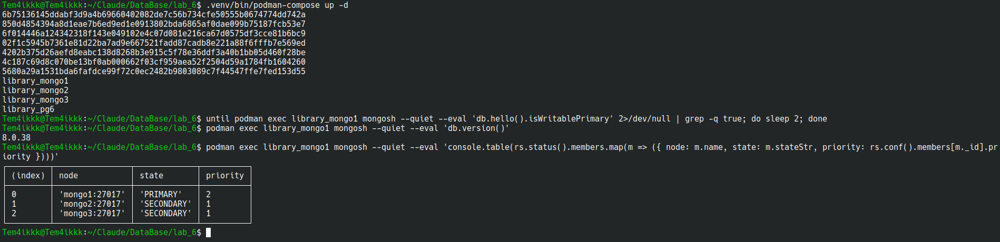

### Крок 2. Підключення до MongoDB (mongosh і Compass)

MongoDB Compass встановлено з Flathub (`flatpak install flathub com.mongodb.Compass`). Підключення: `mongodb://localhost:27017/?directConnection=true`.

Знімок Compass зроблено після виконання всіх кроків, тому в базі вже видно колекції та представлення з наступних кроків.

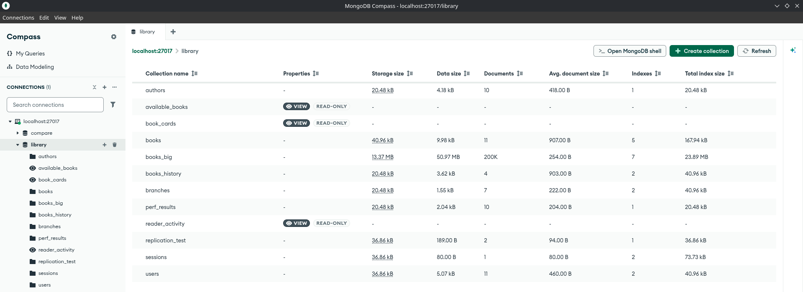

### Як виконуються скрипти

Кожен крок лабораторної — окремий скрипт mongosh у папці `scripts/`. Щоб на скріншотах було видно і команду, і її результат, як у консолі mongosh, написано невеликий скрипт `run.sh`. Він ділить файл на блоки за порожніми рядками, друкує кожен блок після підказки `library>`, виконує його через `mongosh --eval` і виводить результат.

```bash
awk 'BEGIN { RS = ""; ORS = "\0" } { print }' "$FILE" |
while IFS= read -r -d '' block; do
    ...
    printf '\e[32m%s>\e[0m %s\n' "$DB" "$block"
    mongosh "$URI" --quiet --eval "$block" 2>&1
done
```

Підключення йде до всього набору реплік (`mongodb://mongo1,mongo2,mongo3/library?replicaSet=rs0`), тому скрипти працюють, навіть якщо первинним став інший вузол.

---

## Рівень 1

### Крок 3. Створення бази даних і колекцій

База `library` створюється автоматично під час першого запису. Колекцію `books` створено явно з базовою валідацією: обов'язкові поля і їх типи. На рівні 3 валідацію буде розширено.

```javascript
db.createCollection("books", {
  validator: {
    $jsonSchema: {
      bsonType: "object",
      required: ["title", "author", "publication_year"],
      properties: {
        title: { bsonType: "string" },
        author: { bsonType: "string" },
        publication_year: { bsonType: "int", minimum: 1000 },
        pages: { bsonType: "int", minimum: 1 },
        genres: { bsonType: "array", items: { bsonType: "string" } },
        available: { bsonType: "bool" }
      }
    }
  }
})

db.createCollection("authors")

db.createCollection("users")
```

**Результат:** створено три колекції.

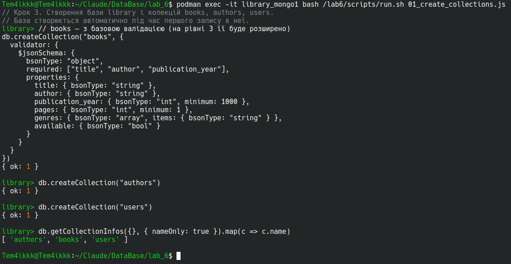

### Крок 4. Заповнення колекцій (по 10 документів)

У кожну колекцію додано 10 документів (`scripts/02_insert_data.js`). Документи навмисно мають різну структуру:

| Колекція | Вкладені документи | Масиви |
|---|---|---|
| `authors` | `birth_place` (у когось `village`, у когось `city`) | `awards` (порожній або з преміями), `genres` |
| `books` | `publisher`, `location` (зал і полиця) | `genres` (рядки), `ratings` (документи `{ user, score, date }`) |
| `users` | `profile` (ім'я, телефон), `address` | `roles`, `borrowed_books` (документи `{ title, isbn, borrowed_at }`) |

Фрагмент документа книги:

```javascript
{ title: "Тигролови", author: "Іван Багряний", publication_year: 1944, pages: 416,
  isbn: "978-966-03-3527-6", genres: ["роман", "пригоди"], available: true,
  description: "Пригодницький роман про втечу Григорія Многогрішного з ешелону на Далекому Сході",
  publisher: { name: "Фоліо", city: "Харків" }, location: { hall: "C", shelf: 1 },
  ratings: [ { user: "ivan_petrov", score: 5, date: new Date("2026-10-01") },
             { user: "bohdan_marchenko", score: 5, date: new Date("2026-10-18") },
             { user: "maria_kovalenko", score: 4, date: new Date("2026-11-02") } ] }
```

**Результат:** у кожній колекції по 10 документів. Нижче — документ автора з вкладеним документом і масивом премій.

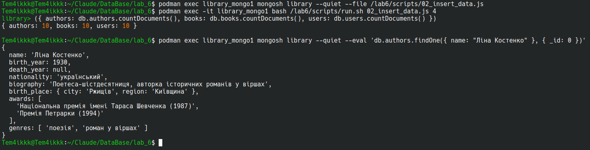

Документи книг у MongoDB Compass. Знімок зроблено після всіх кроків, тому в документах уже є поля `author_id` (крок 12), `version` (крок 16) і `search_terms` (крок 17):

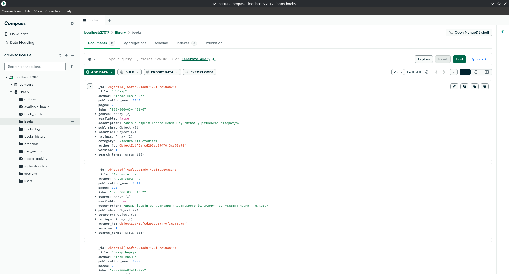

### Крок 5. Базові CRUD-операції

#### Вставка одного та багатьох документів

```javascript
// insertOne — нова книга з вкладеними документами та масивом
db.books.insertOne({
  title: "Intermezzo", author: "Михайло Коцюбинський", publication_year: 1909, pages: 72,
  isbn: "978-966-03-6843-4", genres: ["новела", "імпресіонізм"], available: true,
  description: "Імпресіоністична новела про втомленого митця, що відпочиває серед природи",
  publisher: { name: "Фоліо", city: "Харків" }, location: { hall: "B", shelf: 1 }, ratings: []
})

// insertMany — два нові читачі різної структури (у другого немає адреси)
db.users.insertMany([
  { username: "sofia_tkachenko", ... , address: { city: "Луцьк", street: "вул. Глушець, 5" } },
  { username: "maksym_polishchuk", ... , profile: { first_name: "Максим", last_name: "Поліщук", telegram: "@maks_reads" },
    interests: ["фантастика", "історія"] }
])
```

**Результат:** `insertOne` повертає `insertedId`, `insertMany` — масив `insertedIds`. Книг стало 11, читачів 12.

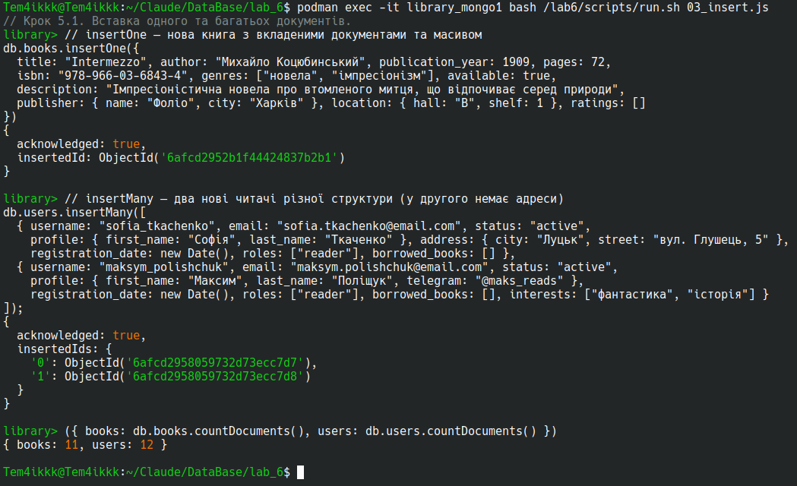

#### Пошук документів з різними умовами

| Умова | Запит |
|---|---|
| рівність | `{ author: "Іван Франко" }` |
| порівняння | `{ pages: { $gt: 200 } }` + `sort({ pages: -1 })` |
| діапазон | `{ publication_year: { $gte: 1900, $lt: 2000 } }` |
| елемент масиву | `{ genres: "поезія" }` |
| поле вкладеного документа | `{ "publisher.city": "Харків", "location.hall": "B" }` |
| неявне І + `$ne` для масиву | `{ available: true, genres: { $ne: "роман" } }` |
| розмір масиву документів | `{ "borrowed_books.1": { $exists: true } }` — на руках понад одна книга |
| сортування й обмеження | `find().sort({ publication_year: -1 }).limit(2)` |
| один документ | `findOne({ isbn: "978-966-03-3527-6" })` |

Усі запити використовують **проєкцію** (`{ _id: 0, title: 1, ... }`), щоб повертати лише потрібні поля.

**Результат:**

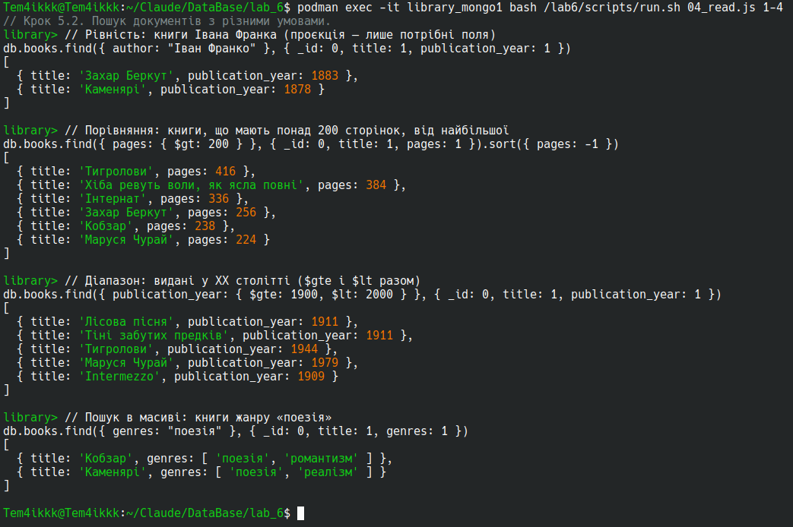

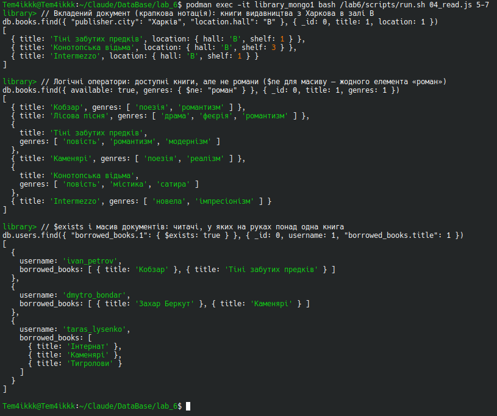

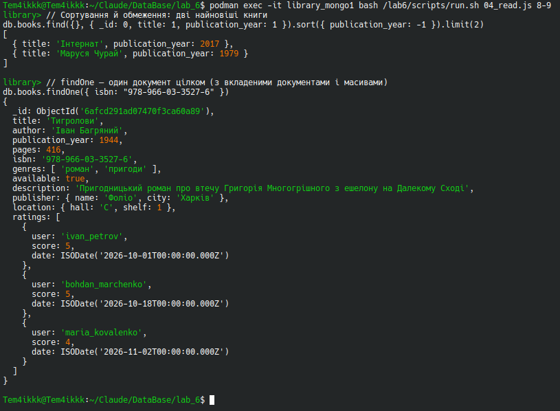

#### Оновлення полів документів

```javascript
// $set — книгу «Кобзар» видано читачеві, вона недоступна
db.books.updateOne({ title: "Кобзар" }, { $set: { available: false, "location.shelf": 4 } })

// $push — новий відгук у масив документів
db.books.updateOne({ title: "Лісова пісня" },
  { $push: { ratings: { user: "ivan_petrov", score: 5, date: new Date() } } })

// updateMany — категорія для всіх книг, виданих до 1900 року
db.books.updateMany({ publication_year: { $lt: 1900 } }, { $set: { category: "класика XIX століття" } })

// $inc — лічильник видач (поле створюється, якщо його немає)
db.books.updateOne({ title: "Тіні забутих предків" }, { $inc: { borrowed_count: 1 } })

// $addToSet — жанр додається лише якщо його ще немає
db.books.updateOne({ title: "Тигролови" }, { $addToSet: { genres: "трилер" } })

// $unset і $rename — видалення та перейменування полів
db.users.updateOne({ username: "maksym_polishchuk" },
  { $unset: { interests: "" }, $rename: { "profile.telegram": "profile.messenger" } })
```

**Результат:** кожна операція повертає `matchedCount` і `modifiedCount`; `updateMany` змінив 5 книг XIX століття. Зміни видно в останньому запиті: `$slice: -1` повертає лише останній відгук.

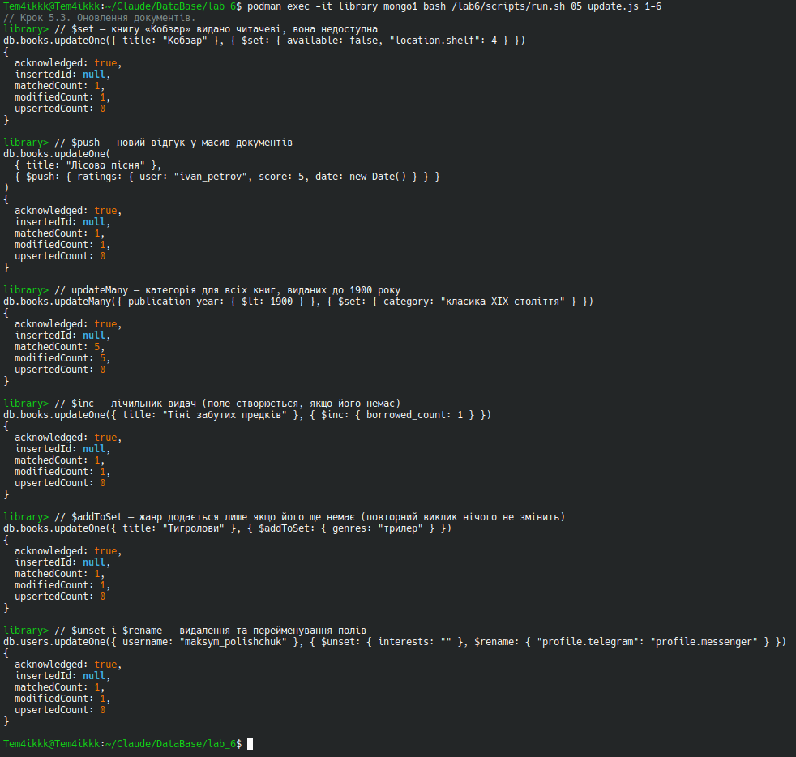

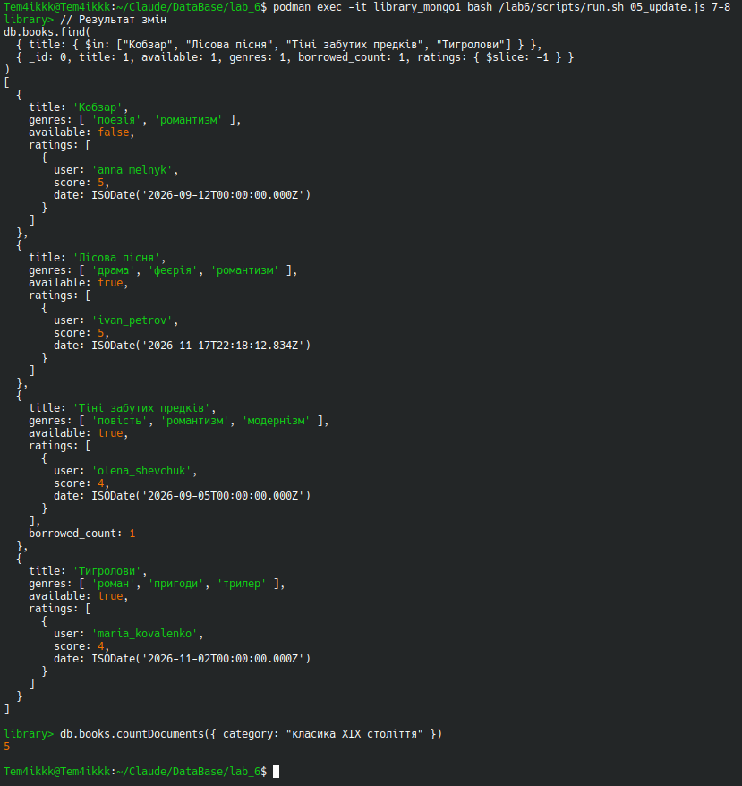

#### Видалення документів за умовами

Щоб не втратити основні дані, спочатку додано три тимчасові книги, і видаляються саме вони.

```javascript
db.books.deleteOne({ title: "Застарілий довідник" })                         // один за назвою
db.books.deleteMany({ temp: true, available: false })                        // усі тимчасові недоступні
db.users.deleteOne({ status: "blocked", borrowed_books: { $size: 0 } })      // не підходить жоден
db.users.findOneAndDelete({ username: "maksym_polishchuk" },
                          { projection: { _id: 0, username: 1, profile: 1 } }) // повертає видалений документ
```

**Результат:** `deleteOne` видалив 1 документ, `deleteMany` — 2. Третій запит нічого не видалив: у єдиного заблокованого читача є книга на руках. `findOneAndDelete` повернув видалений документ. Тимчасових книг не залишилось.

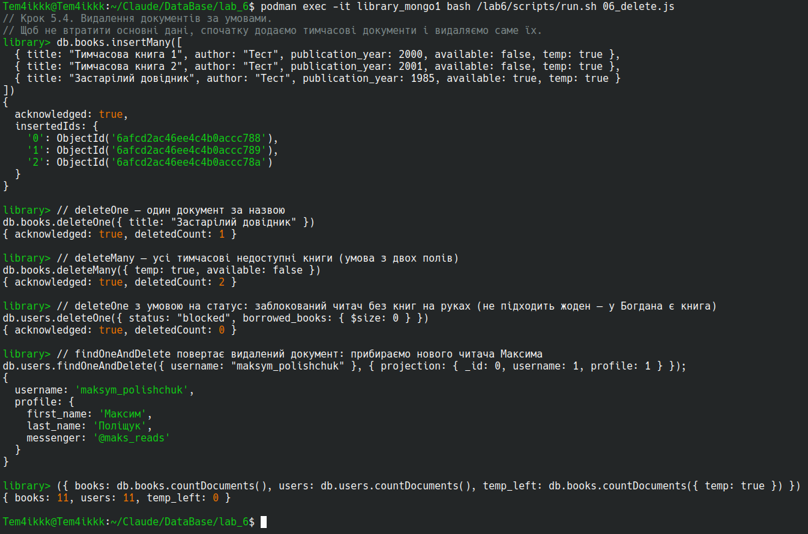

### Крок 6. Три різні індекси

| Індекс | Тип | Для чого |
|---|---|---|
| `{ title: 1 }` | простий | пошук і сортування за назвою |
| `{ author: 1, publication_year: -1 }` | складений | книги автора від найновішої без окремого сортування |
| `{ isbn: 1 }, { unique: true }` | унікальний | швидкий пошук за ISBN і заборона дублікатів |

**Результат:** індекси створено. Унікальний індекс не дає вставити книгу з наявним ISBN (`E11000 duplicate key error`).

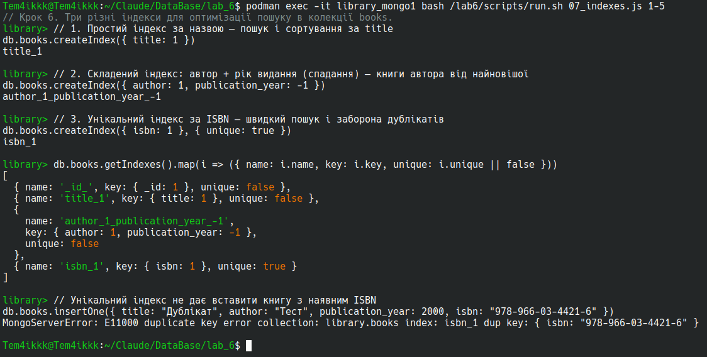

`explain("executionStats")` показує план з індексом: стадія `IXSCAN` за `author_1_publication_year_-1`, переглянуто лише 2 ключі та 2 документи.

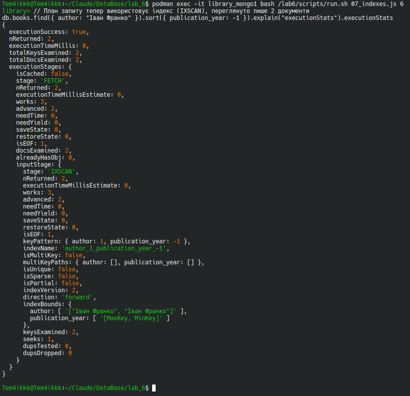

### Крок 7. Порівняння швидкості запитів з індексами і без них

На 11 документах різниці не видно: колекція вміщується в одну сторінку пам'яті. Тому скрипт `08_index_benchmark.js` генерує колекцію `books_big` на **200 000 книг**, близько 50 МБ. Генератор псевдовипадкових чисел детермінований, тож результати можна повторити.

Для вимірювань написано функцію `bench()` (`scripts/lib/bench.js`):

* виконує запит один раз «на прогрів», потім 9 разів;
* бере **медіану** часу;
* з `explain("executionStats")` додає план і кількість переглянутих ключів і документів.

Функція `record()` зберігає результат у колекцію `perf_results`, а `compare()` будує таблицю «до/після».

```javascript
function bench(coll, filter, opts = {}) {
  const runs = opts.runs || 9;
  const make = () => { let c = db[coll].find(filter, opts.projection || {});
                       if (opts.sort) c = c.sort(opts.sort); if (opts.limit) c = c.limit(opts.limit);
                       if (opts.hint) c = c.hint(opts.hint); return c; };
  make().toArray();                                   // «прогрів» кешу
  const times = [];
  for (let i = 0; i < runs; i++) { const t = performance.now(); make().toArray(); times.push(performance.now() - t); }
  times.sort((a, b) => a - b);
  const ex = make().explain("executionStats");
  ...
  return { plan, returned, keysExamined, docsExamined, median_ms: times[Math.floor(runs / 2)] };
}
```

**Результат:** без індексів кожен запит повністю сканує колекцію (`COLLSCAN`, 200 000 документів).

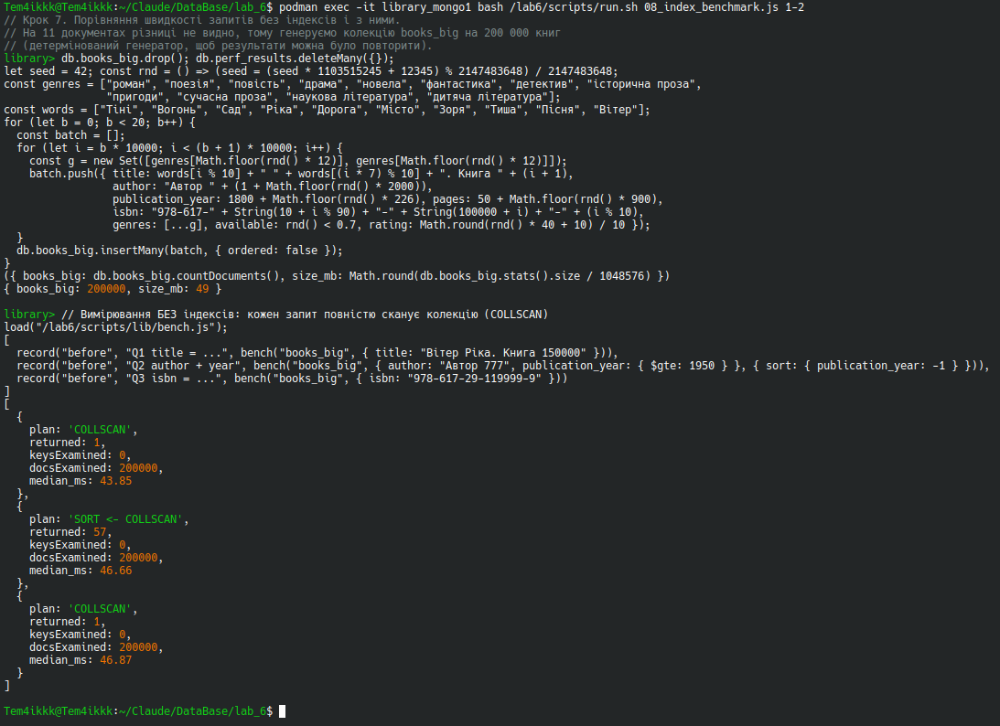

Після створення тих самих трьох індексів план змінюється на `IXSCAN`, а переглядаються лише потрібні документи:

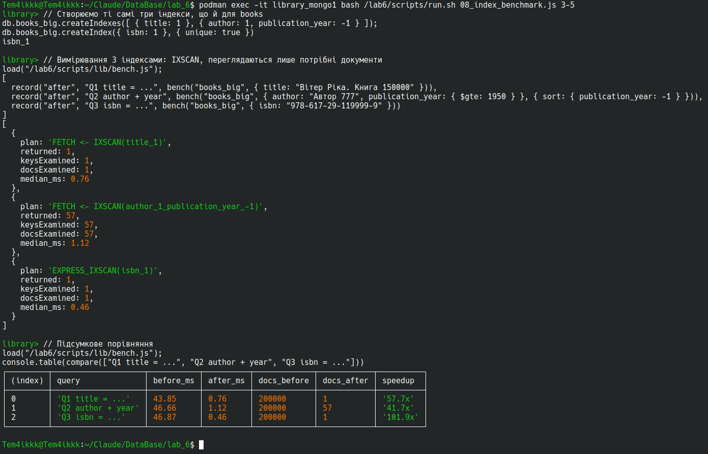

| Запит | Без індексу, мс | З індексом, мс | Документів переглянуто (до → після) | Прискорення |
|---|---|---|---|---|
| Q1: точна назва (`title`) | 43,85 | 0,76 | 200 000 → 1 | 57,7× |
| Q2: книги автора з 1950 р., сортування за роком | 46,66 | 1,12 | 200 000 → 57 | 41,7× |
| Q3: пошук за ISBN (унікальний) | 46,87 | 0,46 | 200 000 → 1 | 101,9× |

Найбільше прискорення дає унікальний індекс за ISBN. MongoDB 8.0 виконує такий запит спеціальною швидкою стадією `EXPRESS_IXSCAN`, оминаючи звичайне планування.

---

## Рівень 2

### Крок 8. Складні запити з `$and`, `$or`, `$in`, `$regex`

```javascript
// $and — дві умови на те саме поле не можна записати одним об'єктом
db.books.find({ $and: [ { genres: "романтизм" }, { genres: { $nin: ["поезія"] } } ] })

// $or — короткі (до 100 сторінок) АБО видані після 1940 року
db.books.find({ $or: [ { pages: { $lte: 100 } }, { publication_year: { $gt: 1940 } } ] })

// $in / $nin
db.books.find({ author: { $in: ["Леся Українка", "Ліна Костенко", "Сергій Жадан"] } })
db.users.find({ "address.city": { $nin: ["Луцьк"] } })

// $regex — назва на «Т» без урахування регістру й опис зі словом «кохан…»
db.books.find({ title: { $regex: "^т", $options: "i" }, description: { $regex: /кохан/ } })

// Комбінація $and + $or + $in + $elemMatch
db.books.find({ $and: [
  { available: true },
  { genres: { $in: ["роман", "повість"] } },
  { $or: [ { ratings: { $elemMatch: { user: "ivan_petrov", score: 5 } } },
           { ratings: { $elemMatch: { user: "anna_melnyk", score: 5 } } } ] }
] })

// $all, $size, $not
db.books.find({ genres: { $all: ["повість", "романтизм"] } })
db.books.find({ genres: { $not: { $size: 3 } }, pages: { $not: { $lt: 200 } } })
```

`$elemMatch` потрібен, щоб обидві умови (`user` і `score`) виконувались для **одного й того самого** елемента масиву. Без нього `{ "ratings.user": "ivan_petrov", "ratings.score": 5 }` знайде книгу, де оцінку 5 поставив хтось інший.

**Результат:**

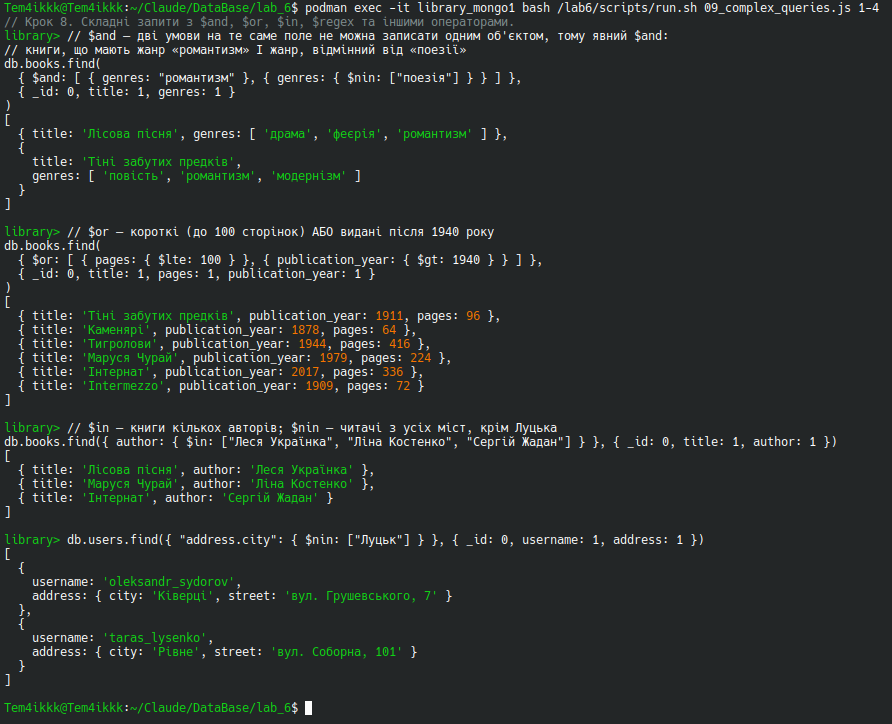

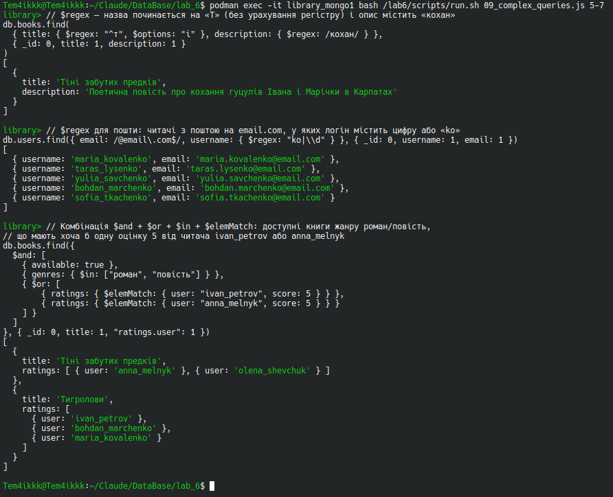

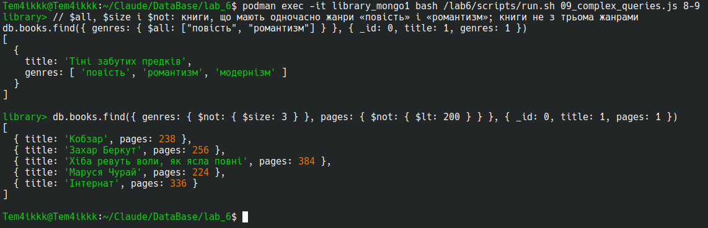

### Крок 9. Агрегаційні запити (pipeline)

| Звіт | Стадії pipeline |
|---|---|
| Кількість книг за жанрами | `$unwind` → `$group` (`$sum`) → `$sort` → `$limit` |
| Середній обсяг книг за автором | `$group` (`$avg`) → `$project` (`$round`) → `$sort` |
| Середня оцінка читачів для книги | `$match` → `$project` (`$avg` по масиву `ratings.score`) → `$sort` |
| Книги за століттями з переліком авторів | `$group` (`$ceil`, `$addToSet`) → `$project` → `$sort` |
| Топ читачів і статистика за статусом | `$project` (`$size`) → `$facet` (два звіти за один прохід) |
| Жанри великої колекції: рейтинг і частка доступних | `$unwind` → `$group` (`$avg`, `$cond`) → `$sort` |
| Розподіл книг за обсягом | `$bucket` |

```javascript
db.books.aggregate([
  { $unwind: "$genres" },
  { $group: { _id: "$genres", books: { $sum: 1 } } },
  { $sort: { books: -1, _id: 1 } },
  { $limit: 8 }
])

db.users.aggregate([
  { $project: { username: 1, status: 1, on_hand: { $size: "$borrowed_books" } } },
  { $facet: {
      top_readers: [ { $sort: { on_hand: -1, username: 1 } }, { $limit: 3 } ],
      by_status:   [ { $group: { _id: "$status", users: { $sum: 1 }, books: { $sum: "$on_hand" } } } ]
  } }
])
```

**Результат:**

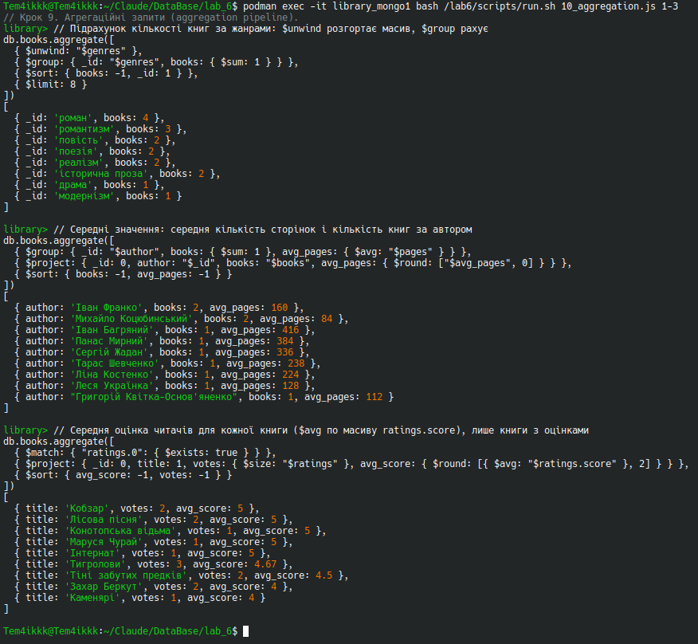

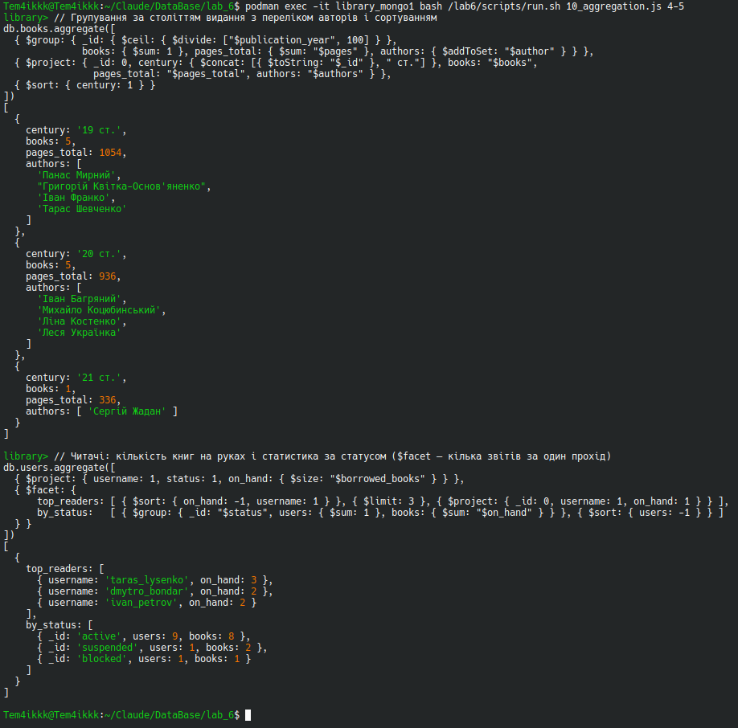

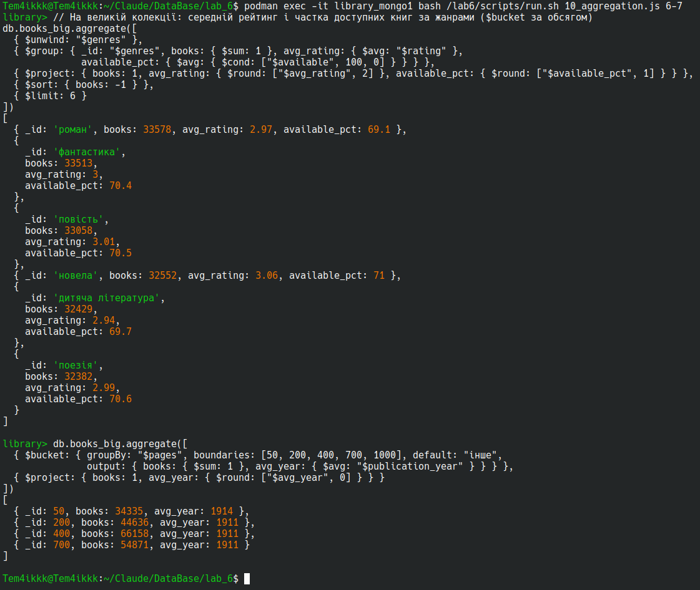

### Крок 10. Складені індекси

Запит каталогу: доступні книги жанру «фантастика» з рейтингом від 4.5, найновіші першими, перші 20. Складений індекс побудовано за правилом **ESR**:

* спочатку поля рівності (**E**quality): `genres`, `available`;
* потім поле сортування (**S**ort): `publication_year`;
* наприкінці поле діапазону (**R**ange): `rating`.

```javascript
// Варіант 1: лише простий індекс за жанром
db.books_big.createIndex({ genres: 1 })

// Варіант 2: складений індекс у порядку ESR
db.books_big.createIndex({ genres: 1, available: 1, publication_year: -1, rating: 1 }, { name: "genre_avail_year_rating" })

// Другий складений індекс — покривний: запит читає лише індекс
db.books_big.createIndex({ author: 1, publication_year: 1, pages: 1 }, { name: "author_year_pages" })
```

**Результат:**

| Запит | Індекс | План | Ключів / документів | Час, мс |
|---|---|---|---|---|
| C1: жанр + доступність + рейтинг, сортування за роком | простий `{ genres: 1 }` | `SORT ← FETCH ← IXSCAN` | 33 513 / 33 513 | 30,59 |
| C1 | складений ESR `genre_avail_year_rating` | `LIMIT ← FETCH ← IXSCAN` | 23 / 20 | 1,60 (у 19 разів швидше) |
| C2: звіт автора (рік, сторінки) | `author_1_publication_year_-1` | `FETCH ← IXSCAN` | 39 / 39 | 1,06 |
| C2 | покривний `author_year_pages` | `PROJECTION_COVERED ← IXSCAN` | 39 / **0** | 0,61 (у 1,7 раза швидше) |

З простим індексом MongoDB читає всі книги жанру і сортує їх у пам'яті (стадія `SORT`). Складений індекс уже впорядкований за роком, тому зупиняється після 20 потрібних записів.

Покривний індекс містить усі поля запиту, тому документи взагалі не читаються (`PROJECTION_COVERED`, `docsExamined: 0`).

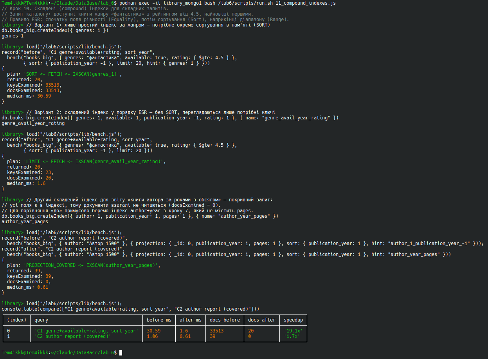

### Крок 11. Текстовий пошук з індексом `text`

Серед мов стемінгу MongoDB **немає української**, тому індекс створено з `default_language: "none"`: текст лише розбивається на слова. Ваги задають важливість полів: збіг у назві важить у 5 разів більше, ніж в описі.

```javascript
db.books.createIndex(
  { title: "text", description: "text" },
  { name: "books_text", default_language: "none", weights: { title: 5, description: 1 } }
)

db.books.find({ $text: { $search: "кохання Карпатах" } }, { score: { $meta: "textScore" } })
        .sort({ score: { $meta: "textScore" } })                       // за релевантністю
db.books.find({ $text: { $search: "\"українського фольклору\"" } })   // точна фраза
db.books.find({ $text: { $search: "роман -віршах" } })                 // виключення слова
```

**Результат:** пошук знаходить книги за словами, фразою та з виключенням, результати впорядковано за `textScore`. Видно і обмеження: без стемінгу «Карпати» не знаходить «Карпатах» (0 документів). Це виправлено на рівні 3, у кроці 17.

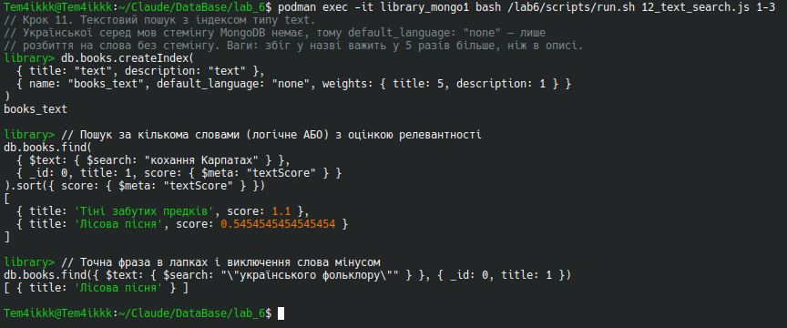

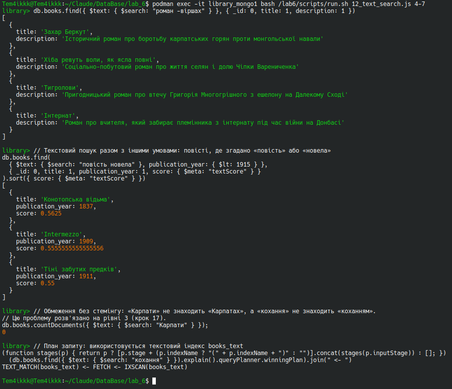

### Крок 12. Об'єднання колекцій з `$lookup`

У книгах автор записаний рядком. Для зв'язку «посиланням» кожній книзі додано `author_id` з колекції `authors`. Далі `$lookup` використано в чотирьох варіантах:

| Варіант | Аналог у SQL |
|---|---|
| `books → authors` (`localField` / `foreignField`) | `INNER JOIN` (з `$unwind`) |
| `authors → books` з `$size` | `LEFT JOIN ... GROUP BY` |
| `users → books → authors`: `$lookup` з `let` і вкладеним `pipeline` | JOIN за масивом значень + ще один JOIN |
| порожній результат `$lookup` (`{ b: { $size: 0 } }`) | анти-JOIN: `LEFT JOIN ... WHERE b.id IS NULL` |

```javascript
db.users.aggregate([
  { $match: { "borrowed_books.0": { $exists: true }, status: "active" } },
  { $lookup: {
      from: "books",
      let: { isbns: "$borrowed_books.isbn" },
      pipeline: [
        { $match: { $expr: { $in: ["$isbn", "$$isbns"] } } },
        { $lookup: { from: "authors", localField: "author_id", foreignField: "_id", as: "a" } },
        { $project: { _id: 0, book: { $concat: ["$title", " (", { $first: "$a.name" }, ")"] } } }
      ],
      as: "reading"
  } },
  { $project: { _id: 0, reader: { $concat: ["$profile.first_name", " ", "$profile.last_name"] }, reading: "$reading.book" } }
])
```

**Результат:**

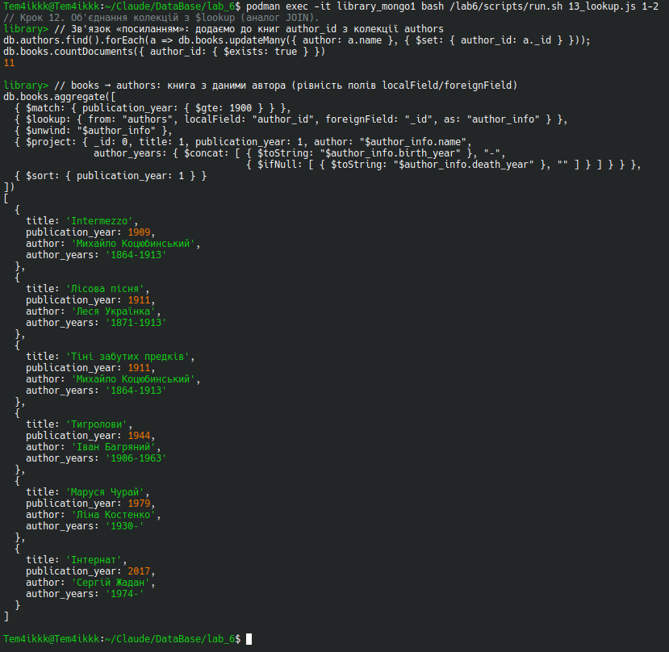

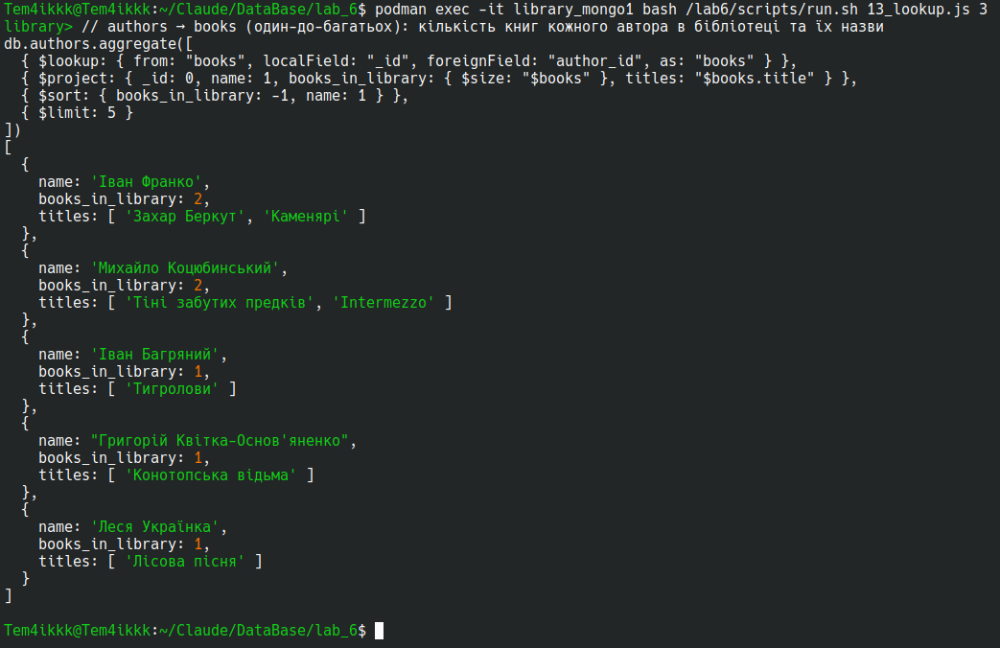

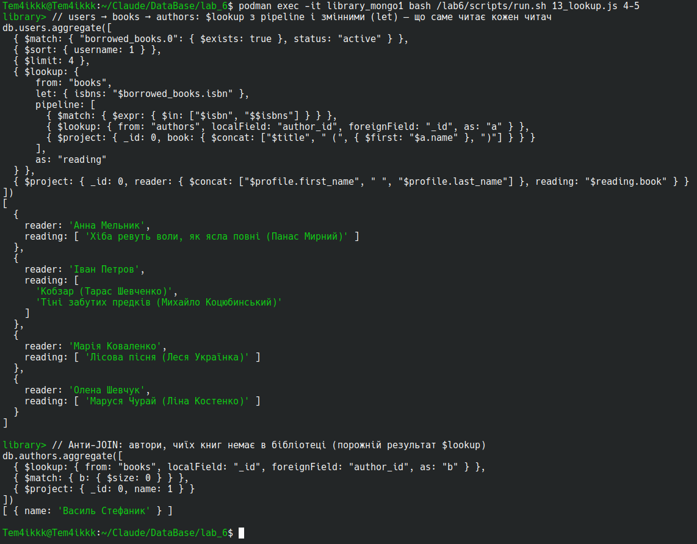

### Крок 13. Представлення (views)

Представлення зберігає лише pipeline, а дані обчислюються під час кожного звернення. Створено три представлення:

| Представлення | Призначення |
|---|---|
| `available_books` | каталог доступних книг для читачів |
| `book_cards` | картка книги з автором (через `$lookup`) і середньою оцінкою |
| `reader_activity` | читачі та кількість книг на руках |

```javascript
db.createView("book_cards", "books", [
  { $lookup: { from: "authors", localField: "author_id", foreignField: "_id", as: "a" } },
  { $project: { _id: 0, isbn: 1, title: 1, author: { $first: "$a.name" }, available: 1,
                genres: 1, avg_score: { $round: [{ $avg: "$ratings.score" }, 1] }, votes: { $size: "$ratings" } } }
])
```

**Результат:** до представлень звертаються як до колекцій (`find`, `sort`, `limit`). Запис у представлення заборонено: `Namespace library.available_books is a view, not a collection`.

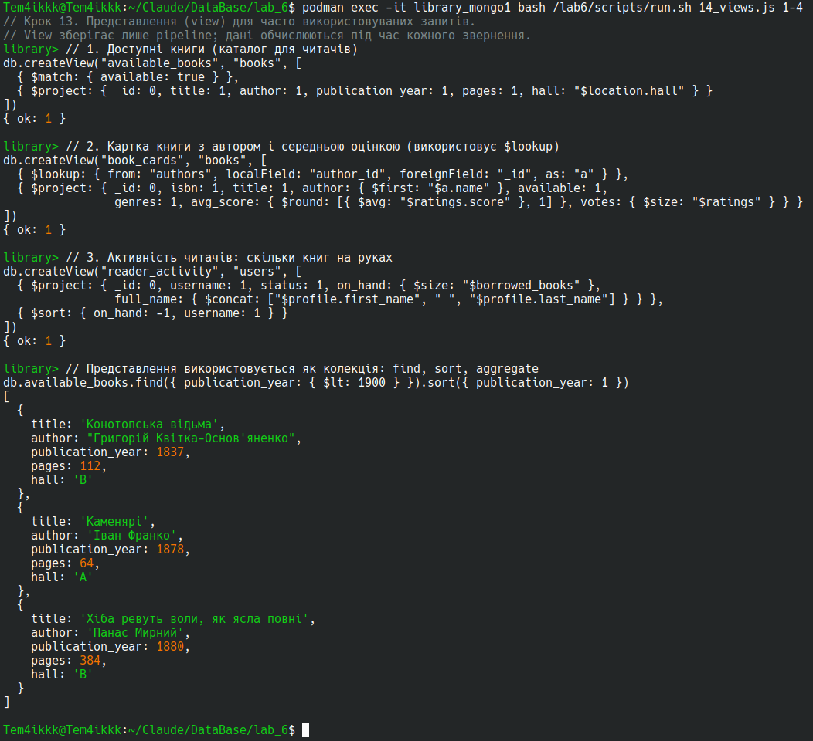

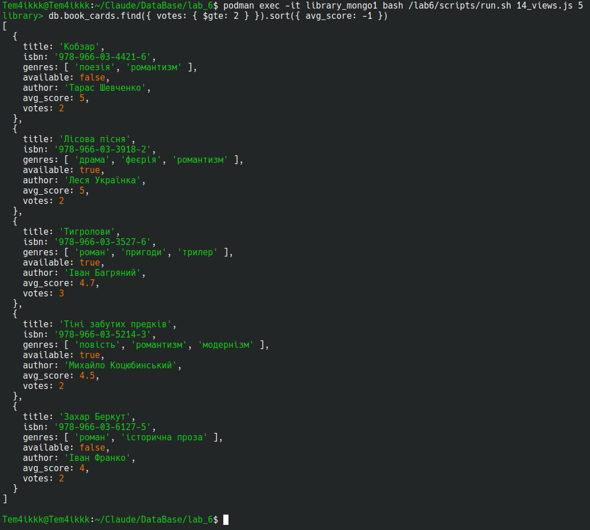

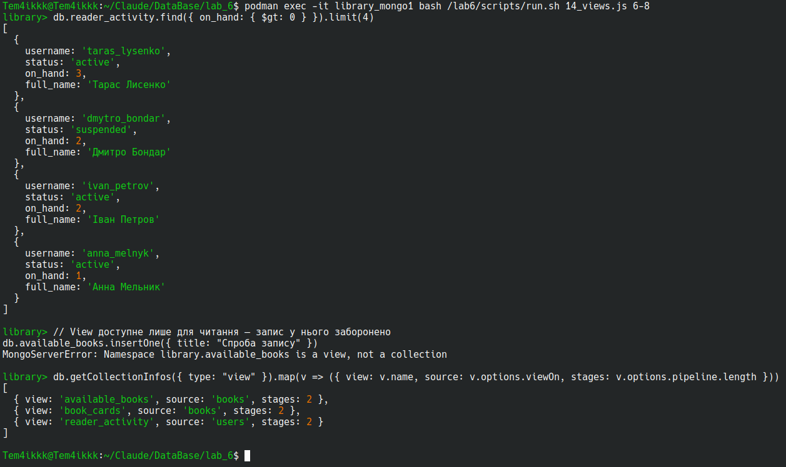

---

## Рівень 3

### Крок 14. Валідація схеми з JSON Schema

Валідатор `books` розширено через `collMod`, а для `users` додано новий. `validationLevel: "strict"` перевіряє всі вставки й оновлення, `validationAction: "error"` відхиляє некоректні документи.

| Поле | Правило |
|---|---|
| `isbn` | обов'язкове, шаблон `^978-\d{1,5}-\d{1,7}-\d{1,7}-\d$` |
| `publication_year` | `int`, від 1000 до 2026 |
| `genres` | масив рядків, хоча б один, без повторів (`uniqueItems`) |
| `publisher` | вкладений документ з обов'язковим `name` |
| `ratings[].score` | `int` від 1 до 5 — перевіряються елементи масиву документів |
| `users.username` | `^[a-z][a-z0-9_]{2,31}$` |
| `users.email` | шаблон email |
| `users.status` | `enum: ["active", "suspended", "blocked"]` |
| `users.profile.phone` | `^\+380\d{9}$` |
| `users.borrowed_books` | не більше 5 книг на руках (`maxItems`) |

```javascript
db.runCommand({
  collMod: "books",
  validationLevel: "strict",
  validationAction: "error",
  validator: { $jsonSchema: {
    bsonType: "object",
    required: ["title", "author", "publication_year", "available", "isbn"],
    properties: {
      publication_year: { bsonType: "int", minimum: 1000, maximum: 2026, description: "рік від 1000 до поточного" },
      isbn:    { bsonType: "string", pattern: "^978-\\d{1,5}-\\d{1,7}-\\d{1,7}-\\d$", description: "ISBN-13 у форматі 978-…" },
      ratings: { bsonType: "array", items: { bsonType: "object", required: ["user", "score"],
                 properties: { score: { bsonType: "int", minimum: 1, maximum: 5 } } } },
      ...
    }
  } }
})
```

Валідатор не перевіряє вже збережені документи. Тому спочатку перевірено, що всі вони відповідають новій схемі: запит `{ $nor: [validator] }` знаходить 0 порушників.

**Результат:**

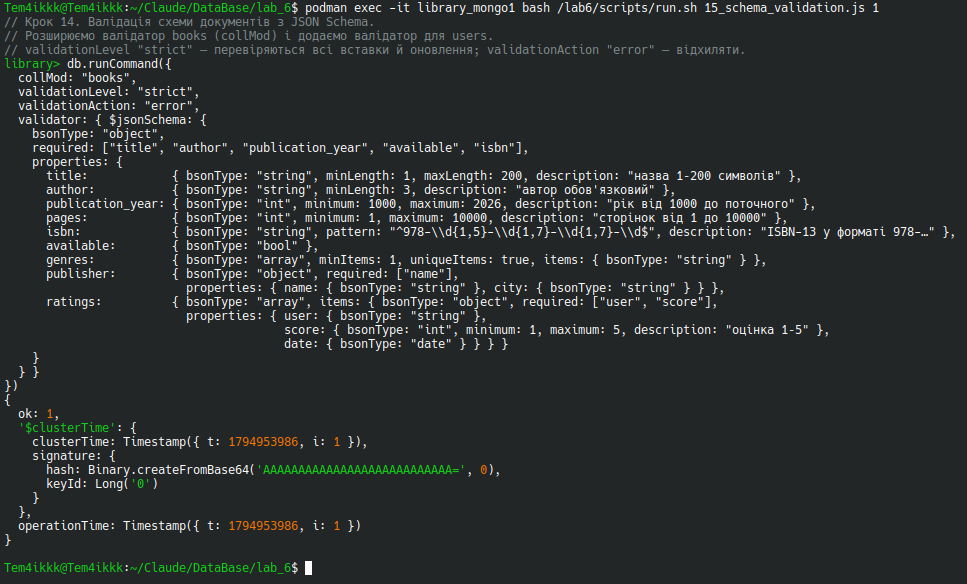

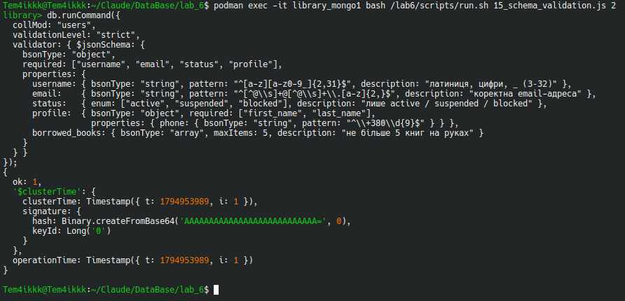

Некоректні документи відхиляються з кодом 121. Допоміжна функція з `errInfo.details` показує, яке саме правило порушено. Перевіряються також оновлення: оцінка 7 і рік 2100 відхилені. Коректна книга вставляється.

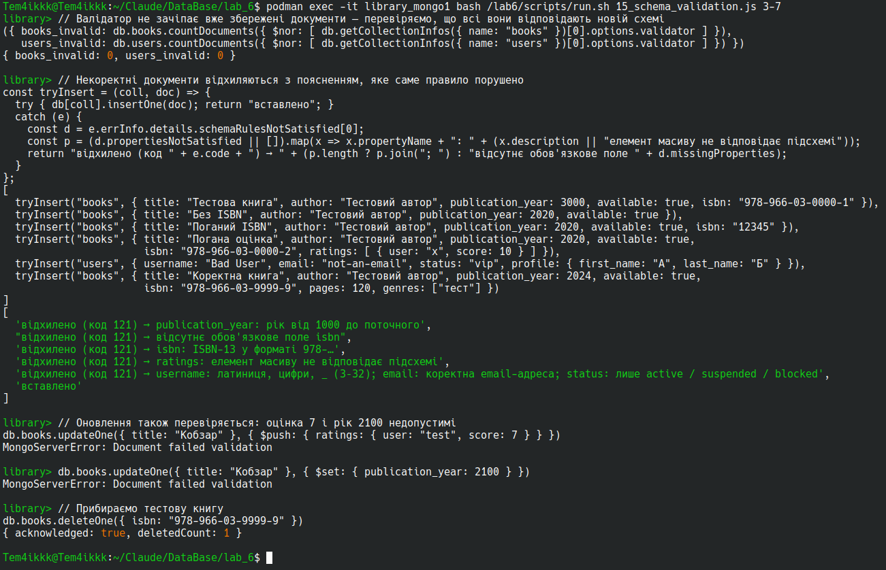

### Крок 15. Геопросторові та TTL-індекси

Колекція `branches` містить 7 філій бібліотеки в Луцьку та області з координатами у форматі GeoJSON `{ type: "Point", coordinates: [довгота, широта] }`. Координати умовні. Двом читачам додано координати адреси. Обидві колекції мають індекс `2dsphere`.

| Запит | Оператор |
|---|---|
| Філії в радіусі 2 км від читача, від найближчої | `$near` + `$maxDistance` |
| Відстань у км до кожної філії | `$geoNear` (агрегація) з `distanceField` |
| Філії в межах 3 км від центру міста | `$geoWithin` + `$centerSphere` (радіус у радіанах = км / 6378,1) |
| Філії в межах полігону міста | `$geoWithin` + `$geometry: Polygon` |

```javascript
db.branches.createIndex({ location: "2dsphere" })

db.branches.aggregate([
  { $geoNear: { near: db.users.findOne({ username: "oleksandr_sydorov" }).address.location,
                distanceField: "dist_m", spherical: true } },
  { $project: { _id: 0, name: 1, km: { $round: [{ $divide: ["$dist_m", 1000] }, 2] } } },
  { $limit: 4 }
])
```

**Результат:** для читача з Ківерців найближча — бібліотека м. Ківерці (0,61 км), далі філії Луцька на відстані 12–15 км. План запиту використовує геоіндекс (`GEO_NEAR_2DSPHERE`).

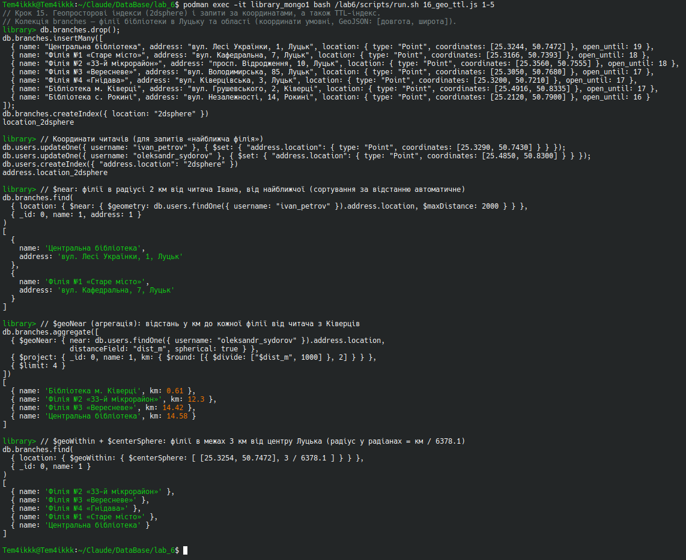

**TTL-індекс** автоматично видаляє документи, коли минає задана кількість секунд після дати в полі. Тут сесії входу видаляються через 30 с після `created_at`.

```javascript
db.sessions.createIndex({ created_at: 1 }, { expireAfterSeconds: 30 })
```

Фоновий процес TTL запускається раз на 60 с, тому скрипт чекає 95 с. Дві сесії видалено автоматично. Сесія з датою в майбутньому лишилась.

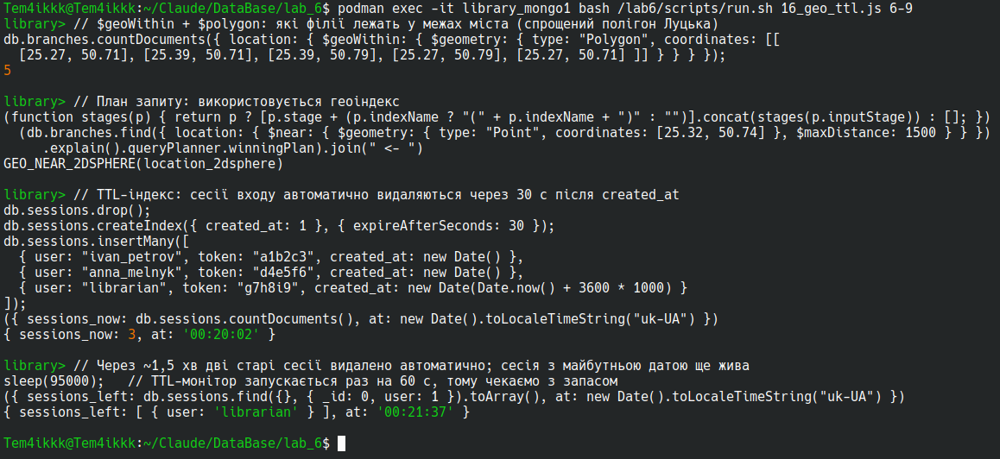

### Крок 16. Система версіонування документів

Функції версіонування — у `scripts/lib/versioning.js`:

* кожна книга має поле `version`;
* попередні стани зберігаються в колекції `books_history` з унікальним індексом `{ isbn, version }`;
* кожна зміна виконується в **багатодокументній транзакції**, яку підтримує набір реплік.

Транзакція `versionedUpdate()`:

1. читає поточну книгу;
2. записує її знімок в історію разом з номером версії, автором, коментарем і проміжком дії `valid_from`–`valid_to`;
3. змінює книгу, збільшуючи `version`.

Умова `{ _id, version: поточна }` в `updateOne` працює як **оптимістичне блокування**: якщо книгу встиг змінити хтось інший, оновлення не спрацює, і вся транзакція відкотиться.

```javascript
function versionedUpdate(isbn, update, user, comment, expectedVersion) {
  const session = db.getMongo().startSession();
  const sdb = session.getDatabase("library");
  session.startTransaction({ readConcern: { level: "snapshot" }, writeConcern: { w: "majority" } });
  try {
    const cur = sdb.books.findOne({ isbn });
    const v = cur.version || 1;
    if (expectedVersion !== undefined && expectedVersion !== v)
      throw new Error("Конфлікт версій: очікувалась v" + expectedVersion + ", у базі вже v" + v);
    const snapshot = Object.fromEntries(Object.entries(cur).filter(([k]) => !VERSION_FIELDS.includes(k)));
    sdb.books_history.insertOne({ book_id: cur._id, isbn, version: v, snapshot,
                                  valid_from: cur.updated_at || cur._id.getTimestamp(), valid_to: new Date(),
                                  changed_by: user, comment });
    const set = Object.assign({}, update.$set, { updated_at: new Date(), updated_by: user });
    const res = sdb.books.updateOne({ _id: cur._id, version: cur.version },
                                    Object.assign({}, update, { $set: set, $inc: { version: 1 } }));
    if (res.matchedCount !== 1) throw new Error("Книгу змінив інший користувач, повторіть спробу");
    session.commitTransaction();
    return "v" + v + " → v" + (v + 1);
  } catch (e) {
    session.abortTransaction();                                    // відкат: ні історії, ні зміни
    throw e;
  } finally { session.endSession(); }
}
```

Інші функції:

* `bookHistory()` — список версій книги;
* `diffVersions()` — лише поля, що змінились між двома версіями;
* `restoreVersion()` — відновлення старої версії. Воно теж створює нову версію, тож історія ніколи не переписується.

**Результат:** книга «Тигролови» пройшла три зміни від двох користувачів. Історія містить усі версії, а різниця v1–v4 показує 4 змінені поля.

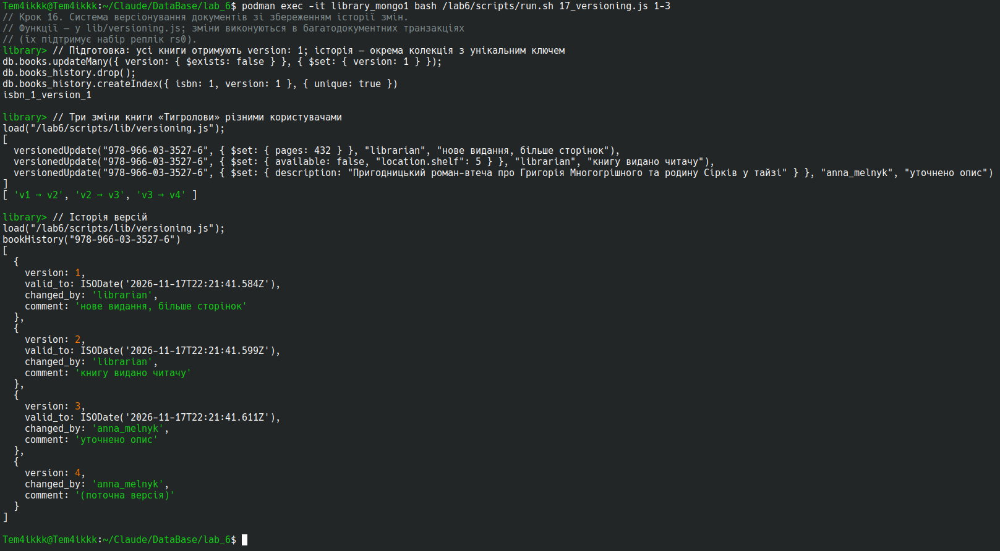

Після відновлення версії 1 з'явилась версія 5: її вміст збігається з v1, а різниця порожня. Зміна на основі застарілої версії 3 відхилена, і транзакція не залишила жодного запису в історії.

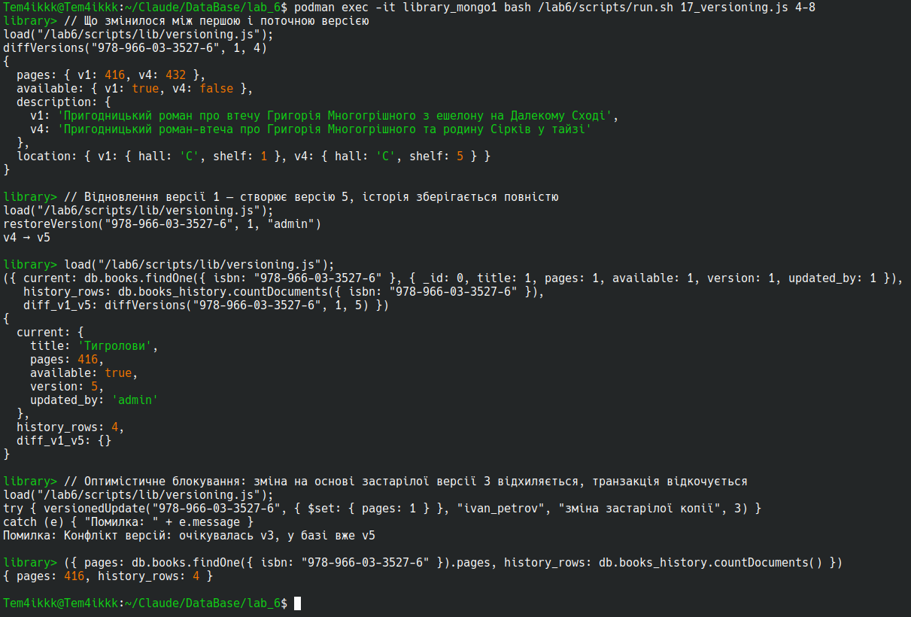

### Крок 17. Повнотекстовий пошук з підтримкою української мови

Вбудований текстовий індекс не має українського стемінгу: «Карпати», «Карпатах» і «карпатських» для нього різні слова. MongoDB Atlas Search має аналізатор `lucene.ukrainian`, але він доступний лише в хмарному Atlas або в окремому сервісі `mongot`.

Тому морфологію реалізовано на рівні застосунку (`scripts/lib/uk_search.js`):

1. **Нормалізація:** нижній регістр; апострофи `'`, `’`, `ʼ` зводяться до одного; розділові знаки замінюються пробілами.
2. **Стоп-слова** (`і`, `та`, `на`, `про`, `який`…) відкидаються.
3. **Легкий стемер:** відкидає найдовше відповідне закінчення (`-ами`, `-ові`, `-ого`, `-ою`, `-ах`, `-ів`, `-а`, `-и`, `-ь`…), якщо основа лишається не коротшою за 3 літери.
4. Основи з назви (двічі, для більшої ваги), автора, опису й жанрів записуються в масив `search_terms`. По ньому побудовано text-індекс з `default_language: "none"`.
5. Запит користувача проходить ту саму обробку, тому слово в будь-якому відмінку знаходить книгу.

```javascript
const UK_ENDINGS = ["ями", "ами", "ові", "еві", "ого", "ому", "ими", "іми", "ій", "их", "іх", "ою", "ею",
  "ам", "ям", "ах", "ях", "ом", "ем", "ів", "їв", "ей", "ий", "ої", "ую", "юю", "у", "ю", "а", "я",
  "і", "и", "о", "е", "є", "ь", "ї"];

function ukStem(word) {
  word = word.replace(/'/g, "");
  if (word.length < 4) return word;
  for (const e of UK_ENDINGS)
    if (word.endsWith(e) && word.length - e.length >= 3) return word.slice(0, -e.length);
  return word;
}

function ukSearch(query, limit = 5) {
  const terms = ukTerms(query);
  return db.books.find({ $text: { $search: terms.join(" ") } }, { _id: 0, title: 1, score: { $meta: "textScore" } })
           .sort({ score: { $meta: "textScore" } }).limit(limit).toArray();
}
```

У колекції може бути лише один text-індекс, тому `books_text` з кроку 11 замінено на `books_uk_text`.

**Результат:** «Карпати» і «Карпатах» дають одну основу `карпат`, «кохання» і «коханням» — `коханн`. Пошук за «Карпати», «коханням», «відьми», «селянам», «війною», «Франка» знаходить потрібні книги, а звичайний text-індекс у кроці 11 для «Карпати» не знаходив нічого. Апостроф у будь-якому написанні і регістр на результат не впливають.

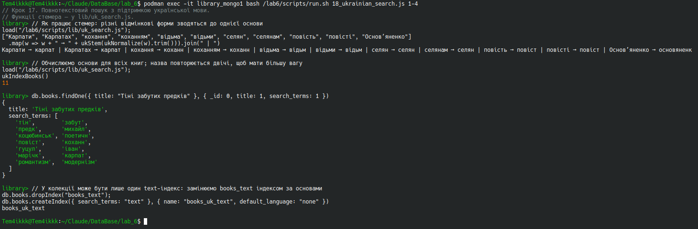

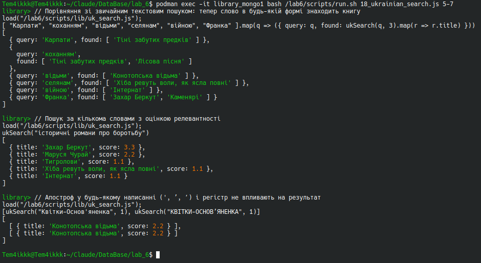

Обмеження: легкий стемер не обробляє чергування звуків («відьма» / «відьом») і суфікси прикметників («карпатських» → `карпатськ`). Для промислової системи краще використати Atlas Search з `lucene.ukrainian` або словниковий морфоаналізатор (наприклад, pymorphy3 з українським словником).

### Крок 18. Реплікація

Набір реплік `rs0` складається з трьох вузлів:

* **первинний (PRIMARY)** приймає всі записи й веде журнал операцій `oplog`;
* **вторинні (SECONDARY)** копіюють `oplog` і застосовують ті самі операції.

Скрипт `scripts/replication.sh` демонструє чотири речі:

1. стан набору — ролі вузлів і час останньої застосованої операції;
2. запис з `writeConcern: { w: "majority" }`: підтвердження приходить, лише коли запис є на більшості вузлів (2 з 3). Цей документ одразу читається з вторинного вузла `mongo3`, а пряма спроба запису в `mongo3` відхиляється з помилкою `not primary`;
3. **аварію:** контейнер первинного вузла `mongo1` зупиняється. Вузли, що лишились, за кілька секунд обирають новий PRIMARY. Застосунок, підключений до набору (`?replicaSet=rs0`), продовжує записувати без змін у коді, бо драйвер сам знаходить новий первинний вузол;
4. **повернення:** `mongo1` запускається знову, наздоганяє пропущені записи з `oplog` і, маючи пріоритет 2, знову стає первинним.

**Результат:** після зупинки `mongo1` первинним став `mongo2`, запис під час аварії успішний. Після повернення `mongo1` знову PRIMARY і має обидва документи, включно із записаним під час своєї відсутності.

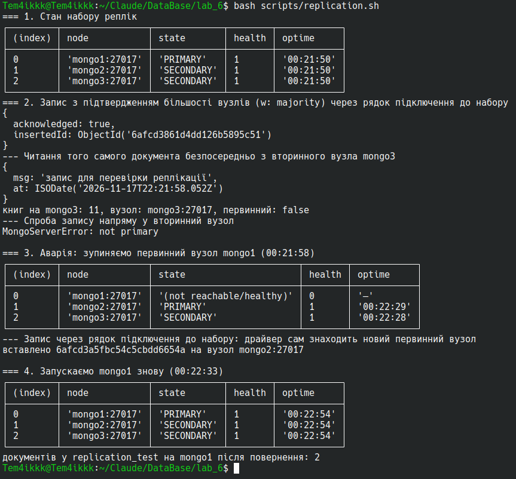

### Крок 19. Автоматизоване резервне копіювання з `mongodump`

Скрипт `scripts/backup.sh` виконує чотири дії:

1. **Повна копія** бази `library` — один стиснений архів (`--archive --gzip`). Дані читаються з вторинного вузла (`readPreference=secondaryPreferred`), щоб не навантажувати первинний.
2. **Копія однієї колекції** `books_history` і **експорт** `books` у JSON (`mongoexport --jsonArray --pretty`), щоб дані можна було переглянути або імпортувати в іншу систему.
3. **Ротація:** зберігаються лише 7 останніх повних копій.
4. **Перевірка копії:** архів відновлюється в окрему базу `library_restore` (`mongorestore --nsFrom 'library.*' --nsTo 'library_restore.*'`) і звіряється з оригіналом: кількість документів, індекси, представлення й валідатор. Після перевірки тестова база видаляється.

```bash
$X mongodump --uri "$URI" --db library --archive=/backups/library_$STAMP.archive.gz --gzip
$X mongorestore --uri "mongodb://mongo1,mongo2,mongo3/?replicaSet=rs0" --archive=/backups/library_$STAMP.archive.gz --gzip \
    --nsFrom 'library.*' --nsTo 'library_restore.*' --drop --quiet
```

Для запуску за розкладом скрипт додається до `crontab`:

```
30 2 * * *  cd /шлях/до/lab_6 && bash scripts/backup.sh >> backups/backup.log 2>&1
```

**Результат:** архів усієї бази (200 тис. книг) займає 6,6 МБ (у самій базі дані займають близько 50 МБ). Усі колекції відновлено з тією самою кількістю документів та індексів; представлення й валідатор теж відновлено.

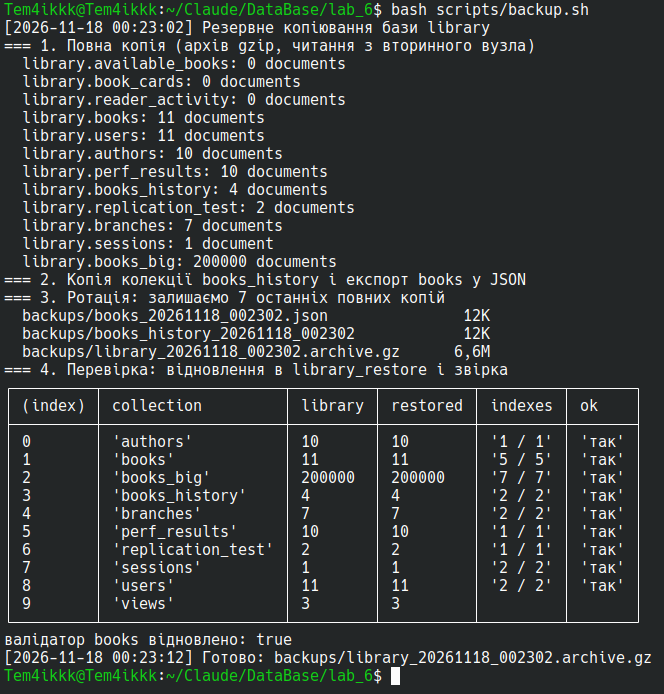

### Крок 20. Порівняльний аналіз реляційного та документного підходів

#### Методика

Скрипт `compare/compare.py` завантажує **однаковий** набір даних бібліотеки (2 000 авторів, 15 жанрів, 50 000 книг з 1–3 жанрами) у три моделі:

| Модель | Структура |
|---|---|
| **PostgreSQL** (3НФ) | `authors`, `genres`, `books` (FK на автора), `book_genres` (зв'язок M:N) |
| **MongoDB emb** (вкладення) | одна колекція: автор `{ id, name, birth_year }` і масив назв жанрів усередині книги |
| **MongoDB ref** (посилання) | `books_ref` з `author_id` і `genre_ids`, окремі `authors_ref` і `genres_ref` |

У всіх моделях є індекси за ISBN і за автором. Для кожної операції береться медіана з 15 запусків після прогріву. Скрипт перевіряє, що всі три моделі повертають однакові результати.

**Результат:**

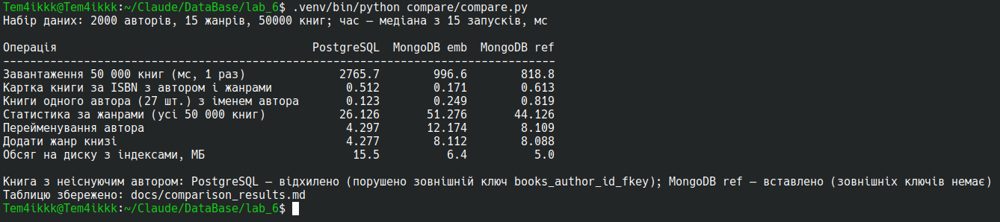

Набір даних: 2 000 авторів, 15 жанрів, 50 000 книг; час — медіана з 15 запусків, мс.

| Операція | PostgreSQL | MongoDB emb | MongoDB ref | Примітка |
|---|---|---|---|---|
| Завантаження 50 000 книг (мс, 1 раз) | 2765,7 | 996,6 | 818,8 | PG: 4 таблиці + ~100 тис. рядків `book_genres`; emb: 1 колекція |
| Картка книги за ISBN з автором і жанрами | 0,512 | **0,171** | 0,613 | PG: 3 JOIN; emb: 1 документ; ref: 2 × `$lookup` |
| Книги одного автора (27 шт.) з іменем автора | **0,123** | 0,249 | 0,819 | індекс за автором у всіх варіантах |
| Статистика за жанрами (усі 50 000 книг) | **26,126** | 51,276 | 44,126 | аналітика по всій колекції |
| Перейменування автора | **4,297** | 12,174 | 8,109 | PG і ref: 1 рядок/документ; emb: 27 копій імені в книгах |
| Додати жанр книзі | **4,277** | 8,112 | 8,088 | PG: рядок у `book_genres`; Mongo: `$addToSet` у масив |
| Обсяг на диску з індексами, МБ | 15,5 | 6,4 | **5,0** | Mongo стискає дані, але дублює імена авторів і жанрів |

Книга з неіснуючим автором: PostgreSQL — відхилено (порушено зовнішній ключ `books_author_id_fkey`); MongoDB (ref) — вставлено (зовнішніх ключів немає).

#### Аналіз результатів

**Читання «цілого об'єкта»** — найсильніша сторона документної моделі. Картку книги з автором і жанрами модель `emb` читає одним зверненням до одного документа, у 3 рази швидше за PostgreSQL з трьома JOIN. Модель з посиланнями (`ref`) потребує двох `$lookup` і виявляється найповільнішою: `$lookup` у MongoDB дорожчий, ніж JOIN у реляційній СУБД.

**Вибірка кількох рядків за індексом** (книги одного автора) у PostgreSQL удвічі швидша. Рядки таблиці компактні, а MongoDB для кожної з 27 книг читає й передає весь документ з вкладеним автором і масивом жанрів.

**Завантаження** в MongoDB у 3 рази швидше. Документ книги вставляється одним записом, а PostgreSQL пише 4 таблиці, ~100 тис. рядків зв'язку й перевіряє зовнішні ключі.

**Аналітика по всій колекції** (статистика за жанрами) швидша в PostgreSQL. Оптимізатор СУБД виконує агрегацію хеш-з'єднанням по компактних рядках. MongoDB натомість розгортає масив жанрів кожного з 50 000 документів (`$unwind`), створюючи 100 000 проміжних документів.

**Зміна даних, що повторюються,** — слабке місце денормалізації. Перейменування автора в PostgreSQL і в моделі `ref` — це один рядок чи документ. У моделі `emb` ім'я треба оновити в усіх книгах автора. При популярних авторах (сотні книг) різниця зростає, а якщо оновлення перерветься, частина книг матиме старе ім'я.

**Записи** в MongoDB тут повільніші ще й через налаштування набору реплік: кожен запис за замовчуванням підтверджується більшістю вузлів (`w: "majority"`). Це плата за стійкість до відмови вузла. PostgreSQL працює на одному вузлі.

**Обсяг на диску:** MongoDB (WiredTiger) стискає дані й індекси (snappy/prefix compression). Тому навіть з повторенням імен авторів у кожній книзі колекція займає менше, ніж нормалізовані таблиці PostgreSQL з окремою таблицею зв'язків і її індексами.

**Цілісність:** PostgreSQL відхилив книгу з неіснуючим автором (зовнішній ключ `books_author_id_fkey`). MongoDB таку книгу прийняв: зовнішніх ключів немає, тому цілісність посилань — відповідальність застосунку.

#### Порівняльна таблиця

| Аспект | Реляційний підхід (PostgreSQL) | Документний підхід (MongoDB) |
|---|---|---|
| Модель даних | Таблиці в 3НФ, зв'язки через зовнішні ключі | Документи BSON з вкладеними документами й масивами |
| Схема | Жорстка, зміни через `ALTER TABLE` / міграції | Гнучка; за потреби обмежується JSON Schema (крок 14) |
| Зв'язки M:N (книга — жанри) | Окрема таблиця `book_genres` | Масив у документі |
| Читання цілого об'єкта | Кілька JOIN | Один документ — найшвидше (картка книги) |
| Аналітичні запити | SQL, потужний оптимізатор — швидше | Aggregation pipeline; `$unwind` масивів дорожчий |
| Оновлення даних, що повторюються | Один рядок | `updateMany` по всіх копіях (модель emb) |
| Цілісність посилань | Гарантується (FK, CHECK, тригери) | Відповідальність застосунку; частково — валідатор |
| Транзакції | ACID для будь-яких операцій | Атомарність документа; багатодокументні транзакції лише в наборі реплік або шардованому кластері (крок 16) |
| Масштабування | Переважно вертикальне; репліки для читання | Вбудовані репліки з автоматичним failover (крок 18) і шардинг |
| Обсяг на диску | Більший (немає стиснення за замовчуванням) | Менший завдяки стисненню WiredTiger |
| Мова запитів | SQL — стандарт, декларативна | MQL — JSON-подібна, ближча до коду застосунку |

#### Висновок щодо бібліотечної системи

Для **основної облікової частини бібліотеки** краще підходить **реляційна модель**:

* видачі, повернення, штрафи, бронювання;
* тут важливі цілісність (книгу не можна видати неіснуючому читачу), транзакції через кілька таблиць (видача зменшує кількість примірників) і аналітичні звіти.

Саме так побудовано базу лабораторних 4–5.

**Документна модель** вигідна для частин, що читаються значно частіше, ніж змінюються, і мають змінну структуру:

* картка книги з автором, жанрами й відгуками;
* каталог для пошуку;
* історія змін;
* сесії користувачів з TTL.

Оптимальне рішення — **гібридне** (polyglot persistence): PostgreSQL як система обліку, а MongoDB як денормалізоване «вітринне» сховище каталогу з повнотекстовим і геопошуком.

---

## Висновки

У ході лабораторної роботи для предметної області «Електронна бібліотека» освоєно документо-орієнтовану СУБД MongoDB 8.0.

**Рівень 1.**

* MongoDB розгорнуто в контейнерах (набір реплік з трьох вузлів) і підключено MongoDB Compass.
* Створено базу `library` з колекціями `books`, `authors`, `users` по 10 документів. Документи мають різну структуру: вкладені документи, масиви рядків і масиви документів.
* Виконано всі CRUD-операції з операторами `$set`, `$push`, `$inc`, `$addToSet`, `$unset`, `$rename`, `findOneAndDelete`.
* Три індекси (простий, складений, унікальний) на колекції з 200 000 книг прискорили запити в 42–102 разів: замість повного сканування переглядаються лише потрібні документи.

**Рівень 2.**

* Реалізовано складні запити з `$and`, `$or`, `$in`, `$regex`, `$elemMatch`, `$all`.
* Сім агрегаційних звітів, зокрема `$facet` і `$bucket`.
* Складені індекси за правилом ESR прибрали сортування в пам'яті. Покривний індекс дозволив виконати запит без читання документів.
* Реалізовано текстовий пошук з вагами полів, чотири варіанти `$lookup` (включно з `pipeline` та анти-JOIN) і три представлення.

**Рівень 3.**

* Валідація JSON Schema перевіряє навіть елементи масивів і пояснює причину відмови.
* Геоіндекс `2dsphere` знаходить найближчі філії, а TTL-індекс сам видаляє застарілі сесії.
* Версіонування на транзакціях з оптимістичним блокуванням зберігає повну історію змін і дозволяє відновити будь-яку версію.
* Власний легкий стемер додав пошуку підтримку української морфології.
* Набір реплік пережив зупинку первинного вузла без втрати записів.
* `mongodump`-скрипт з ротацією сам перевіряє, що копія відновлюється.
* Порівняльний аналіз на однакових даних показав сильні сторони кожного підходу.

**Труднощі та їх розв'язання:**

* **Показ команд у скріншотах.** `mongosh --file` не виводить результати виразів, а при читанні зі stdin не показує самих команд. Тому написано `run.sh`: він виконує скрипт поблоково через `--eval` і друкує кожен блок разом з результатом.
* **Транзакції в mongosh.** Допоміжна функція `session.withTransaction()` у `mongosh` поводилась некоректно (повертала `null` без змін). Тому версіонування використовує явні `startTransaction()` / `commitTransaction()` / `abortTransaction()`.
* **Порядок кроків.** Валідатор рівня 3 вимагає ISBN, тож тимчасові книги кроку 5 після нього вже не вставляються. Скрипти розраховані на виконання по черзі на чистій базі (`run_all.sh`).
* **Вимірювання обсягу.** Одразу після вставки MongoDB ще не записала дані на диск (контрольна точка WiredTiger — раз на 60 с), і `storageSize` занижувався в кілька разів. Перед вимірюванням виконується команда `fsync`.

---

## Контрольні запитання

1. **Відмінності реляційних і документо-орієнтованих БД. Коли який підхід доречний.**
   * Реляційна БД зберігає дані в таблицях з фіксованою схемою, зв'язки задаються зовнішніми ключами, запити пишуться мовою SQL з JOIN. Нормалізація усуває дублювання, а СУБД гарантує цілісність і ACID-транзакції.
   * Документна БД зберігає самодостатні документи (у MongoDB — BSON) з вкладеними документами й масивами. Схема гнучка, пов'язані дані часто вкладаються в один документ, а масштабування горизонтальне (шардинг).
   * Реляційний підхід доречний, коли важливі цілісність, складні транзакції та довільні аналітичні запити: облік, фінанси, видачі книг.
   * Документний доречний для даних зі змінною структурою, які читаються «цілим об'єктом»: каталоги, профілі, контент, журнали подій, кеш, IoT. Також — коли потрібне горизонтальне масштабування.

2. **BSON і JSON.**
   * BSON (Binary JSON) — двійковий формат серіалізації документів у MongoDB.
   * Він має більше типів, ніж JSON: `ObjectId`, `Date`, `Int32`/`Int64`/`Double`/`Decimal128`, `Binary`, `Timestamp`, регулярні вирази. У JSON є лише рядок, число, логічне значення, `null`, об'єкт і масив.
   * Кожен елемент BSON зберігає тип і довжину. Тому сервер швидко пропускає непотрібні поля, не розбираючи весь документ, і точно зберігає типи: дата лишається датою, ціле — цілим.
   * Валідатор у кроці 14 перевіряє саме BSON-типи (`bsonType: "int"`, `"date"`).
   * Недолік BSON — документ іноді більший за JSON через службові дані.

3. **Денормалізація в NoSQL.**
   * Денормалізація — навмисне дублювання даних, щоб читати їх без об'єднань. Наприклад, ім'я автора і жанри зберігаються в документі книги (модель `emb` у кроці 20).
   * Переваги: один запит читає весь об'єкт (картка книги — найшвидша операція в порівнянні), простіший код, вкладений документ оновлюється атомарно, легше розподіляти дані між шардами.
   * Недоліки: дані повторюються й займають місце; зміна повторюваних даних вимагає `updateMany` по всіх копіях (перейменування автора), при збої копії можуть розійтися; цілісність контролює застосунок.
   * Тому вкладають дані, які читаються разом і рідко змінюються, а великі чи часто змінювані зберігають посиланням.

4. **Агрегаційний pipeline.**
   * Pipeline — послідовність стадій: вихід кожної стадії є входом наступної.
   * Основні стадії:
     * `$match` — фільтрація; на початку конвеєра може використовувати індекси;
     * `$project` / `$addFields` / `$set` — вибір і обчислення полів;
     * `$group` — групування з акумуляторами `$sum`, `$avg`, `$min`, `$max`, `$push`, `$addToSet`;
     * `$sort`, `$limit`, `$skip`;
     * `$unwind` — розгортання масиву в окремі документи;
     * `$lookup` — об'єднання з іншою колекцією;
     * `$facet` — кілька підконвеєрів за один прохід;
     * `$bucket` — групування за діапазонами;
     * `$geoNear` — геопошук;
     * `$out` / `$merge` — запис результату в колекцію.
   * Приклад у кроці 9: `$unwind` → `$group` → `$sort` → `$limit` рахує книги за жанрами.

5. **Індекси в MongoDB.**
   * Індекс — окрема впорядкована структура (B-дерево) зі значеннями полів і посиланнями на документи.
   * Без індексу запит переглядає всю колекцію (`COLLSCAN`). З індексом він переглядає лише потрібні ключі (`IXSCAN`): у кроці 7 запит до 200 000 книг прискорився до 102 разів.
   * Індекси займають пам'ять і сповільнюють запис, бо кожна вставка оновлює всі індекси.
   * Типи індексів:
     * простий;
     * складений (порядок полів важливий, правило ESR);
     * multikey — для масивів, створюється автоматично;
     * унікальний;
     * частковий (`partialFilterExpression`);
     * розріджений (`sparse`);
     * TTL;
     * текстовий;
     * геопросторові `2dsphere` / `2d`;
     * хешований (для шардингу);
     * wildcard (`$**`);
     * кластеризовані колекції.

6. **`updateOne`, `updateMany`, `replaceOne`.**
   * `updateOne(filter, update)` змінює **перший** знайдений документ операторами оновлення (`$set`, `$inc`, `$push`…). Решта полів лишається. Застосовують для зміни конкретного об'єкта, зазвичай за `_id` чи унікальним полем.
   * `updateMany(filter, update)` застосовує ту саму зміну до **всіх** відповідних документів, наприклад категорію для всіх книг XIX століття.
   * `replaceOne(filter, doc)` **повністю замінює** документ новим (зберігається лише `_id`): поля, яких немає в новому документі, зникають. Застосовують, коли застосунок має повну нову версію об'єкта.
   * Усі три підтримують `upsert: true` — вставку, якщо документ не знайдено.

7. **Валідація схеми і JSON Schema.**
   * Валідатор колекції задає правила для документів. Він задається в `db.createCollection(name, { validator })` або змінюється командою `collMod`.
   * Оператор `$jsonSchema` описує: обов'язкові поля (`required`), типи (`bsonType`), діапазони (`minimum`/`maximum`), довжину рядків, шаблони (`pattern`), перелік значень (`enum`), розмір і унікальність елементів масиву, схеми вкладених документів та елементів масивів.
   * `validationLevel`: `strict` перевіряє всі вставки й оновлення, `moderate` — лише документи, які вже були коректними.
   * `validationAction`: `error` відхиляє документ, `warn` лише пише попередження в журнал.
   * Відмова містить `errInfo` з деталями порушених правил (крок 14).

8. **Зв'язки між документами: вкладення і посилання.**
   * **Вкладення** — пов'язані дані всередині документа: адреса читача, відгуки до книги, автор у моделі `emb`. Читання одним запитом, атомарне оновлення. Підходить для зв'язків 1:1 і 1:кілька, коли дані читаються разом і масив не росте необмежено. Обмеження — 16 МБ на документ і дублювання.
   * **Посилання** — у документі зберігається `_id` іншого документа (`author_id`), дані поєднуються через `$lookup` або другим запитом. Підходить для зв'язків M:N, великих або часто змінюваних даних, сутностей, які використовуються незалежно.
   * Часто поєднують обидва: посилання плюс копія потрібних для показу полів, тобто розширене посилання. Порівняння в кроці 20: вкладення найшвидше для читання картки, посилання — для перейменування автора.

9. **Текстовий індекс і повнотекстовий пошук.**
   * Текстовий індекс розбиває рядкові поля на слова (токени), відкидає стоп-слова і зводить слова до основи (стемінг) для підтримуваних мов.
   * Пошук — оператор `$text: { $search }`:
     * кілька слів — логічне АБО;
     * `"фраза в лапках"` — точна фраза;
     * `-слово` — виключення;
     * релевантність — `{ $meta: "textScore" }`, з урахуванням ваг полів.
   * У колекції може бути лише один текстовий індекс.
   * Української мови серед мов стемінгу немає. Тому для неї використано `default_language: "none"` і власну обробку основ (крок 17), або Atlas Search з `lucene.ukrainian`.

10. **Масштабування: реплікація і шардинг.**
    * **Реплікація** — набір реплік: первинний вузол приймає записи, вторинні копіюють `oplog`. Вона забезпечує відмовостійкість (автоматичні вибори нового первинного, крок 18), резервування даних і масштабування читань через `readPreference: secondary`, з можливою невеликою затримкою даних.
    * Рівень надійності запису задає `writeConcern` (наприклад, `majority`), а актуальність читання — `readConcern`.
    * **Шардинг** — горизонтальне розбиття колекції між кількома наборами реплік (шардами) за ключем шардування (діапазонним або хешованим). Маршрутизатори `mongos` спрямовують запити до потрібних шардів, а метадані зберігають конфігураційні сервери.
    * Шардинг масштабує і обсяг даних, і навантаження на запис, але вимагає вдалого ключа шардування, щоб дані й запити розподілялись рівномірно.
    * Вертикальне масштабування (потужніший сервер) теж можливе, але має межу.
